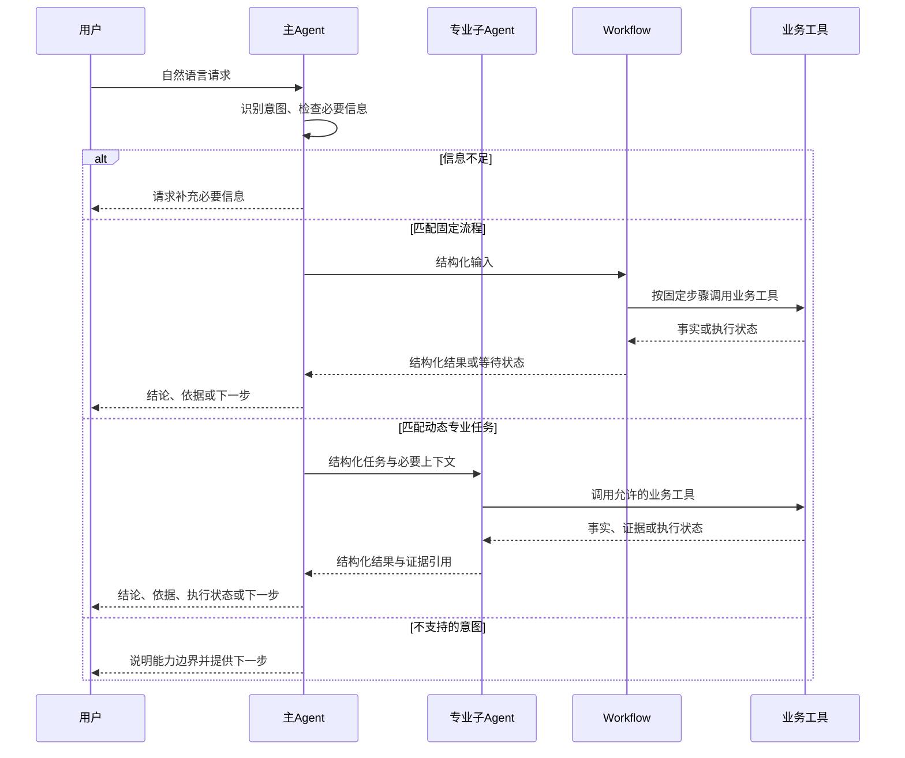

# 多 Agent 业务场景示例需求

状态：需求草案，供后续实现与验收使用；本文件不表示新增案例已完成。\
目标仓库：`kart-io/goagent-examples`。\
范围依据：用户提出的“用户 → Agent 分析意图 → 子 Agent → tools → 返回内容”，以及 GoAgent 作为通用业务基础框架的定位。

调研依据与收紧后的执行边界见 [意图与执行路由调研](../research/intent-execution-routing.md)。

## 1. 目标

补齐可运行、可测试、可参考的完整多 Agent 业务案例，让开发者能把自然语言请求接入不同业务，而不需要修改 GoAgent 内核。

核心链路为：用户提出问题，主 Agent 理解意图并选择业务能力；固定步骤由 Workflow 执行，动态专业任务委派子 Agent，单步操作直接调用工具。执行器返回结构化结果，主 Agent 汇总成用户可读答复。子 Agent 内部也可以调用工具或 Workflow。

成功标准同时包括业务结论正确、实际调用链符合预期、资源和成本受控。不能仅靠多段不同角色的提示词或多次 Chat 调用宣称完成多 Agent 示例。

## 2. 现状与支持结论

**现有能力支持该需求，首轮预计无需新增 GoAgent 核心机制。** 实现时若发现缺口，应先形成独立核心需求，不能在示例仓库复制执行引擎。

| 现有案例 | 已有能力 | 本需求如何复用 |
| --- | --- | --- |
| [agent-tool](../../orchestration/agent-tool/main.go) | 工厂创建独立子 Agent、独立会话、资源清理 | 子 Agent 生命周期与隔离 |
| [多级委派](../../orchestration/live/delegation/README.md) | 主 Agent → 专家 Agent → 工具，共享根预算、嵌套限制、回放 | 最接近目标链路的实现基线 |
| [工单分诊](../../orchestration/live/ticket-triage/README.md) | 订单规则图、政策子 Agent、退款结论与计量验证 | 客服业务事实与规则 |
| [并行诊断](../../orchestration/live/parallel-diagnostics/README.md) | 多 Agent 并行、汇总、观察与追踪 | 多意图组合与并行专家 |
| [运维案例](../../orchestration/ops/README.md) | 工具取证、受限子调查、费用归因与 SQL 审核 | 运维工具与证据校验 |
| [会话日志与重放](../../orchestration/live/session-replay/README.md) | 会话历史、日志导出与回归重放 | 多轮对话与可重复验证 |

当前主要缺口是统一的用户输入入口、多意图路由契约、跨场景的完整返回流程与验收矩阵，而不是缺少子 Agent 的底层调用能力。

本仓库当前 `go.mod` 固定 GoAgent `v0.28.0`、Go `1.25.0`；本需求不升级或降级依赖。调研已用临时 workspace 验证最新核心 `033e744` 下全部案例编译及五组案例定向 race，结果见调研第15节；这不表示固定依赖已升级。实现须以选定版本真实导出的 API 为准。

## 3. 主流程



主 Agent 在宿主注册的业务能力中做选择；能力可以由 Tool、Workflow 或子 Agent 实现。建议首轮由不持有业务执行工具的路由 Agent 通过原生工具调用返回决策，宿主再校验并执行；这两个职责分离，但不要求两次路由模型请求。不要求输出模型内部推理过程。

委派路径的工具结果沿“工具 → 子 Agent → 主 Agent → 用户”返回；Workflow 路径沿“工具 → Workflow → 主 Agent → 用户”返回；工具事实由工具产生，主 Agent 不得把未执行或失败的操作描述为成功。

## 4. 业务场景与优先级

下表为建议的首批范围，具体业务数据使用合成 fixtures，不连接生产系统。

| 优先级 | 场景 | 用户输入示例 | 子 Agent 与工具 | 应验证的结果 |
| --- | --- | --- | --- | --- |
| P0 | 多意图路由入门 | “查订单 A1001”“checkout-api 为什么报错”“审核这篇文案” | 订单查询 Tool、退款资格 Workflow、运维诊断子 Agent及内容能力 | 按输入选择正确业务能力，执行器实际运行，主 Agent 汇总 |
| P0 | 客服订单与售后 | “A1001 能退款吗？” | 售后 Agent → 订单查询、退款规则查询 | 基于订单事实和规则给出结论；缺订单号先澄清；不执行真实退款 |
| P1 | 运维故障分析 | “checkout-api 的 5xx 为什么升高？” | 诊断 Agent → 指标、日志、变更查询 | 结论引用工具证据；证据不足时返回不足，不假定根因 |
| P1 | 内容审核与修改 | “检查这段文案并给出修改建议” | 内容 Agent → 规则检查、事实资料查询 | 区分违规项、证据和建议；不编造事实来源 |
| P1 | 财务计算与查询 | “1200 美元采购含税需要多少人民币？” | 财务 Agent → 汇率查询、换算、税费计算 | 数值由工具计算，标注币种、汇率与税率 |
| P2 | 多专家组合 | “查订单异常，并分析相关服务告警” | 客服与运维 Agent 并行，各自调用工具，主 Agent 汇总 | 两条任务及证据独立；汇总不遗漏失败分支 |
| P2 | 人工审批与恢复 | “申请退款并提交处理” | 售后 Agent → 规则工具 → 持久审批子图 → 模拟执行工具 | 未批准无效果；批准后执行；恢复不重复已记录的完成操作 |

P0 入门案例只要求三个方向的最小可核验能力，覆盖 Tool、Workflow 和子 Agent；P1 再扩展完整领域场景。财务、多级委派、运维等已有案例优先补齐统一入口或链接，不重新复制一套相同实现。

## 5. 功能需求

### F1 用户输入与意图路由

- 提供 CLI 入口，接收自然语言输入；网页或 HTTP 服务不作为首轮交付要求。
- 至少支持订单售后、运维诊断、内容审核三种意图，建立输入样本与预期业务能力及执行器类型的映射。
- 主 Agent 的业务能力清单由宿主注册，包含工具、Workflow 和子 Agent；模型不能凭空创建执行目标或改变执行器类型。
- 缺少必要字段时返回明确补充问题，不启动需要该字段的业务工具；不支持的请求返回能力边界。
- 输入包含多个任务时，首轮返回需要拆分或明确的待处理项；P2 再实现多子 Agent 联合执行。

### F1.1 不明确输入与多轮澄清（P0）

“没有命中子 Agent”本身不是系统异常。主 Agent 应先区分信息不足、多个可能意图、超出能力范围与可直接回答四种情况，不把所有输入强行交给某个子 Agent。

| 路由结果 | 判定依据 | 主 Agent 行为 | 是否调用子 Agent |
| --- | --- | --- | --- |
| execute | 能确定所需能力，且必要字段齐全 | 宿主校验后按能力定义执行 Tool、Workflow 或子 Agent | 仅 agent 类型 |
| clarify | 缺对象/操作/必要字段，或存在多个合理目标 | 返回一个能消除关键歧义的问题及必要选项 | 否 |
| answer | 能由主 Agent 直接解释的能力咨询或已掌握的一般信息 | 直接回答，不编造需要查工具才能知道的业务事实 | 否 |
| unsupported | 意图已经明确，但已注册能力确实不能处理 | 说明具体能力边界并给出下一步 | 否 |

路由结果是宿主可检查的结构化决策，不要求模型给出内部思考过程。模型自行报告的置信分数仅可辅助观察，不能单独作为委派门槛；仍须核对候选能力、必要字段和歧义是否消除。实现可使用显式路由阶段或主 Agent 的结构化工具协议，但不得只依靠一句提示词阻止未澄清的委派。

澄清过程要求：

1. 优先利用同一会话已确认的信息，追问当前最关键的缺口，不让用户重复提交已知字段。候选能力只能来自宿主注册清单。
2. 目标明确但缺参数时只补参数；目标本身不明确时先问想完成什么，避免一开始索取不相关业务字段。
3. 返回 `status=needs_input`，附 `clarification_reason`、`question`、`missing_fields`、`candidate_capabilities`（可为空），`selected_agents` 为空。用户只需看到自然问题和必要选项，无需理解 Agent 名称或内部字段。
4. 宿主保存待澄清任务：原始请求、已确认字段、未决字段、候选意图和澄清次数。下一条输入与该状态合并后重新判断；不能把“订单 A1001”这种补充回答当成无关的新请求。
5. 澄清必须先返回给用户并结束本次调用，不在后台循环请求模型等待答案，不创建子 Agent、不调用业务工具。主 Agent 产生澄清的模型调用仍计入额度。
6. 建议连续最多主动澄清两轮，次数可配置。仍不明确时给出简短能力选项和完整输入示例，返回 needs_input 并停止主动追问；不误报 unsupported 或 completed，不自动挑选一个子 Agent 执行。用户之后明确选择仍可继续。
7. 支持用户取消、重置和切换任务。切换任务时清除旧的待补字段；澄清状态设置可配置有效期，过期后说明需重新确认，不静默沿用旧目标。
8. 不同用户/会话的待澄清状态隔离。SessionID 关联对话；每次新回合与旧回合的恢复身份由宿主管理，不能把新补充内容当作旧 completed 运行回放。总请求额度采用明确的宿主策略，不能靠循环澄清绕过成本上限。

示例交互：

```text
用户：帮我查一下。
主 Agent：你想查询订单，还是排查服务问题？
用户：订单能不能退。
主 Agent：请提供订单号。
用户：A1001。
主 Agent → 退款资格 Workflow → 订单/规则工具 → 资格结论 → 主 Agent 返回。
```

另一个例子：“最近总报错”应先询问服务或系统名称；“你能帮我做什么”直接介绍可用能力；“帮我预订机票”在没有机票能力时才返回 unsupported。

### F1.2 业务能力注册与执行器路由（P0）

**业务意图与执行器类型分离。** 模型识别“用户要完成什么”，宿主声明“这个能力由谁执行”；不能仅因为意图明确就固定使用 Workflow，也不能因为请求复杂就无条件创建子 Agent。

建议在示例宿主定义 Capability 描述，包含 `id`、`version`、`intent`、`description`、`examples`、`required_fields`、`input_schema`、`executor_kind`、`handler` 与预算/超时/审批策略。`executor_kind` 取 tool、workflow 或 agent。这是示例层设计，不宣称 GoAgent 已有同名 Registry API；首轮可直接用静态配置与映射，不建设新的框架。

| 业务能力 ID | 意图 | 执行器 | 选择依据 |
| --- | --- | --- | --- |
| order_status | 查询订单状态 | tool | 一次结构化查询即可完成 |
| refund_eligibility | 检查退款资格 | workflow | 查询订单、检查规则、生成结论的步骤固定 |
| refund_exception_review | 评估特殊售后问题 | agent | 需要结合补充材料动态选择调查工具；不能自行绕过退款规则 |
| service_diagnosis | 分析服务故障 | agent | 需要根据指标、日志和变更动态探索 |
| content_rule_check | 按固定清单检查文案 | workflow | 校验项、顺序和返回格式明确 |
| content_revision | 综合审核并改写内容 | agent | 需要专业判断与迭代修改 |

同一业务域可以存在多种能力；例如“订单”不能直接等同于“售后 Agent”。按目标操作和完成标准匹配能力，缺少区分信息时澄清，不以最高模型分数强行选一个。

推荐调用过程：

1. 宿主根据当前会话与业务可用范围提供能力描述、输入 Schema 和适用示例。
2. 主 Agent 基于用户输入及已确认信息选择 `execute / clarify / answer / unsupported`。execute 选择唯一 capability 并提取参数，首轮不输出任意执行计划。
3. 宿主检查能力是否存在、是否适用于当前请求、参数是否满足 Schema、必要字段是否缺失，以及预算/期限/审批条件是否满足。模型不能修改能力的执行器、版本或执行策略；未满足条件不启动目标执行器。
4. 从注册描述派生执行器：普通工具经 Dispatcher；Workflow 的编译产物经 `NewRunnableTool` 适配；有状态子 Agent 经 `NewRunnableToolFactory` 创建和清理，三者统一进入 Dispatcher 契约。
5. 完成后返回结构化结果。Workflow 如处于审批等待，返回 waiting 与续跑信息，不能当作 completed；失败返回 failed，不自动切换子 Agent 重做，更不能绕开固定规则或审批。
6. 主 Agent 基于结果回答用户；需要更多任务时进入显式后续回合，并继续受预算与最大步骤限制约束。

示例路由记录（用于宿主验证与测试，不是框架已有 DTO）：

```json
{
  "action": "execute",
  "intent": "refund_eligibility",
  "capability_id": "refund_eligibility",
  "arguments": {"order_id": "A1001"}
}
```

宿主查表得出 `executor_kind=workflow`，模型不提交可以覆盖它的 executor_kind。首轮推荐路由 Agent 只持有 `route_decision` 一类无业务效果的工具：返回 capability_id 和 arguments，宿主验证后再分派。不能仅用提示词保证“澄清时不执行”。路由模型调用本身已完成分类，不要求再加一次分类请求；模型自然语言答复是否需要第二次调用由结果渲染策略决定。将能力直接注册为主 Agent 执行工具的方式可作为简化对照，但不作为本需求的主实现。

工具描述应说明业务用途与边界，例如“检查退款资格，不提交退款”，而不只写“调用某工作流”。业务规则和数值计算由执行器保证，不能仅靠主 Agent 的提示词。Workflow 也可包含 Agent 节点；是否固定编排与是否包含模型调用是两个独立属性，包含模型调用的复合工具同样声明 ModelInvoking 并共享根预算。

本案例需同时展示 Tool、Workflow、子 Agent 三条执行路径，且每条路径都包含宿主验证；澄清时三类执行器都不启动。一个用户回合只接受一个顶层路由决策；多个决策或澄清/执行混合结果必须在业务执行前拒绝。持久可续跑子图继续使用 Resumable / AsChildRunnable 协议，普通适配不自动获得该能力。

### F2 子 Agent 与业务工具

- 每个子 Agent 有独立角色、工具集、会话及必要的记忆命名空间；不能把同一个有状态实例换提示词当成多个独立 Agent。
- 通过 `AsRunnable` 与 `NewRunnableToolFactory` 等现有能力接入，经过 Dispatcher 执行。
- 子 Agent 只接收任务所需字段，不自动复制父 Agent 全部历史。业务工具参数使用明确 Schema，结果可被宿主验证。
- 模型型子 Agent 工具声明 `ModelInvoking`；宿主显式配置嵌套深度、工具和模型并发上限及超时。
- 每次工厂创建的资源在成功、失败与取消时清理。共享资源由宿主管理生命周期，不能由单个子 Agent 提前关闭。

### F3 返回契约与错误

执行与答复分阶段保存：业务执行已成功、总结模型或连接失败时，恢复仅重生成/交付答复。用户重试同一条提交应定位既有执行；提交新回合或补充信息须明确使用新的回合身份。能力版本和已验证参数随执行记录保存，恢复不重新分类后改派。

建议示例层结果含 `run_id`、`session_id`、`status`、`intent`、`selected_capability`、`executor_kind`、`selected_agents`、`answer`、`evidence`、`steps`、`usage`、`error_code`；这是案例 DTO，不新增到 GoAgent 公共接口。

- `status` 至少区分 completed、needs_input、unsupported、failed、waiting、partial。首轮不支持的状态保留为后续约定，不伪造执行结果。
- `steps` 记录主 Agent 委派、子 Agent 调用与工具完成状态；不输出模型内部推理文本。
- 工具失败、预算不足和取消不能转成普通成功。并行部分成功须标明哪些任务完成、哪些失败；默认以整条调用失败处理也必须保留清晰诊断。
- 主 Agent 的最终答复必须与实际工具状态一致。若采用结构化终态提交，须由宿主校验后才能标记 completed。

### F4 预算、会话与持久恢复

- 父子调用继承同一根预算与取消上下文；总额度不得通过创建子 Agent 重置。
- 运行、Agent 与操作身份稳定且互不冲突；同名工具和相同 CallID 位于不同 Agent 时不串记录。
- 持久案例使用持久预算，保存版本与配置身份。纯回放不新发模型请求、不重复执行已完成工具、不重复计量。
- 区分普通不透明子 Agent 工具与可续跑子图。普通工具不得承诺任意中断都自动重入；审批案例须使用已验证的 Resumable 与子图恢复协议。
- 对外部系统的重复效果仍需业务幂等；示例不宣称对任意第三方工具提供 exactly-once 保证。
- P0 必须支持完成意图识别所需的多轮澄清状态；至少验证连续补充与两个独立会话不混用。长期历史、任务完成后的持续追问及进程重启后的澄清状态恢复另列后续能力，不能因此省略首轮澄清闭环。

### F5 运行方式

- 默认确定性离线运行，无密钥、不访问真实业务系统、不产生付费模型调用。
- 离线使用脚本化 ToolStreamClient 模拟模型的意图选择和工具调用；Agent、Dispatcher、工具与编排路径使用真实实现，不能用固定最终字符串绕过链路。
- 真实模型模式显式开启，复用 `internal/livemodel` 与当前环境变量；不在代码或文档内保存密钥。
- 离线测试验证调用契约，真实模型评测验证自然语言识别与工具选择，两类证据分别报告，不能把脚本化路由通过当成真实意图识别质量证明。

## 6. 交付结构建议

新增 `orchestration/multi-agent/README.md` 作为统一学习入口，链接已有案例与以下新增目录；这是建议布局，实现阶段可按仓库模式调整。

| 目录或文件 | 内容 |
| --- | --- |
| `orchestration/multi-agent/intent-router/` | P0 自然语言入口与 Tool/Workflow/子 Agent 路由；main、离线测试和 fixtures |
| `orchestration/multi-agent/customer-service/` | P0 售后事实、规则与澄清案例，可复用已有工单分诊逻辑 |
| `orchestration/multi-agent/parallel-team/` | P2 多专家并行与明确的汇总/失败策略 |
| `orchestration/multi-agent/approval-recovery/` | P2 审批、模拟效果与恢复 |
| 现有 `orchestration/live`、`orchestration/ops` | 补齐统一入口链接与领域场景说明，避免重复工程 |

每个案例交付：业务说明、架构与调用顺序、模型和工具职责、输入输出样本、可复制命令、确定性测试、能力限制。共享代码仅在多个案例有真实复用时抽取，避免先创建通用团队框架。

## 7. 验收标准

| 编号 | 必须验证的行为 | 验收证据 |
| --- | --- | --- |
| A1 | 至少三类意图正确选择能力，覆盖 Tool、Workflow、子 Agent 三条路径；子 Agent 调用至少一个领域工具 | 路由记录、执行器与工具计数，不只检查最终文字 |
| A2 | 每类意图至少两个表达不同但含义相同的输入 | fixtures；Live 评测逐条记录预期与实际路由 |
| A3 | 缺参、未知意图、工具失败各有案例 | 缺参/未知不执行相应业务工具，错误不报告成功 |
| A4 | 委派路径按父 → 子 → 工具 → 子 → 父完成；固定流程直接经过 Workflow 返回 | 可检查的步骤与层级身份；Workflow 路径子 Agent 创建数为0 |
| A5 | 至少两个子任务并发时不串会话 | 独立会话、工具参数和返回值断言；race 检查 |
| A6 | 父子共享预算，额度不足时在请求前停止 | 根预留数与实际传输调用计数；未知用量单独报告 |
| A7 | 超时和取消能结束合作式调用，子资源清理 | 有界等待测试、创建/清理计数；不承诺强杀忽略 ctx 的实现 |
| A8 | completed 持久案例再次运行无新增模型/工具执行 | 重建实例并回放，答案与累计预算保持一致 |
| A9 | 审批前无模拟效果，恢复不重复已记录效果 | P2 持久审批与崩溃点测试 |
| A10 | 默认测试完全离线；真实模型显式开启 | 测试入口与独立 Live 报告，不以跳过的 Live 测试充当通过 |
| A11 | 模糊输入先澄清，连续补充后才正确执行 | 至少覆盖“帮我查一下 → 订单能否退 → A1001”；补充前执行器与业务工具调用数为0，补充后进入资格 Workflow |
| A12 | 多候选、澄清达到上限、取消、过期、切换任务有确定行为 | 不无限追问、不强行委派、不误报成功；新任务不继承旧待补字段 |
| A13 | 两会话同时澄清时信息不混用；能力咨询无需子 Agent | 独立会话状态断言和对应工具计数 |
| A14 | 同域不同目标能分别路由；目标 ID 不存在、参数不合法或执行器策略被改写时不执行 | “退款资格”走 Workflow，“特殊售后调查”走子 Agent；注册契约回归测试 |
| A15 | Workflow 失败或等待时不隐式改派子 Agent | waiting/failed 状态与子 Agent 创建数断言 |
| A16 | 路由阶段返回多个决策或澄清/执行混合时无业务效果 | 路由工具不持有业务执行能力，验证后才可进入分派 |
| A17 | 执行成功后答复失败、重复提交同一请求时不重复业务效果 | 执行结果和答复阶段分离，稳定提交身份与恢复测试 |
| A18 | 请求重试、输出修复和用户澄清分别受限 | 重试尝试计入预算、子 Agent 显式策略、缺失事实不由模型编造 |

A1–A4、A6、A7、A10–A18 为 P0 验收；A5、A8、A9 随对应后续案例交付。第一轮所有新增包至少通过离线 `go test` 与 `go test -race`，并能用 go.mod 固定版本独立编译。Live 评测至少完整报告两个 Provider 的上述意图样本与失败情况；提供模型、时间、请求数和用量证据，不预先承诺通过率。

## 8. 实施顺序

1. **P0：统一入口与基本链路。** 复用子 Agent 工厂和现有模型封装，完成三意图入门、售后案例、多轮澄清闭环及未知/失败/预算测试。
2. **P1：领域扩展与真实模型评测。** 补充运维、内容、财务场景，复用已有 fixtures/工具；验证不同表达的路由质量，记录局限。
3. **P2：复杂协作。** 多专家并行、任务完成后的持续追问、持久回放、审批与恢复，分别验收后再串成完整案例。

本文件只定义需求和交付边界，不表示上述步骤已经执行；具体 API、文件拆分与运行参数在实现计划中确定。

## 9. 范围边界与待确认项

本轮不要求开发 GoAgent 内核、不建设 Web 产品、不实现分布式团队调度、Agent 间邮箱或任意动态生成团队，也不接入真实付款、退款、线上变更等外部效果。

建议默认采用 CLI、合成业务数据和离线优先方式。用户已明确的核心需求是完整委派链路与多场景案例；本文中的场景数量、优先级、目录与 Live Provider 数量均为建议，可在实现前调整。真实业务 API、业务评价标准与部署方式尚未指定，不作为已确认范围。
