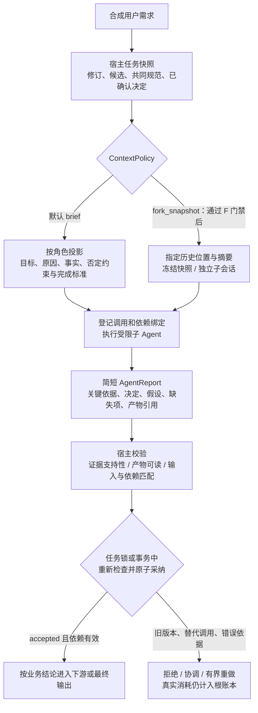
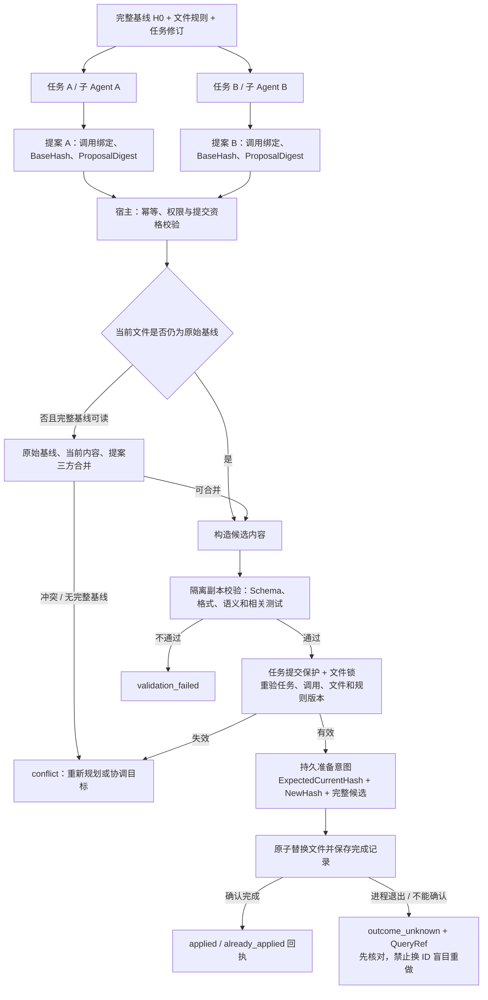

# 多 Agent 上下文传递：场景分析与案例建议

日期：2026-11-01。状态：按本轮评审修订输入、上下文策略、输出及采纳契约；尚未新增可执行案例。

基础：机票案例已快进合入 goagent-examples main 并推送到远端 2140026。合并结果关闭 go.work 与真实模型开关后的全量 race 验证：35 个包通过、7 个包无测试。当前根模块固定 GoAgent da848ae，以下 API 和判断对照该依赖及现有案例源码，不假定存在额外的多 Agent 上下文框架。

## 1. 结论

现有接口足以构建首版案例，无需先修改 GoAgent 核心。建议新增独立的 `orchestration/agent-context`，以只读差旅行程分析为业务载体，重点演示父子委派、串行接力、并行专家汇总，以及传递过程中的字段投影、会话隔离与版本核验。

上下文不是一个应该在所有 Agent 间共享的对象。执行控制可以沿调用链继承，模型资料需要显式裁剪和传入，各 Agent 的会话历史默认分开。父 Agent 调用子 Agent，不意味着父对话自动成为子模型的输入。

业务规则、资料可见性和字段选择留在 examples/宿主层；核心继续提供 Runnable、工具、图、会话、预算与持久执行原语。首版 P1 固定 brief 默认及三平台分别实测；fork_snapshot 经过 F 门禁后开放，shared-file 按 W 独立交付；持久记忆、大上下文和恢复留给 P2。

## 2. 三类上下文

| 类型 | 示例 | 传递方式 | 不能据此推断 |
| --- | --- | --- | --- |
| 执行上下文 | 取消、期限、根预算、追踪、操作日志、执行键 | 沿同进程 context.Context 及框架派生作用域传递 | 模型自动看见其中内容；可以跨网络序列化整个 ctx |
| 模型任务资料 | 用户目标、已确认约束、当前任务事实、证据片段 | 类型化 Brief、Runnable 输入、工具参数及结果；按角色投影后编码到模型消息 | 可以自动复制父 system prompt、完整工具历史或支付授权 |
| 会话与长期业务状态 | 某个角色的历史消息、跨轮偏好、任务修订、业务记录 | 宿主分配 SessionID，按需使用 MemoryManager 或 SessionLog；独立保存任务状态 | 多 Agent 使用相同 SessionID 就能安全协作；会话回退会撤销外部业务效果 |

共享 budget.Controller 表示共同使用额度，不等于共享记忆；共享 MemoryManager 实例也不等于共享同一会话。SessionID、AgentID、根 RunID、业务 TaskID、任务修订与单次 InvocationID 有不同用途，不能混为一个 ID。

上下文来源另由 ContextPolicy 明确选择 `brief` 或 `fork_snapshot`，与三种编排方式正交。首版默认 brief；Fork 只有在子任务依赖大量简报难以完整表达的既有历史、且通过组合验证时才开放。大量中间工具结果适合委派专家汇总，但不自动意味着要 Fork；缺少尚未获取的信息则先查询或补充输入。具体快照位置、更新和权限契约见 7.3。

## 3. 已有能力与证据

| 能力 | 代码入口 / 已有案例 | 已确认的行为与限制 |
| --- | --- | --- |
| 显式输入输出 | GoAgent tools/runnable_tool.go；[agent-tool](../../orchestration/agent-tool/main.go) | Decode 将工具参数转为子 Runnable 输入；Encode 将子输出转为父工具结果。不会自动把父历史注入子模型 |
| 子会话生命周期 | NewRunnableToolFactory、OwnedRunnable.Close；[delegation](../../orchestration/live/delegation/README.md) | 每次实际调用建立子实例并清理；独立 Dispatcher 避免父子重入；支持深度与超时限制 |
| 字段适配 | workflow.Adapt；[field-adapter](../../orchestration/field-adapter/main.go) | 通过明确的输入、输出映射连接不同类型，不依赖万能共享 map |
| 并行与合并 | workflow.ParallelConfig；[parallel-diagnostics](../../orchestration/parallel-diagnostics/main.go) | Clone 深拷贝可变字段；Merge 接收按注册顺序排列的成功结果；分支失败会取消并等待已启动分支，不能假定仍会调用 Merge |
| 受限共享证据 | [scoped-lookup](../../orchestration/ops/scoped-lookup/README.md) | 子调查返回摘要、引用和已核对片段；父层只采纳共享账本中能核对的内容，不转发全部工具原文 |
| 持久大结果 | builder.WithOffload、contextpolicy.ResultStore；[context-recovery](../../orchestration/context-recovery/main.go) | 保存不可变证据，按 scope 和摘要核验并读取；不是通用角色权限系统 |
| 历史记忆 | builder.WithMemory、WithSessionID | 加载指定会话历史；已有 TestOwnedAgentSessionIsolation 验证不同子会话的记忆隔离和资源清理 |
| 会话日志 | builder/session_log.go、core/session | 原生工具流的实际模型历史可从日志推导；启用 SessionLog 后不再读取 Memory 历史；Fork/Rewind 有明确序号及冲突契约 |
| 历史 Fork 原语 | core/session.Store.Fork、DeriveMessages | Fork 原样复制指定前缀，0 表示全部；不做角色权限投影，也不保证不复制执行快照。拟议 fork_snapshot 需先验证合法历史重建及独立子会话，不能直接等同于裸 Store.Fork |
| 持久执行 | DurableGraph、Dispatcher 操作日志 | 已完成操作可以回放；不自动保证任意子 Agent 中途崩溃都能安全重入，需按组合工具的 Resumable 契约实现 |
| 根预算与统计 | core/budget、usage hook、execution.Scope；[agent-usage](../../agent-usage/README.md) | 可共享根额度并区分父子 Agent 用量；身份和执行键由宿主建立，不交给模型生成 |

### 一个需要专门验证的会话边界

`builder/session_log.go` 的 sessionLogID 优先读取 `tools.SessionIDFrom(ctx)`，然后才使用 Builder 的 SessionID；`builder/tool_events.go` 同样会沿用宿主已经绑定的上下文会话身份。`tools/call_scope.go` 的 enterRunnable 处理嵌套与预算，并不为子 Agent 自动分配或切换 SessionID。

因此，新案例不能只调用子 Builder.WithSessionID 就宣称所有会话路径均已隔离。宿主应在子 Runnable 执行入口显式绑定子会话的上下文 SessionID，并使 Builder、工具审批及 SessionLog 的有效身份一致，同时保留根预算、取消、追踪与派生操作键。不要给每个孩子另建一个相互冲突的根 Scope。

这不是在本次宣布核心存在一个已复现缺陷：已有 agent-tool 测试覆盖的是直接调用子工具并使用 Memory 的路径，不能代替“父 ctx 已绑定 SessionID + 子 SessionLog + 子工具审批”的组合验证。该组合属于首版身份契约测试：可在受控的短会话/内存日志中验证，不等于已经交付第二阶段的长期持久历史功能。Fork 历史输入组合测试另见阶段 F。

## 4. 需要覆盖的场景

| 编号 | 场景 | 应传什么 | 主要风险 / 验收点 | 建议阶段 |
| --- | --- | --- | --- | --- |
| S1 | 父 Agent 委派给专家 | 当前子问题、角色所需事实、约束、允许的证据引用 | 子 Agent 不得看到父层私有字段和无关历史；输出经 Encode 返回 | P1 |
| S2 | 串行 A → B → C | 已采纳报告、具体候选版本、已确认决定与必要产物 | A 的审核不能用于 B；推测不升格事实，否定约束和来源不丢失 | P1 |
| S3 | 并行专家分析同一任务 | 同一修订的独立只读快照，各自分配字段和工具 | 深拷贝、稳定合并、不互相改写；报告冲突须显式呈现 | P1 |
| S4 | 多用户、不同角色的隔离 | 宿主确定的会话映射；模型只见投影后资料 | 父 ctx + 子 Builder + 子工具审批 + SessionLog 的有效身份一致且不串用 | P1 身份组合测试；P2 持久历史 |
| S5 | 同一专家继续多轮对话 | 该专家自己的历史 + 最新任务快照 | 不自动读父历史；同一会话避免并发写；明确何时新建、复用和清理 | P2 |
| S6 | 大文档和长工具结果 | 摘要、已核对片段、不可变引用，按需读取 | 摘要损失、引用越权、过期或错误摘要；不能只给 ref 却要求模型引用看不到的原文 | P2 |
| S7 | 用户修改任务后仍有旧子任务运行 | 当前任务修订、候选及有资格的 InvocationEpoch | 采纳 CAS、替代调用及迟到结果拒绝；不能先查版本再无条件写入 | P1 确定性交错测试；P2 完整交互 |
| S8 | 暂停、重启后继续协作 | 固定任务快照、已采纳报告、稳定执行键和证据 scope | 同版本恢复；不重复模型或工具效果；不保证任意半途中子流程都可重入 | P2 |
| S9 | 一个专家失败、取消或预算耗尽 | 明确的结果状态和已提交证据 | 区分业务无结论与执行故障，不将失败当成功，也不隐式无限重试 | P1 |
| S10 | 多 Agent 共同使用知识或黑板 | 宿主管理的事实存储 + 有权限的读写工具 | 可见性、写权限、预期版本/CAS、冲突规则；不能共用可变对象任意写 | 后续按需求 |
| S11 | 不同模型平台协作 | 供应商无关的 Brief/Report、决定、依赖及产物引用 | 不把原生 tool call ID、reasoning 内容或 SDK 对象当作通用上下文 | P1 三平台分别实测；混合平台拓扑后续扩展 |
| S12 | 切换主负责 Agent / handoff | 当前任务摘要、待处理问题及必要历史投影 | 不继承旧角色工具权限或审批，不假定存在自动 handoff API | 后续 |
| S13 | 跨进程或跨服务 Agent | 可序列化 DTO、可验证身份与引用、服务端接受的期限 | Go context、指针、锁和本地文件引用不能直接发送；协议连通不等于共享上下文 | 后续独立案例 |
| S14 | 子报告或工具原文包含注入文本 | 作为数据处理的原文、来源标签、受限工具及输出校验 | 引文不升格为 system 指令；子结论不能批准订票或突破角色边界 | P1 |
| S15 | 不同任务的子 Agent 同时修改同一文件 | 完整不可变基线、任务/调用绑定、提案摘要、共同文件规则 | 单文件提交、幂等冲突及崩溃核对；不混入只读案例 | W 独立专项 |
| S16 | 子任务依赖大量既有历史 | 带明确位置、源摘要、决定及任务修订的 fork_snapshot | 目标独立会话、模型输入正确、更新 frozen、不继承工具权限或执行快照 | F 门禁通过后才开放 |
| S17 | 证据存在但解释不支持结论 | 结构化人数、金额、航段主张和对应证据 | 识别单位、合计、往返覆盖等解释错误；不能只验引用和哈希 | P1 |
| S18 | 报告与产物采纳竞争 | 输入/依赖/候选绑定、可读取的固定产物版本 | 原子采纳、迟到拒绝、重复去重、产物版本可用 | P1 |

S4 的“隔离”首先通过宿主投影和工具授权证明，不承诺模型一定不推测隐私。S14 不能单靠提示词完成，必须使敏感工具和授权根本不在子 Agent 能力集中。

## 5. 候选实现方向

| 方案 | 内容 | 优点 | 代价 |
| --- | --- | --- | --- |
| A：独立上下文协作案例（推荐） | 新建 orchestration/agent-context，用只读差旅分析演示三种传递方式 | 可聚焦上下文，正反例清楚；不改变已验证的支付、出票和确认边界 | 需要一套精简合成事实和说明 |
| B：直接扩展 flight-booking | 在订票案例中加入行程、预算、规则子 Agent | 业务链路直观，可直接比较单 Agent 和多 Agent | 将上下文实验与交易状态机耦合，验证面更大，容易掩盖二次确认边界 |

推荐 A，业务背景沿用差旅，但只做分析，不进行付款、出票或主动退改签。已有机票案例保留为交易 Workflow 的独立演示。A 与 B 都仅是待选择方案，尚未创建新案例代码。

## 6. 推荐案例的业务闭环与任务依赖

合成用户需求：一位成人与一位儿童往返 SIN/NRT，明确日期、预算、行李要求和退改偏好。任务快照包含必要事实、用户硬约束、已确认决定、暂时判断和已排除方向，并保留各自来源，不能仅压缩为一句“找便宜机票”。

三种编排方式保持不变，独立于 ContextPolicy：

| 编排方式 | 输入输出闭环 | 决定与依赖如何继承 |
| --- | --- | --- |
| delegation | 协调 Agent → 宿主构造角色简报 → 受限子 Agent → 短报告/产物 → 宿主校验采纳 → 协调 Agent | 子任务只见必要资料；已确认约束及决定显式进入 Brief。父层以 AcceptedReport 为依据继续，不直接信任任意子文本 |
| pipeline | 行程 Agent → 宿主采纳候选 A → Adapt 构造审核 Brief → 预算审核 Agent → 宿主采纳审核结果 | 审核绑定 A 的 CandidateID/Version/Digest、AcceptedReportID 与决定；换成 B 必须重新审核。强依赖可先留在同一 Agent，或在决定形成后 Fork |
| parallel | 宿主冻结同一任务修订和共同规范 → 航班/规则专家独立快照 → 报告分别采纳 → 确定性 Merge → 最终解释 | 提前约定人数、币种、行程口径和规则；分支不可并行猜测尚未形成的上游决定。相互依赖的部分先串行决定，再分叉 |

首版以 brief 跑通以下闭环；fork_snapshot 经阶段 F 的组合验证后，替换“上下文准备”策略，而非新增协作模式：

同一专家的后续报告不自动推翻已确认决定；改变决定必须有明确授权及任务修订。派发时所绑定的决定和产物可在同一 Agent 内延续，也可通过 Brief/Fork 显式移交，但不能在汇总时丢弃或悄悄改写。

首版上下文案例只读，不实现交易授权、自动 handoff、跨服务或通用黑板。shared-file 作为阶段 W 独立交付，不给只读专家逐步追加实际写文件权限。

## 7. 输入、上下文来源、输出与依赖契约

本节与第 8 节是实现前必须固定的行为契约。以下类型均为示例/宿主层数据结构，不新增 GoAgent 核心 API。宿主可信元数据、模型可见内容、执行记录分开保存；不能把一个包含全部身份、历史和权限的 Envelope 直接编码进 prompt。

### 7.1 HostEnvelope 与调用身份

宿主为每次委派建立不可变绑定：

| 字段 | 契约 |
| --- | --- |
| TaskID / TaskRevision | 当前任务及其明确修订，不能由模型提升或覆盖 |
| RootRunID | 同一根任务的执行、预算与追踪归属；不同任务保持独立 |
| StepID / CandidateID / CandidateVersion / CandidateDigest | 本次处理哪个步骤、哪个候选对象及其具体内容。对方案 A 的审核不得用于方案 B |
| InvocationID / InvocationEpoch | 单次委派身份及该逻辑处理槽位的当前代次，由宿主分配。重规划替换调用时递增代次 |
| AttemptKey | 每次实际模型网络尝试的独立键；不同于 InvocationID，不能用一个键覆盖多次真实消耗 |
| AgentID / SessionID | 执行角色与独立会话身份；上下文绑定、Builder、工具审批和 SessionLog 的有效身份须一致 |
| BriefDigest / ContextSnapshotID / ContextDigest | 实际派发的简报与上下文来源摘要，明确报告对应哪次输入 |
| DependencyBindings / RulesVersion | 依赖的已采纳报告及共同规范版本，不只记录一个上游任务名称 |
| Grants / GrantsVersion / deadline / limits | 宿主授权及版本、截止时间和根治理配置，不从模型生成的字段取得权限 |

逻辑处理槽位为 `(TaskID, TaskRevision, StepID, CandidateID)`；同一槽位默认只有一个有提交资格的 InvocationEpoch。父子共享执行控制不意味着共用 SessionID；并行专家各自有会话，不能并发写入一个角色历史。

### 7.2 AgentBrief：默认按角色派发，既受限又充分

| 内容 | 必须表达的语义 |
| --- | --- |
| Goal / Why | 要完成什么，以及为什么需要该子任务；避免专家局部优化偏离总目标 |
| HardConstraints | 用户硬约束及明确来源，例如人数、日期、预算、禁止转机；只能由获授权的任务修订改变 |
| RequiredFacts | 当前子任务必需的事实，含单位、时间、来源和版本，不传无关私有资料 |
| ConfirmedDecisions | 已经由用户/宿主确认或由既定规则形成的决定，含 DecisionID、适用候选和确认依据 |
| ExcludedDirections | 已排除的方案及理由、排除条件和有效范围；不得只留下正向摘要 |
| WorkingJudgments / Assumptions | 上游 Agent 的暂时判断、推测和待验证假设，明确标记，不能伪装成用户决定或权威事实 |
| DependencyBindings | 已采纳的上游报告、具体候选对象、版本/摘要，以及本步骤必须继承的决定和产物 |
| EvidenceRefs | 当前角色允许读取的证据引用及必要片段；引用可定位且当前调用有读取权限 |
| OutputContract / CompletionCriteria | 报告 Schema、必须核对的字段、完成标准、何时应返回 needs_input 或 needs_attention |
| CommonRules / MissingInputs | 并行任务共同约定的币种、单位、人数、行程口径、规则版本，以及仍缺失的信息 |

角色投影不仅做删减，也做充分性检查：关键否定条件、已确认决定、已排除方向和完成标准不能在裁剪时丢失。必需信息不存在时先查询权威工具或等待用户补充，不由子 Agent 根据经验补出。

### 7.3 ContextPolicy：brief 与 fork_snapshot

上下文策略和 delegation/pipeline/parallel 是两个正交维度；不增加第四种编排方式。同一种编排可按子任务选策略，首版默认 brief。

| 策略 | 选择依据 | 明确边界 |
| --- | --- | --- |
| brief | 角色简报能充分表达必要事实、决定和约束；中间工具结果很多、父层只需短报告时优先委派并使用简报 | 显式按角色投影，不隐含复制父历史 |
| fork_snapshot | 子任务依赖大量既有历史、推理过程中的已形成决定或交互背景，简报压缩会丢失关键关系，且当前角色有权读取该历史 | 只继承指定位置的不可变上下文快照；使用独立子会话，不实时共享父会话 |

“需要子 Agent”和“需要 Fork”不是同一个判断。信息尚未被任何 Agent 获取时，必须查询或补充输入，Fork 不能生成不存在的信息。强依赖的连续判断可以先留在同一个 Agent，不为增加 Agent 数量而强行拆分。

fork_snapshot 的宿主记录至少包括：SourceSessionID、显式的 SnapshotSeq、源前缀摘要、TaskRevision、快照内容摘要、已采纳决定/依赖集合、目标 SessionID、角色投影/授权规则版本、捕获时间。不得以 `upTo=0` 暗指“当时的全部历史”；须先解析并记录具体位置。快照应落在完整回合或合法消息边界，不能留下没有配对结果的原生工具调用。

Fork 在强依赖的上游决定采纳、候选内容冻结之后执行；捕获的任务修订、上游报告及源前缀必须一致。先生成不可变快照清单，再在派发准入中确认绑定仍有效；期间任务或依赖变更则重新捕获，不派发混合版本。

快照只提供模型可读历史，不复制父角色权限、交易审批、执行句柄、budget.Controller 或 durable 操作完成记录。GoAgent `session.Store.Fork` 是原样复制指定前缀事件的存储原语，可能包括 boundary/snapshot；它本身不执行权限投影。不能直接 Fork 含执行记录的父日志后就让孩子继承执行状态。组合验证应使用经授权的完整消息前缀重建与独立子日志；需要裁剪时生成新的派生快照及摘要，不声称它仍是原始前缀的逐字副本。父 system prompt 和工具定义不自动生效，子角色使用宿主配置的 system 与工具集合。

子权限由宿主取“调用者可委派权限 ∩ 角色白名单 ∩ 当前任务/候选范围”，并固定 GrantsVersion；历史可见性与工具执行权分别检查。Fork 不自动获得父工具或证据读取权；源历史包含不能对该角色公开的资料时，拒绝该快照或重建经授权的派生快照。授权撤回更新版本并使旧调用失去采纳资格。

初始更新策略固定为 `frozen`：Fork 后父会话追加内容不自动注入孩子。新决定或用户修改通过新任务修订/依赖版本、新简报或新快照及新 Invocation 显式传递，旧调用失去采纳资格。第一阶段不支持执行中偷偷改 prompt 或在同一 Invocation 中热切换快照。

Fork 单独做组合验证，先证明历史重建、目标会话身份、实际模型输入、工具消息完整性及权限隔离，再开放可选策略。供应商前缀缓存只作为后续优化观测；Fork 不承诺缓存命中、降低费用或消除重复计算。缓存不可复用权限和业务采纳结果。

### 7.4 AgentReport：父层默认收到短报告

| 报告字段 | 契约 |
| --- | --- |
| Conclusion / KeyReasons | 简短业务结论及关键依据，能让父层判断下一步，不默认回传全部聊天和中间工具原文 |
| Claims / EvidenceRefs | 结构化主张及支持证据，明确所指的候选、人数、金额、币种、航段和适用规则 |
| DownstreamDecisions | 会影响后续工作的决定或建议，引用 DecisionID 并标明其权威来源与适用范围；模型建议不会自动升级为已确认决定 |
| Assumptions / Exclusions | 仍未证实的假设、推测及排除方向和理由，供下游继续验证 |
| MissingInputs / BusinessConclusion | 缺失项及业务结论类型；不能用一句“完成”替代是否满足业务条件 |
| ArtifactRefs | 长内容、完整表格、方案文件或大段证据的独立产物引用 |

报告正文按 OutputContract 限制长度和条目数；长内容保存为独立产物后仅返回概要及引用。宿主为报告分配 ReportID、计算 ReportDigest，并绑定 7.1 的身份、输入摘要、候选和依赖。模型自报的 AgentID、版本或权限不能成为采纳依据。

执行耗时、ExecutionStatus、模型 AttemptKey、实际请求和 token 记录在宿主 ExecutionRecord/预算账本；不要求模型在 AgentReport 中自报“消耗多少 token”。被拒绝、取消或被替代报告对应的真实调用同样保留用量，未知字段不填零冒充已知。

### 7.5 ArtifactRef 与 EvidenceRef：可定位、可读取、可校验

ArtifactRef 至少包含 ArtifactID、宿主管理的 ReadLocator（可读取的工具/位置）、媒体类型/Schema、版本及内容摘要、TaskID/TaskRevision、来源 Invocation、大小和读取范围。EvidenceRef 还需注明原始业务来源及证据与候选的对应关系。只有一个路径或引用号、不提供当前角色可访问的读取入口，不算可用产物。

产物内容不可变；修订产物生成新版本或新引用。采纳前验证读取能力、版本、内容摘要和目标任务；采纳后固定所需版本并保留至依赖消费完毕，避免下游读取时被正常清理或替换。读取失败/权限撤回进入 needs_attention 或重验证，不编造内容。

ResultStore 的运行 scope 校验不自动细分专家访问权。共享根 RunKey 时，读取工具仍需角色级引用允许清单。原始日志路径、凭据或不受控 URL 不直接充当模型可访问位置；同进程引用也不默认在远程服务可读取。

### 7.6 DependencyBinding 与 AcceptedReport

每条依赖固定 AcceptedReportID、ReportDigest、上游 Invocation、CandidateID/Version/Digest、适用的 DecisionID 和 ArtifactRef 版本。下游只能使用宿主校验采纳的版本；不能使用未采纳、失败、已替换调用或旧修订的原始报告。

AcceptedReport 保存宿主认定的真实来源、输入与依赖摘要、校验规则版本、证据支持检查结果、采纳时任务/候选版本及产物保留记录。采纳记录不可被另一份文本原地覆盖；替换需形成新的记录及显式失效关系。

同进程继承取消、根预算和追踪，模型事实走上述 DTO；跨进程另建可序列化协议与服务端授权，不传 ctx.Value、指针或进程锁。

## 8. 校验、采纳与执行治理契约

### 8.1 三种状态分别表达

| 状态维度 | 示例状态 | 谁负责 / 含义 |
| --- | --- | --- |
| ExecutionStatus | queued / running / succeeded / failed / canceled / timed_out / unknown | 宿主记录执行是否结束、失败或结果未知；模型返回文字不意味着报告已被接受 |
| BusinessConclusion | feasible / infeasible / needs_input / needs_attention | 经过 Schema 解码的业务结论；执行失败时可没有报告，不能伪造业务成功 |
| AdoptionStatus | pending / accepted / rejected / superseded | 宿主判断这份报告是否能用于当前版本，模型不能自行设置 accepted |

允许推进的组合：

| 条件 | 后续动作 |
| --- | --- |
| succeeded + accepted + feasible，依赖和候选仍有效 | 才允许进入需要可行结果的下游步骤 |
| succeeded + accepted + infeasible | 可进入明确的否定结论/替代方案分支，不可当作可行方案 |
| succeeded + accepted + needs_input | 等待输入；不调用依赖完整信息的下游 |
| succeeded + accepted + needs_attention | 转明确的协调/人工处理路径，不继续自主交易 |
| failed / canceled / timed_out / unknown，或 pending / rejected / superseded | 不进入成功下游；按治理和恢复规则处理 |

副作用是否已经发生独立核对，不能由 ExecutionStatus 或报告文字推断。首版上下文案例只读，shared-file 的提交结果见第 10 节。

### 8.2 报告校验不仅检查引用存在

按顺序验证：Schema 与长度 → 宿主调用身份和输入绑定 → TaskRevision/候选/依赖版本 → 证据和产物可访问且摘要匹配 → 业务主张是否由证据支持 → 共同规范和必要决定是否被保留。

只验证“引用存在且摘录原样出现”不足以采纳。首版差旅域应做确定性核对：成人/儿童人数及票价口径、整数金额与币种、往返航段完整性、日期/机场对应、行李数量/重量以及退改结论的规则条件。能逐字引用“每人 100 元”但把两人的总价解释为 100 元，仍应拒绝。

主张须区分权威工具事实、用户决定、宿主规则推导和模型推测。无法确定性核验的自由语义只可保留为有标记的建议/假设，不能成为硬事实或支付授权；可用第二模型辅助检查，但不能据此宣称任意自然语言结论都已被证明。材料不足时返回 needs_input/needs_attention。

### 8.3 提交资格、重试、迟到与去重

- 派发时原子登记当前逻辑槽位的 InvocationEpoch 和绑定摘要。上游决定形成后重规划、任务修改或更换候选，会更新槽位并使旧调用失效。
- 传输重试在同一 Invocation 下使用不同 AttemptKey；按模型协议选定的最终结果只生成一份待采纳报告。首版不做同 Invocation 内的并发竞速请求。
- 语义重做或替代子任务创建新 Invocation/Epoch，并原子替换当前资格；旧调用应取消，迟到结果即使质量更好也不能覆盖新调用或新修订。
- ReportID 与 ReportDigest 一起去重。同 ID 同内容重试返回原处理回执，不重复推进；同 ID 不同内容拒绝。已采纳旧报告可查询历史回执，但不能因此推进当前新版本。
- canceled/timed_out/unknown 调用的迟到返回仅记录审计和实际用量，不自动改为 accepted；需要重新准入或显式恢复处理。

### 8.4 采纳的原子边界

证据解析和昂贵验证可在事务外基于不可变输入进行。正式采纳必须在同一个任务状态锁/存储事务中重新检查：当前 TaskRevision、槽位 InvocationEpoch、候选摘要、全部已采纳依赖摘要、授权及规则版本、任务取消状态及去重记录。

检查通过后，原子写入 AcceptedReport、该槽位采纳状态和允许下游消费的版本标记；任何一项变化都不能发布“可以推进”的结果。不能先查询版本、释放锁，再无条件写 accepted。产物版本需在采纳前准备保留并在采纳记录中绑定；若后端无法确认保留或一致性，保持 pending/返回需处理，不能先让下游继续。

首版由共享的宿主协调记录验证原子采纳，不声称会话日志、预算账本、产物存储和任意外部服务能一起事务提交。启动下游是消费已采纳标记的独立动作：以 AcceptedReportID/依赖摘要生成稳定执行键，启动前重验当前依赖；不靠一个非事务的“已启动”布尔值保证不重复。跨进程恢复能力按第二阶段范围单独验收。

### 8.5 决定继承与并行汇合

强依赖步骤有三种合法选择：留在同一 Agent 连续完成；上游决定采纳且候选冻结后再 Fork；通过 Brief 显式传入已采纳决定和必要产物。不得把“审核方案 A”的报告接到“方案 B”，也不得让审核者重猜上游已经决定的人数或币种。

并行派发前冻结共同规范、输入修订和候选范围，Clone 深拷贝可变字段。Merge 按明确的规则保留证据、假设和冲突，不采用最后写入者胜出。并行分支若相互依赖尚未形成的决定，应调整为先决定后分叉/串行，不能用并行模式隐藏依赖。

遵守 AddParallel 现有契约：分支返回 error 时取消并等待已启动分支，不调用成功 Merge。若业务允许“无可行方案”或“资料不足”报告，可用正常业务输出表示；取消、存储失败和执行故障不能伪装成成功。不同专家主张冲突时进入明确协调或 needs_attention，不让总结 Agent 静默掩盖。

### 8.6 根预算、总并发与重试上限

下表是首版建议的宿主默认限制，实施时进入配置与报告，不能仅写在提示词中：

| 限制 | 首版建议 | 执行位置 |
| --- | --- | --- |
| 根实际模型请求准入 | 最多 12 次，包含父子、摘要、传输重试及输出修复 | 同一个持久 budget.Controller，网络调用前 Reserve |
| 根同时在途模型请求 | 最多 2 个，覆盖所有模型客户端和角色 | 宿主共享的请求级限流器；不是每个 Dispatcher 各限制 2 个 |
| 同时运行的子任务 | 最多 2 个 | 根任务调度器；等待孩子的协调角色不占子任务工作槽，避免互相等待 |
| 子 Agent 委派深度 | 最多 1 层 | RunnableToolConfig.MaxDepth 及宿主拓扑校验 |
| 单次传输与输出修复 | 每逻辑请求最多 1 次传输重试；每 Invocation 最多 1 次输出修复 | 所有实际请求仍先消费同一个根 12 次额度；不恢复本地次数来重置根预算 |
| 语义重规划 | 每逻辑槽位最多替换 1 次 Invocation | 宿主槽位代次和次数记录；新调用仍共享原根额度 |
| 根总期限 | 5 分钟，子期限不能更晚 | context deadline + 预算期限 + 工具调用期限 |

这些是拟实施的案例策略，不表示当前 GoAgent 已提供一个自动的跨 Dispatcher 根并发调度器。该限流器需要示例宿主/客户端适配层显式接入，所有可能发模型请求的路径都必须经过它。P1 的根总并发保证限于单宿主进程内的全部角色，不宣称已有分布式并发租约；P2 的跨进程恢复另验收未结清请求。父 Agent 等待子工具时不持有“模型请求在途”槽位；完成流消费或明确关闭传输后才释放，避免把等待链变成死锁。

并发请求先通过根请求槽，再在统一账本原子预留实际尝试；Remaining 只能做提示，不能先检查余量后让多个孩子无条件发送。预留失败释放尚未发起请求的在途槽。预留成功后发生错误或进程退出，按已有预算保守保留，不能因为最终报告 rejected/superseded 就退回次数。三层各自配置重试不会让实际请求突破根准入上限；次数耗尽时后续请求在网络调用前被拒。

如果开启 token 预算，使用带策略版本的宿主估计在请求前预留，再按供应商证据记录实际用量、已知/未知字段和估计差额。当前账本的保守预留不承诺按较小的实际值自动返还 token 额度，也不能仅凭估计声称严格限制供应商账单。没有可靠上界时报告“请求硬上限 + token 观测/保守估计”，不能将缺失字段当零。实际超出估计应记录并停止不满足预算条件的后续准入。

结算分开处理：在途并发槽在请求真正结束后释放；预算账本按 AttemptKey 记录证据；报告是否采纳由 8.4 判断。父子汇总使用账本去重，不重复相加每次 usage hook 的累计快照。被拒绝、失败、取消及迟到结果的真实请求同样计费归集，回放不伪造新请求。

### 8.7 取消与结果未知

取消先在宿主任务/调用状态中登记，使其失去采纳资格，再向相关 ctx 传播；子 Agent、工具与模型传输必须合作响应取消，结束工作并执行有界清理。不能通过 context.Background 让子任务逃离根期限。

取消不等于供应商立即停止计算，也不等于零消耗。未确认结束的传输保留为 unknown/仍在途，不假装释放后无限启动替代请求。根调度器等待已启动任务退出；不合作的组件记录未结清状态并停止后续派发，首版不承诺强杀任意 goroutine。取消后的实际用量仍进入账本，但输出不能进入成功下游。

第一版不直接重入未知状态的非 Resumable 子工具。恢复时依据实际组合工具日志契约判断已完成回放或需宿主处理，不靠打开 Resumable 标志绕过执行歧义。

## 9. 交付阶段与验收门槛

阶段统一命名如下，场景表不再使用“首版契约、后续再三平台验证”的混合口径。下述均为计划验收，不能把尚未运行的用例写成已通过。

### P1：只读上下文协作首版，brief 默认

独立目录 `orchestration/agent-context`，保留 delegation/pipeline/parallel，共用第 7、8 节契约。包含角色投影、调用及依赖绑定、短报告/产物、证据支持检查、原子采纳、显式子会话身份、根预算与根并发治理。首版产物可用本地不可变小文件，不以大文档 Offload 完整功能为前置条件。只读指不修改业务文件或交易状态；宿主可以保存报告、日志和不可变产物，子 Agent 不因此获得通用 write_file 权限。

首版必须完成以下验收：

| 验收项 | 必须证明 |
| --- | --- |
| 简报受限且充分 | 实际子模型输入不含父层私有标记，同时保留必要事实、用户硬约束、否定条件、已确认决定和排除理由 |
| 任务及候选依赖 | 针对方案 A 的审核不能用于 B；输入、决定或产物变更时旧报告失效 |
| 三轴状态与路由 | 执行成功不等于业务可行或宿主采纳；needs_input/needs_attention/拒绝状态不能进入成功下游 |
| 采纳并发正确 | 旧任务修订、被替代调用、迟到返回不能覆盖当前结果；同报告同内容去重、不同内容拒绝；版本检查与采纳写入为同一原子边界 |
| 证据支持结论 | 引用和哈希正确仍可拒绝人数、金额、币种、往返航段或规则解释错误；模型推测不升格硬事实 |
| 产物可用 | 当前位置能读取、权限有效、内容及版本匹配；只给无效文件路径不得采纳，所依赖版本在消费前保留 |
| 身份组合 | 父 ctx 已绑定 SessionID 时，子 Builder、SessionLog、工具审批仍绑定子身份；使用短受控日志验证，不承诺持久历史产品功能 |
| 严格并行 | 深拷贝 map/slice，稳定汇合和显式冲突；执行失败不触发成功 Merge |
| 执行限制 | 竞争根预算只能准入允许次数；嵌套不同 Dispatcher 仍受总模型并发 2 限制；包含所有重试的实际请求不超过 12；取消合作退出且清理，迟到结果不采纳 |
| 真实用量 | 被拒绝、失败、被替代调用仍记录实际请求；usage hook 快照不重复累加，回放不产生新调用 |

离线确定性用例与 race 通过后，三平台 Gemini、DeepSeek、MiniMax **分别真实运行三种模式**，验证实际投影、工具/报告闭环和用量。三平台真实测试是 P1 完成门槛，不再推迟到后续阶段；仍须显式开启付费测试。缺少环境或某平台失败应报告未完成/失败，不将 skip 当作验收通过。单个拓扑同时混用三家平台属于后续扩展，不与“三平台分别验证”混淆。

### F：fork_snapshot 独立组合验证，通过后开放

可在 P1 基础上独立推进，但不阻塞默认 brief 的设计和离线开发。开放前必须验证：

1. 快照落在指定合法位置，源前缀/派生快照摘要和任务修订准确，指定位置之后的历史不进入子输入。
2. 子 Agent 获得预期历史和上游已采纳决定，使用独立 SessionID，独立写入日志；父历史不被修改。
3. 实际模型请求按“子 system + 已授权快照历史 + 当前 Brief/输入”重建，工具消息完整，父工具权限、审批、reasoning 私有内容及执行快照不被继承。
4. frozen 更新语义成立：父追加消息不自动同步；更新决定形成新绑定/Invocation，旧结果不再具有采纳资格。
5. 私有历史存在且不能安全投影时拒绝 Fork 或回到充分的 brief，不通过扩大子权限解决。
6. 首先离线组合验证和请求捕获，再在三平台对已支持的原生消息结构真实验证。未通过则不向 CLI 开放 fork_snapshot，明确标记该策略未完成。

Fork 的缓存复用测量在此之后作为优化项验证命中率、实际 token 和延迟；不作为正确性前提，不保证跨平台缓存相同。此阶段仅验证固定快照启动和独立子会话，不包含长期多轮历史运营或任意执行中断恢复。

### W：shared-file 独立专项

独立目录 `orchestration/shared-file`，按第 10 节交付并单独验收。涉及真实本地文件写入、跨任务资源协调、提案幂等和崩溃核对；不能把它列为 P1 只读案例的隐式功能。先交付可信本地单文件保证，跨文件事务与多主机协调不在首个专项范围。

### P2：持久记忆、大上下文与恢复

在 P1（及需要时 F）之后交付专家多轮延续、持久历史生命周期、Offload 受控大结果、运行中用户变更的完整交互、已完成阶段的跨进程恢复。明确存储保留、撤回和不可安全重入的状态；不笼统承诺“上下文不丢失”。P1 的 SessionID/SessionLog/审批身份组合测试不等于 P2 已交付。

### 后续独立专题

共享黑板、主负责角色 handoff、远程 Agent、混合平台拓扑和跨文件/多主机提交按实际需求独立设计。暂不引入通用 ContextManager、v1/v2 双接口、新协议或核心内置行业 Agent。

## 10. shared-file：独立的提案、提交与核对契约

本节作为阶段 W 单独交付，不改变 P1 的只读边界。两个任务可以同时分析同一文件，但子 Agent 只生成带基线和调用绑定的 PatchProposal，宿主 WorkspaceCoordinator 决定是否合并、验证及提交。代码仓库可用独立 Git worktree 生成补丁，普通文档/配置可用隔离目录；隔离本身不代替统一提交。

### 10.1 提案、完整基线与身份绑定

| 结构 | 必需内容与限制 |
| --- | --- |
| FileSnapshot | WorkspaceID、规范化 ResourceKey、FileRevision、完整基线字节的不可变 BaselineArtifactRef、BaseHash、FileContract/RulesVersion、允许读取的范围。基线至少保留至所依赖提案完成及结果核对结束，必须可读取和校验，不能只有一个无法恢复原文的哈希 |
| PatchProposal | ChangeID、TaskID/TaskRevision、RootRunID、StepID、InvocationID/Epoch、宿主认定的 AgentID/提交者、输入/上下文摘要、ResourceKey、FileRevision、BaseHash/BaselineArtifactRef、RulesVersion、Patch/结构化编辑、意图与影响范围，以及 ProposalDigest |
| PreparedCommit | 提案摘要、完整原始基线引用、三方合并时读取的 CurrentRevision/ExpectedCurrentHash、候选完整内容引用及 NewHash、校验记录、规则版本、提交序号和当前状态 |
| CommitResult | applied / already_applied / conflict / validation_failed / outcome_unknown；另有明确原因、ChangeID、ProposalDigest、前后版本/摘要、任务/调用绑定、提交或核对记录，以及必要的 QueryRef |

ProposalDigest 按明确的规范编码计算，覆盖身份绑定、任务修订、资源、基线、规则及实际补丁内容；不能只对说明文字计算摘要。ChangeID 由宿主管理，在 `(WorkspaceID, ChangeID)` 范围唯一。

同 ChangeID 同 ProposalDigest 返回原提交/核对回执；同 ChangeID 不同内容、不同任务修订或不同提交身份一律拒绝，不能当作“更新提案”。重新规划后产生新的 ChangeID，但对结果未知的旧提案必须先核对，不能通过换 ID 重做同一效果。

子 Agent 可调用 read/submit_patch；不授予直接 commit/write_file 权限。即使返回整份新文件，也只是基于明确基线的候选，不直接 os.WriteFile。追加写同样需要记录格式、幂等键和顺序规则，不是通用的避冲突办法。

### 10.2 版本与语义一致性

A 增加重试参数、B 增加超时参数，均从完整基线 H0 出发：A 提交 H1 后，B 必须以 H0、H1、B 的候选进行三方合并，检查后才能提交 H2。B 不能用基于 H0 的整文件覆盖 H1。

必须区分：提案的 OriginalBaseHash=H0、准备提交时的 ExpectedCurrentHash=H1、最终候选 NewHash=H2。合并后崩溃恢复应核对 H1/H2 的提交意图，不能错误地仍以 H0 判断可直接重试。

| 一致性层次 | 必须执行的规则 |
| --- | --- |
| 文件完整性 | 临时文件、必要的持久化、原子替换；避免读到半写内容 |
| 文件版本 | 完整基线及当前版本/摘要校验；缺少原始基线时拒绝三方合并，不能让模型猜原文 |
| 内容与业务 | 统一 FileContract：格式、Schema、导入规则、接口和业务不变量；无文本冲突不代表语义兼容 |
| 任务与调用资格 | 提交前重验 TaskRevision、InvocationEpoch、输入/依赖摘要及取消状态；过期任务不能因为文件未变就仍获准提交 |
| 幂等与可追溯性 | ChangeID、ProposalDigest、准备/完成记录、前后内容和版本；已完成历史回执可查询，但不重复应用或推进新任务 |

同字段值冲突、删除对方依赖字段或任务目标矛盾时返回 conflict，按明确策略重新规划/协调，不采用最后写入者胜出，也不让模型通过自由文本自行声明“无冲突”。不同任务只接收必要的文件版本、已采纳改动和冲突原因，不共享全部私有任务历史。

### 10.3 提交的锁与生效点

资源锁按 `WorkspaceID + 规范化实际文件身份` 建立，路径别名不能绕过；不能按 TaskID 给同一个文件建立两把互不相关的锁。任务 A/B 保持各自根预算、会话和追踪，仅共享资源协调器。

提案生成及昂贵验证在隔离候选上完成。实际提交按固定锁顺序取得“当前任务/调用资格的提交保护 → 文件资源锁”，在保护范围内重验任务、依赖、文件当前摘要、规则版本和幂等记录，然后持久化 PreparedCommit 并替换文件。任务修订或取消的更新也必须遵守该提交保护，不能在校验后、文件生效前绕过保护改变资格。

文件写锁内不调用模型。提交前若文件或规则又改变，回到冲突/重新合并，不提交已针对旧内容测试的候选。成功替换和完成记录确定后才返回 applied；准备日志成功而结果无法确认时返回 outcome_unknown。

同进程可用稳定资源键对应的 mutex；多进程需共享文件锁/协调后端。单个 Dispatcher.MaxConcurrency=1 只限制该实例，既不覆盖别的实例，也不能识别旧快照覆盖。W 仅保证可信本地、全部写入者遵守同一协调入口的范围，不宣称能对绕过入口的任意外部编辑器提供文件 CAS。

### 10.4 崩溃核对与结果未知

文件替换与提交日志不天然共享事务。协调器在同一资源锁下先处理该文件未结清的 PreparedCommit，再允许后续提交，避免 A 替换后未记完成、B 又写入导致证据链丢失。

恢复规则：

1. 已有完整提交回执及可核对提交链：返回原结果；即使后续合法提交已改变文件，也不再应用旧补丁。
2. 存在 PreparedCommit、实际内容为 NewHash 且提交序号/链表明对应本次替换：补记完成并返回已应用；不能只凭任意同内容就猜测来源。
3. 实际内容仍为 ExpectedCurrentHash，且没有后续提交：先重新核验任务/调用资格及规则，再决定按同一准备记录重试。资格已失效则不写入。
4. 其他摘要、缺失基线/候选、断裂提交链或日志不可读：保持 outcome_unknown 或明确 conflict，保留 QueryRef，禁止覆盖。

outcome_unknown 不等于失败、未写入或可以重做。任务取消也不能抹掉已经发生的文件效果，必须先核对再报告。原子 rename 只提供单文件替换完整性，不自动提供 CAS、与日志的原子事务或任意外部服务的恰好一次效果。

### 10.5 单文件与跨文件保证范围

W 首个交付只允许每个提案一个规范化文件资源；多文件提案在写入前 validation_failed，不循环提交一部分再声称整体成功。保证范围为该单文件的合作式串行提交、幂等、冲突和崩溃核对。

跨文件引用、代码与配置同时修改、多个仓库或多主机原子提交属于独立后续设计，需要明确整体版本、锁顺序、验证快照和失败恢复协议。Git worktree/commit 可以作为方案组件，但不能据此声称工作区多个文件已同时原子切换。

### 10.6 当前能力、归属与专项验收

现有 goagent/mcp/tools/write_file.go 的覆盖路径直接 os.WriteFile，追加路径使用 O_APPEND；没有提案基线、跨任务协调或三方合并。Durable 存储自己的锁也不会自动锁住任意业务文件。

先在 goagent-examples 的独立 shared-file 专项验证；生产级 WorkspaceCoordinator、文件工具与工作区隔离属于宿主或 goagent-harness。GoAgent 核心继续承担 Agent/Workflow、工具调用和执行治理，不新增代码编辑专用调度策略。

W 验收包括：两个独立修改均保留；重叠/语义冲突拒绝；完整基线缺失拒绝；旧任务修订、替代调用及旧规则拒绝；同 ChangeID 同内容去重、不同内容拒绝；不同进程竞争同文件；准备前/替换前/替换后/完成记录前崩溃；outcome_unknown 查询核对；文件替换期间取消与任务修订的保护；多文件提案写入前拒绝；两个独立任务的预算与会话不串用。

## 11. 修订结果、交付顺序与待实施项

本轮完成设计修订，没有新增多 Agent 案例实现、共享文件写入代码或新的付费模型调用。此前机票案例 main 合并及测试事实仍按开头记录保留，不代表本设计的验收用例已通过。

| 本轮评审方面 | 落地章节 |
| --- | --- |
| 1. 简报充分性、决定与否定约束 | 7.2；6；P1 简报验收 |
| 2. brief/fork_snapshot 独立策略 | 2、3、6、7.3；F 开放门禁 |
| 3. 短报告与可读产物引用 | 7.4–7.5；执行状态/用量由宿主另存 |
| 4. 已采纳报告、候选及版本依赖 | 6、7.1、7.6、8.5 |
| 5. 三轴状态、证据支持、原子采纳和迟到去重 | 8.1–8.4；P1 验收 |
| 6. 并发预留、所有重试总请求上限、取消和实际用量 | 8.6–8.7；P1 执行限制验收 |
| 7. 共享文件调用绑定、摘要、完整基线和待核对 | 10.1–10.6；W 独立专项 |
| 8. 统一阶段、三平台及身份测试范围 | 场景表、第 9 节与本节 |

执行顺序固定为：先依据第 7、8 节形成只读 P1 的实施计划，再实现默认 brief 的三种编排并完成离线/race 和三平台真实验收；fork_snapshot 按 F 单独组合验证后开放；shared-file 按 W 独立计划、独立交付。P2 的持久记忆、大上下文和恢复，以及后续远程 Agent/黑板不混入首版。

下一步是依据这些契约确定具体类型、文件拆分、宿主协调记录及验证器的实施计划。本轮没有自动进入实现或把新增要求拆成 v1/v2 兼容接口。
