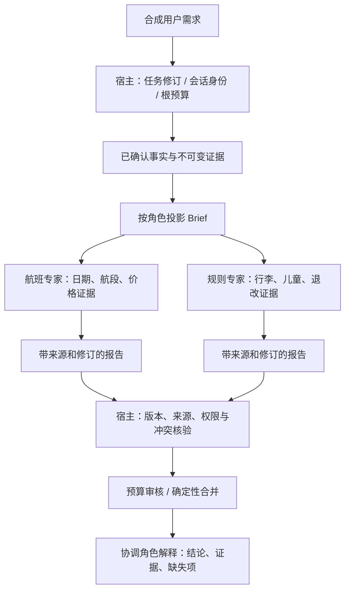
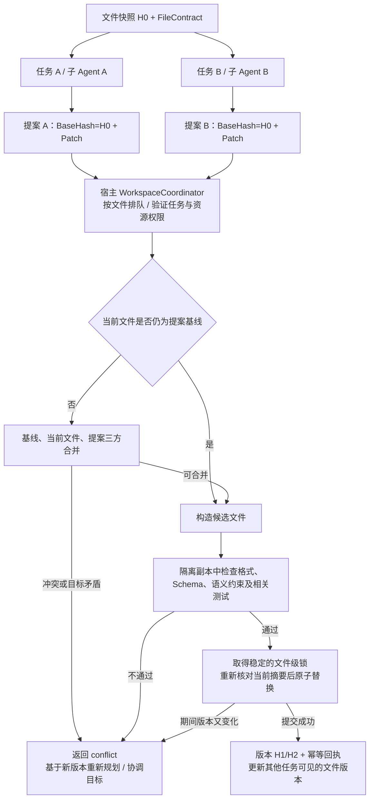

# 多 Agent 上下文传递：场景分析与案例建议

日期：2026-11-01。状态：场景分析与候选方案，尚未确定实现范围，未新增可执行案例。

基础：机票案例已快进合入 goagent-examples main 并推送到远端 2140026。合并结果关闭 go.work 与真实模型开关后的全量 race 验证：35 个包通过、7 个包无测试。当前根模块固定 GoAgent da848ae，以下 API 和判断对照该依赖及现有案例源码，不假定存在额外的多 Agent 上下文框架。

## 1. 结论

现有接口足以构建首版案例，无需先修改 GoAgent 核心。建议新增独立的 `orchestration/agent-context`，以只读差旅行程分析为业务载体，重点演示父子委派、串行接力、并行专家汇总，以及传递过程中的字段投影、会话隔离与版本核验。

上下文不是一个应该在所有 Agent 间共享的对象。执行控制可以沿调用链继承，模型资料需要显式裁剪和传入，各 Agent 的会话历史默认分开。父 Agent 调用子 Agent，不意味着父对话自动成为子模型的输入。

业务规则、资料可见性和字段选择留在 examples/宿主层；核心继续提供 Runnable、工具、图、会话、预算与持久执行原语。

## 2. 三类上下文

| 类型 | 示例 | 传递方式 | 不能据此推断 |
| --- | --- | --- | --- |
| 执行上下文 | 取消、期限、根预算、追踪、操作日志、执行键 | 沿同进程 context.Context 及框架派生作用域传递 | 模型自动看见其中内容；可以跨网络序列化整个 ctx |
| 模型任务资料 | 用户目标、已确认约束、当前任务事实、证据片段 | 类型化 Brief、Runnable 输入、工具参数及结果；按角色投影后编码到模型消息 | 可以自动复制父 system prompt、完整工具历史或支付授权 |
| 会话与长期业务状态 | 某个角色的历史消息、跨轮偏好、任务修订、业务记录 | 宿主分配 SessionID，按需使用 MemoryManager 或 SessionLog；独立保存任务状态 | 多 Agent 使用相同 SessionID 就能安全协作；会话回退会撤销外部业务效果 |

共享 budget.Controller 表示共同使用额度，不等于共享记忆；共享 MemoryManager 实例也不等于共享同一会话。SessionID、AgentID、根 RunID、业务 TaskID、任务修订与单次 InvocationID 有不同用途，不能混为一个 ID。

## 3. 已有能力与证据

| 能力 | 代码入口 / 已有案例 | 已确认的行为与限制 |
| --- | --- | --- |
| 显式输入输出 | GoAgent tools/runnable_tool.go；[agent-tool](../../orchestration/agent-tool/main.go) | Decode 将工具参数转为子 Runnable 输入；Encode 将子输出转为父工具结果。不会自动把父历史注入子模型 |
| 子会话生命周期 | NewRunnableToolFactory、OwnedRunnable.Close；[delegation](../../orchestration/live/delegation/README.md) | 每次实际调用建立子实例并清理；独立 Dispatcher 避免父子重入；支持深度与超时限制 |
| 字段适配 | workflow.Adapt；[field-adapter](../../orchestration/field-adapter/main.go) | 通过明确的输入、输出映射连接不同类型，不依赖万能共享 map |
| 并行与合并 | workflow.ParallelConfig；[parallel-diagnostics](../../orchestration/parallel-diagnostics/main.go) | Clone 深拷贝可变字段；Merge 接收按注册顺序排列的成功结果；分支失败会取消并等待已启动分支，不能假定仍会调用 Merge |
| 受限共享证据 | [scoped-lookup](../../orchestration/ops/scoped-lookup/README.md) | 子调查返回摘要、引用和已核对片段；父层只采纳共享账本中能核对的内容，不转发全部工具原文 |
| 持久大结果 | builder.WithOffload、contextpolicy.ResultStore；[context-recovery](../../orchestration/context-recovery/main.go) | 保存不可变证据，按 scope 和摘要核验并读取；不是通用角色权限系统 |
| 历史记忆 | builder.WithMemory、WithSessionID | 加载指定会话历史；已有 TestOwnedAgentSessionIsolation 验证不同子会话的记忆隔离和资源清理 |
| 会话日志 | builder/session_log.go、core/session | 原生工具流的实际模型历史可从日志推导；启用 SessionLog 后不再读取 Memory 历史；Fork/Rewind 有明确序号及冲突契约 |
| 持久执行 | DurableGraph、Dispatcher 操作日志 | 已完成操作可以回放；不自动保证任意子 Agent 中途崩溃都能安全重入，需按组合工具的 Resumable 契约实现 |
| 根预算与统计 | core/budget、usage hook、execution.Scope；[agent-usage](../../agent-usage/README.md) | 可共享根额度并区分父子 Agent 用量；身份和执行键由宿主建立，不交给模型生成 |

### 一个需要专门验证的会话边界

`builder/session_log.go` 的 sessionLogID 优先读取 `tools.SessionIDFrom(ctx)`，然后才使用 Builder 的 SessionID；`builder/tool_events.go` 同样会沿用宿主已经绑定的上下文会话身份。`tools/call_scope.go` 的 enterRunnable 处理嵌套与预算，并不为子 Agent 自动分配或切换 SessionID。

因此，新案例不能只调用子 Builder.WithSessionID 就宣称所有会话路径均已隔离。宿主应在子 Runnable 执行入口显式绑定子会话的上下文 SessionID，并使 Builder、工具审批及 SessionLog 的有效身份一致，同时保留根预算、取消、追踪与派生操作键。不要给每个孩子另建一个相互冲突的根 Scope。

这不是在本次宣布核心存在一个已复现缺陷：已有 agent-tool 测试覆盖的是直接调用子工具并使用 Memory 的路径，不能代替“父 ctx 已绑定 SessionID + 子 SessionLog + 子工具审批”的组合验证。该组合应成为新案例的必测场景。

## 4. 需要覆盖的场景

| 编号 | 场景 | 应传什么 | 主要风险 / 验收点 | 建议阶段 |
| --- | --- | --- | --- | --- |
| S1 | 父 Agent 委派给专家 | 当前子问题、角色所需事实、约束、允许的证据引用 | 子 Agent 不得看到父层私有字段和无关历史；输出经 Encode 返回 | 首版 |
| S2 | 串行 A → B → C | 上一步结构化结论及必要原始证据、当前任务修订 | B 的推测不能变成 C 认定的事实；不能丢失金额、否定条件和来源 | 首版 |
| S3 | 并行专家分析同一任务 | 同一修订的独立只读快照，各自分配字段和工具 | 深拷贝、稳定合并、不互相改写；报告冲突须显式呈现 | 首版 |
| S4 | 多用户、不同角色的隔离 | 宿主确定的会话映射；模型只见投影后资料 | 跨租户/角色/任务的历史、引用和授权不串用 | 首版基础隔离，后续补持久历史 |
| S5 | 同一专家继续多轮对话 | 该专家自己的历史 + 最新任务快照 | 不自动读父历史；同一会话避免并发写；明确何时新建、复用和清理 | 第二阶段 |
| S6 | 大文档和长工具结果 | 摘要、已核对片段、不可变引用，按需读取 | 摘要损失、引用越权、过期或错误摘要；不能只给 ref 却要求模型引用看不到的原文 | 第二阶段 |
| S7 | 用户修改任务后仍有旧子任务运行 | 新修订、当前允许采纳的 InvocationID | 旧报告不能覆盖新输入，迟到输出需拒绝或留作历史 | 首版版本拒绝；后续验证运行中修改 |
| S8 | 暂停、重启后继续协作 | 固定任务快照、已采纳报告、稳定执行键和证据 scope | 同版本恢复；不重复模型或工具效果；不保证任意半途中子流程都可重入 | 第二阶段 |
| S9 | 一个专家失败、取消或预算耗尽 | 明确的结果状态和已提交证据 | 区分业务无结论与执行故障，不将失败当成功，也不隐式无限重试 | 首版 |
| S10 | 多 Agent 共同使用知识或黑板 | 宿主管理的事实存储 + 有权限的读写工具 | 可见性、写权限、预期版本/CAS、冲突规则；不能共用可变对象任意写 | 后续按需求 |
| S11 | 不同模型平台协作 | 供应商无关的 Brief/Report 与证据引用 | 不把原生 tool call ID、reasoning 内容或 SDK 对象当作通用上下文 | 首版数据契约；后续三平台实测 |
| S12 | 切换主负责 Agent / handoff | 当前任务摘要、待处理问题及必要历史投影 | 不继承旧角色工具权限或审批，不假定存在自动 handoff API | 后续 |
| S13 | 跨进程或跨服务 Agent | 可序列化 DTO、可验证身份与引用、服务端接受的期限 | Go context、指针、锁和本地文件引用不能直接发送；协议连通不等于共享上下文 | 后续独立案例 |
| S14 | 子报告或工具原文包含注入文本 | 作为数据处理的原文、来源标签、受限工具及输出校验 | 引文不升格为 system 指令；子结论不能批准订票或突破角色边界 | 首版 |
| S15 | 不同任务的子 Agent 同时修改同一文件 | 相同基线快照、文件规则及带版本的修改提案 | 按文件协调、拒绝旧版本覆盖、验证语义和格式；不能只按任务加锁 | 建议新增专项案例，待确定 |

S4 的“隔离”首先通过宿主投影和工具授权证明，不承诺模型一定不推测隐私。S14 不能单靠提示词完成，必须使敏感工具和授权根本不在子 Agent 能力集中。

## 5. 候选实现方向

| 方案 | 内容 | 优点 | 代价 |
| --- | --- | --- | --- |
| A：独立上下文协作案例（推荐） | 新建 orchestration/agent-context，用只读差旅分析演示三种传递方式 | 可聚焦上下文，正反例清楚；不改变已验证的支付、出票和确认边界 | 需要一套精简合成事实和说明 |
| B：直接扩展 flight-booking | 在订票案例中加入行程、预算、规则子 Agent | 业务链路直观，可直接比较单 Agent 和多 Agent | 将上下文实验与交易状态机耦合，验证面更大，容易掩盖二次确认边界 |

推荐 A，业务背景沿用差旅，但只做分析，不进行付款、出票或主动退改签。已有机票案例保留为交易 Workflow 的独立演示。A 与 B 都仅是待选择方案，尚未创建新案例代码。

## 6. 推荐案例的业务闭环

合成用户需求：一位成人与一位儿童往返 SIN/NRT，明确日期、预算、行李要求和退改偏好。协调 Agent 将任务分配给航班专家、规则专家，最终交给预算审核角色或确定性汇总节点输出可解释结论。

三种模式使用同一份任务数据及相同的报告契约，分别回答不同问题：

1. **delegation**：协调 Agent → 受限工具工厂 → 航班专家 → 结构化报告 → 协调 Agent。验证父子资料投影、独立会话、生命周期与共享根预算。
2. **pipeline**：行程 Agent → 宿主校验/Adapt → 预算审核 Agent → 宿主验证结果。验证 A 的输出如何成为 B 的输入，保留原始价格证据及修订号，不能靠自由文本互相猜。
3. **parallel**：宿主图同时运行航班与规则专家 → 确定性 Merge → 协调角色生成解释。验证快照隔离、冲突呈现和完成顺序无关。汇总可使用 Agent，但金额、证据匹配与授权由普通代码检查。

上图是推荐目标结构，不表示所有模式都同时运行全部角色。首版不实现自动 handoff、跨服务调用、通用黑板和交易授权传递。

## 7. 建议的数据边界

宿主内部可信元数据与模型可见数据应分开定义，而不是把一个包含所有字段的 Envelope 直接编码进 prompt。

| 数据结构（示例内类型，非核心新 API） | 主要内容 | 所属边界 |
| --- | --- | --- |
| HostEnvelope | Tenant/Principal 引用、TaskID、Revision、RootRunID、AgentID、SessionID、InvocationID、宿主授权清单 | 由宿主管理，模型不能写入或覆盖 |
| AgentBrief | 当前子问题、完成标准、该角色所需的已确认事实、允许的 EvidenceRef、缺失项 | 显式传给模型；默认不带父 system prompt 和完整聊天历史 |
| EvidenceRef | 业务来源、证据 ID、源版本、内容摘要、所属任务 scope | 引用不是访问凭证，读取工具还要检查角色和宿主授权 |
| AgentReport | 状态、结构化发现、证据引用、缺失项、假设/推测标签、绑定的任务修订 | 先由宿主核验；不包含付款授权或可以直接执行的任意工具指令 |
| AcceptedReport | 宿主记录的真实来源 Agent/Invocation、验证结果、采纳时的修订 | 不相信模型自报身份；区分模型判断与权威工具事实 |

ResultStore 的运行 scope 校验不自动细分每个专家的访问权。共享根 RunKey 时，仍应在读取工具前增加角色级引用允许清单。预算专家可以看金额证据，不应因此获得所有旅客资料或交易授权。

同进程复用可信执行上下文，保留取消和根预算；任务事实走显式 DTO。跨进程时另建序列化协议与服务端授权，不试图把 ctx.Value、内存地址或 budget.Controller 指针传到对端。

## 8. 错误与冲突策略

- 非法 Brief 在创建子会话前拒绝；无效报告不得进入下游 Agent 或成为共享事实。
- task revision、证据摘要或来源不匹配时拒绝采纳；不要让模型决定是否忽略版本冲突。
- 不同专家结论冲突时保留冲突和证据，按明确业务规则处理或返回 needs_input/needs_attention，不采用最后写入者胜出。
- 严格并行模式遵守 AddParallel 契约：分支返回 error 时不执行成功 Merge。若需要部分报告，必须显式将“业务无结论”编码为正常的报告状态；取消、存储失败和执行故障不能伪装成成功报告。
- 模型重试、子 Agent 深度、工具并发、任务总预算和总期限均有界；子任务共享根预算，不在每次委派时重置额度。
- 已采纳结果和用量回放不再次计入新请求；业务待输入、图审批等待、模型失败分别表达。
- 第一版不直接恢复未知状态下的半途中非 Resumable 子工具；展示安全拒绝/需宿主处理，不能通过随意打开 Resumable 标志绕过。

## 9. 分阶段交付建议

### 首版：先证明传递正确

- 三个模式 delegation/pipeline/parallel；实际 Builder Agent、RunnableToolFactory、Adapt 与 AddParallel。
- 角色投影、报告验证、显式子上下文 SessionID、独立 Dispatcher、资源清理与统一用量统计。
- 合成可见性陷阱：给父层放一个专家不需要的敏感标记，并从实际模型请求检查专家看不到它；检查共享 ctx 不会自动形成共享模型历史。
- 测试旧修订拒绝、相互矛盾的报告、证据伪造、并行可变 map/slice 隔离、取消与预算耗尽、未授权工具不可用。
- 单独验证父 ctx 带 SessionID 时，子 Memory/SessionLog/工具审批的有效身份一致；不同用户、不同角色及并发分支不共用写会话。
- 离线确定性验证后，显式进行三平台真实测试；报告每个 Agent 的输入投影、来源 ID、输出去向和 token，不记录敏感原文。

### 第二阶段：记忆、大上下文和恢复

加入同一专家多轮延续、SessionLog 与角色历史隔离、Offload 授权读取、用户变更新修订、已完成阶段的跨进程恢复。需要先写明各存储的生命周期与哪些阶段允许重放，而非笼统承诺“上下文不丢失”。

### 后续独立专题

有实际需求再补共享黑板、主负责角色 handoff 和远程 Agent 传输。暂不引入新协议、向量数据库、通用 ContextManager、v1/v2 双接口或核心内置行业 Agent。

## 10. 不同任务同时修改同一文件

### 推荐：并行分析与提出修改，宿主统一提交

两个任务可以同时分析同一份文件，但子 Agent 不应各自调用裸 write_file 覆盖原文件。分别生成带基线版本的 PatchProposal，由宿主 WorkspaceCoordinator 合并、校验和提交。协调者可以请 Agent 解释冲突，但冲突判断、版本检查及最终文件写入由确定性逻辑控制。

对于代码仓库，可给每个子 Agent 独立 Git worktree 生成补丁；普通文档和配置可用隔离目录或只读快照。工作区隔离只能防直接覆盖，最终仍需统一合并、版本检查和语义验证。

上图为待实现方案，不表示现有通用写文件工具已经提供这些机制。

### 两个任务怎样避免覆盖

例如 A 给配置文件增加重试参数，B 增加超时参数，二者均从 H0 开始：

1. A 的提案在 H0 上通过检查，宿主提交 H1。
2. B 的 BaseHash 仍是 H0，不能拿它生成的整份文件覆盖 H1，即使 B 的写入发生得更晚。
3. 宿主以 H0 为共同基线，把 B 的改动合到 H1；若修改独立且符合文件规则，检查后提交 H2，保留两份修改。
4. 若二者修改同一配置值、同一函数含义，或一个任务要删除另一个任务依赖的字段，返回 conflict；不能靠最后写入者胜出，也不能只以“没有文本冲突”认定业务兼容。
5. 若两项目标本身矛盾，先按明确的宿主策略协调目标；不能让两个子 Agent 无限制互相覆盖或来回修复。

### 一致性需要同时约束四层

| 层次 | 建议约束 | 避免的问题 |
| --- | --- | --- |
| 写入完整性 | 临时文件、必要的持久化、原子替换 | 读到截断或半写入内容 |
| 版本一致性 | BaseHash / ExpectedRevision，提交时重新检查 | 串行写入仍覆盖了另一任务的最新修改 |
| 内容与风格一致性 | FileContract：格式化工具、Schema、导入规则、业务不变量和保护字段 | 修改不冲突但格式、接口或业务约束互相矛盾 |
| 任务协同与可追溯性 | TaskID、AgentID、InvocationID、ChangeID、前后摘要、规则版本、提交回执 | 无法确认谁改了什么、重复执行或旧任务迟到提交 |

FileContract 是宿主维护的该文件当前规则，所有任务使用同一规则版本；变更规则也需要版本检查。子 Agent 的报告仅是候选修改，不自动成为文件事实。

### 锁和上下文的作用域

- 锁应按 `WorkspaceID + 规范化实际文件身份` 建立稳定的资源键，不能按 TaskID 分别加锁；路径别名不能绕过同一文件的协调。
- 同进程可以用资源键对应的 mutex，多进程需共享文件锁或协调后端；多主机需要共同协调和防止过期写入者提交的机制。首个案例只承诺可信本地、全部写入经协调器的范围。
- 不在文件写锁内等待模型推理。提案和昂贵验证在隔离副本完成，提交时短暂加锁并重新验证预期摘要；若版本变化，则重新处理提案。
- 任务 A 和任务 B 保留各自根 RunID、会话、预算和追踪。它们共享的是文件资源协调器，不是把两个独立任务强行合为一个根预算或共享模型历史。
- 共享文件版本不要求 A 看见 B 的全部任务上下文。向其他任务反馈新文件版本、必要的已采纳修改及冲突原因，私有任务资料仍按角色投影。
- 所有写入者必须遵守同一协调入口。单个 Dispatcher.MaxConcurrency=1 只限制该实例的执行并发，不能解决不同 Dispatcher/进程间竞争，更不能识别旧快照覆盖。

### 建议的示例内契约

- FileSnapshot：资源身份、原始字节摘要、文件版本、规则版本和允许读取的内容。
- PatchProposal：ChangeID、TaskID、宿主认定的提交者、BaseHash、规则版本、结构化编辑或 Patch、意图及影响范围。优先使用能表达边界的 AST/结构化编辑；文本补丁仍需验证。
- CommitResult：applied / already_applied / conflict / validation_failed，以及前后摘要、采纳记录和需要重规划的原因。
- 读取和 submit_patch 可作为子 Agent 工具；实际 commit 不给子模型直接调用，而由宿主 Workflow 统一执行。

即使模型返回完整新文件，也只能作为基于指定基线的候选内容；不能直接 os.WriteFile。追加写也只有在记录格式、去重键和顺序规则明确时才允许，不是解决共享文件覆盖的通用办法。

### 重试与崩溃

同一 ChangeID 的重试返回原提交结果，不重复应用。文件替换与提交日志不天然共享事务：应先持久化待提交意图、基线和预期新摘要，再替换并记录完成；恢复时在同一资源锁下核对实际内容和提交链。

实际内容等于该变更预期新摘要时核对为已应用；仍为基线时，只有能确认未有后续变更的前提下才允许重试；是其他摘要且缺少可核对提交链时，返回冲突或结果待核对，不覆盖。原子 rename 解决文件替换完整性，不等于自动具备比较并交换、提交日志事务或恰好一次效果。

### 当前能力与归属

现有 `goagent/mcp/tools/write_file.go` 的覆盖路径直接调用 os.WriteFile，追加路径使用 O_APPEND；这个工具没有 BaseHash、跨任务文件协调或三方合并。Durable 存储自己的锁也不会自动锁住任意业务文件。

建议先在 goagent-examples 增加 `shared-file` 专项场景验证上述契约；生产级 WorkspaceCoordinator、文件工具和工作区隔离属于宿主或 goagent-harness 的文件执行适配层。GoAgent 核心继续承担 Agent、Workflow、工具调用和执行治理，不新增面向代码编辑的核心调度策略。

专项验收至少覆盖：两个不相交修改均保留、重叠/语义冲突拒绝、错误基线不覆盖、重复 ChangeID 不重复提交、旧规则/旧任务修订拒绝、多进程同时提交、提交后崩溃核对，以及两个任务预算和会话相互独立。

## 11. 本轮完成与待确定项

已完成机票案例合并推送、当前接口及案例调查、场景矩阵和候选结构；本轮未调用新的付费模型，未新增多 Agent 案例代码。

新增需求已补入 S15：不同任务共享文件的统一提交与冲突处理。下一步先确定 A/B 方向，以及首版三种模式与 shared-file 专项场景的交付顺序。确定后，再形成实施设计与验收计划，避免在尚未确定上下文边界前直接复制父对话或给所有 Agent 共用一个会话。
