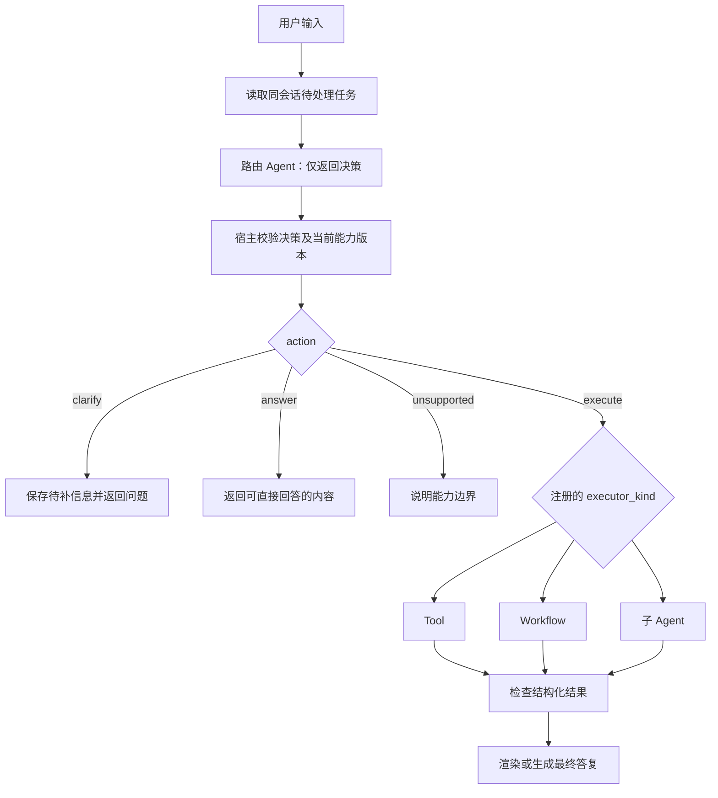

# 意图识别与执行路由调研

日期：2026-10-31。状态：调研结论与实现建议，尚未实现路由案例。\
范围：多轮澄清、Tool / Workflow / 子 Agent 选择，以及执行、会话与恢复边界。\
需求：[多 Agent 与 Workflow 场景](../requirements/multi-agent-scenarios.md)。

## 1. 结论

建议采用“会话入口 + 无业务效果的路由 Agent + 宿主验证与分派 + 结果响应”的结构。主 Agent 作为用户交互角色，可以由这套流程实现，不必是一个持有全部业务工具的无限循环 Agent。

首轮通过静态能力清单和显式 Workflow/普通 Go 编排完成；不新增核心框架、通用团队运行时、向量路由或动态 DAG。

相比前版需求，需收紧两点：

- “识别与调用可在同一模型回合完成”不等于“识别与业务效果可以不设代码边界”。路由模型只产出决策，返回宿主后才启动业务执行器；仍然可以只有一次路由模型请求。
- Dispatcher 能验证结构、执行策略和调用契约，但不能证明语义意图识别正确。模型将退款资格误选成特殊调查，即使 Schema 合法，也需要语义样本和业务效果断言发现。

## 2. 依据与版本

### 2.1 仓库依据

- examples 基线提交 `138f781`，go.mod 固定 GoAgent `v0.28.0`；使用 `GOWORK=off` 验证发布版本，没有修改依赖或创建 go.work。
- [agent-tool](../../orchestration/agent-tool/main.go) 和其测试验证工厂创建、独立会话、共享预算与清理。
- [delegation](../../orchestration/live/delegation/README.md) 验证主 Agent → 专家 → 图工具，多层共享预算，深度与 Dispatcher 重入限制。
- [ticket-triage](../../orchestration/live/ticket-triage/README.md) 的 order_lookup 已将固定规则图封成工具；它证明 Workflow 可以直接作为主 Agent 的能力，不需要额外子 Agent。
- [scoped-lookup](../../orchestration/ops/scoped-lookup/README.md) 提供同轮并行子调查、结果引用和回放重建的复用模式。
- [session-replay](../../orchestration/live/session-replay/README.md) 演示会话历史与持久运行，但没有自动提供本需求的 PendingTask 业务状态机。
- 核心源码另核对当前 GoAgent `12aae58` 与发布版本 v0.28.0 的 RunnableTool、Dispatcher、ReturnDirectTools、会话和子图适配接口；不能假设两个源码树完全相同。

### 2.2 外部官方资料

以下资料用于对照架构，不引入这些框架为本项目依赖。访问日期均为2026-10-31。

| 官方资料 | 相关结论 | 本项目采用方式 |
| --- | --- | --- |
| [OpenAI Agents SDK：编排](https://openai.github.io/openai-agents-python/multi_agent/) | 管理者把专家作为工具调用时保留对话控制；handoff 会转移控制 | 主入口统一回答，专家返回结果；首轮无需 handoff |
| [LangGraph：工作流与 Agent](https://docs.langchain.com/oss/python/langgraph/workflows-agents) | 固定代码路径与动态工具决策是不同控制方式 | 能力定义固定执行器，Workflow 可以包含 Agent 节点 |
| [LangChain：Router](https://docs.langchain.com/oss/python/langchain/multi-agent/router) | 路由与有状态对话协调职责不同；多轮需要显式上下文管理 | 会话层持有待补字段，路由读取相关上下文，不向所有专家复制完整历史 |
| [Anthropic：Building effective agents](https://www.anthropic.com/research/building-effective-agents) | 从简单组合开始；明确步骤适合工作流，开放过程适合 Agent | 先做固定能力清单与可测路由，后续按证据扩展复杂度 |

这些是架构原则依据，不是本项目性能、路由准确率或生产可靠性的实测结论。

## 3. 三种方案比较

| 方案 | 行为 | 优点 | 主要限制 | 建议 |
| --- | --- | --- | --- | --- |
| 主 Agent 直接持有所有工具 | 模型选择并立即进入工具执行循环 | 接线少，适合简单只读演示 | 同轮可调用多个工具；可能同时澄清与执行；难限制一轮只选一个业务目标 | 保留作对照，不作为本需求主案例 |
| 路由决策与执行分开 | 先返回一个结构化决策，经验证后分派 | 澄清期间无业务效果；便于测试、记录与恢复 | 增加少量宿主状态代码，仍需测试语义质量 | 首轮推荐 |
| 规则匹配全部输入 | 关键词/正则直接映射能力 | 确定、无需分类模型成本 | 自然语言歧义和多轮补充难覆盖 | 仅用于已确认的明确入口或辅助规则 |

可信产品入口可直接给出能力 ID（例如用户点击“查订单”并填写表单），省去意图模型，但仍走同一参数校验与执行路径。自然语言中出现工具名不等同于可信入口。

## 4. 推荐流程



### 4.1 路由 Agent 的边界

路由 Agent 只看当前输入、已确认字段、待补问题和候选能力描述；不持有订单查询、业务提交、子 Agent 工厂等执行工具。

可通过单一 `route_decision` 工具输出结构化结果，工具自身仅验证/返回决策，不启动业务执行。使用现有 Builder/AsRunnable 路径，使该模型请求进入根预算和持久记录，不自行绕过统一入口调用 SDK。

`WithReturnDirectTools` 可让单个有效决策直接结束模型回合，减少额外总结调用；它不是“只允许一个工具调用”的保证。P0 要求宿主验证恰好一个决策；多个决策、结构无效、原始自由文本等不能启动业务效果。限制模型轮数，输出修复也计入预算，不能无限修复。

模型可调用同一个工具多次，因此“只提供一个工具名称”和“只产生一个调用”不是同一件事。

### 4.2 决策与能力契约

建议路由结果只含 action、capability_id、arguments、question、missing_fields 等字段；业务意图可作为分析标签，不能与 capability_id 不一致而仍执行。各 action 对字段的要求使用明确的互斥校验。

宿主能力清单保存执行器类型、Schema、版本、所需字段与具体 handler。工具描述包含适用与不适用示例，例如“检查资格、不提交退款”。示例层先用静态映射，不用反射发现执行器。

能力数量少时提供完整清单；以后若能力很多，再增加候选检索和召回评估。检索未命中不是 unsupported 的充分证据，也不能默认转给万能 Agent。

宿主检查能保证目标存在、字段合法和状态允许；不能仅凭此保证用户语义与目标匹配。后者通过真实输入评测与明确业务规则共同约束。

### 4.3 执行与结果

三类业务能力经过现有 Dispatcher。主路由阶段不执行任何业务能力，执行阶段只接受已验证的选择。P0 每个用户回合只允许一个顶层业务目标，不允许模型同轮选择两个互斥目标。

子 Agent 可以在自身受限循环中调用多个工具；Workflow 也可以包含 Agent 节点。executor_kind 表示顶层执行模式，ModelInvoking 表示是否包含模型请求，二者分别声明。

普通 Workflow 的成功结果可直接渲染，避免再增加一个总结 Agent。需要自然语言总结时，摘要阶段只接收真实执行结果，不持有业务执行工具。总结失败时业务操作可能已完成：返回可重试生成答复的状态，不重做业务操作。

## 5. 四类容易混淆的状态

| 层次 | 示例 | 处理 |
| --- | --- | --- |
| 路由决策 | clarify / execute / answer / unsupported | 决定是否启动执行器 |
| 用户任务状态 | needs_input / running / waiting / completed / failed / partial | 表达业务进展 |
| 单次调用状态 | 这次 Invoke 已结束、stream 已 Done | 只证明本次调用结束 |
| 持久操作状态 | pending / waiting / completed / failed | 决定是否回放或允许恢复 |

典型例子：Workflow AsRunnable 返回一次成功终态，但 GraphSnapshot.Waiting=true、Done=false，业务仍未完成。需要恢复的子图应使用 AsChildRunnable 与 Resumable 协议，不能把等待快照普通 Encode 成工具成功结果。

业务澄清 needs_input 也不同于审批等待：澄清需要用户提供新信息；审批恢复引用已保存的执行和审批位置，不应重新识别成另一项任务。

## 6. 会话、身份与恢复

建议区分 SessionID（对话）、TaskID（待完成目标）、TurnID（一次用户输入）和 RunID（可回放的执行）。这些是宿主业务模型，不要求为核心增加新接口。

- 用户补充订单号属于同一 Session/Task 的新 Turn；不复用旧 completed RunID 请求重新执行。
- 同一次失败/等待运行恢复时保持 RunID、稳定 Agent scope、调用键和版本；不能生成新身份来规避 pending 记录。
- 待澄清状态显式保存已确认字段、未决字段、问题、轮数、有效期与版本。普通消息历史可用于理解，但不能替代业务状态。
- 同会话的并发输入应由宿主串行或使用版本比较；单个 Agent 的执行门只保护该实例，不能协调不同实例或进程。
- 会话 Store 的 Append CAS 与运行 Store 的操作日志不是天然跨存储事务；两边写入失败时应重读/恢复，不能假设一起提交。
- `execution.Scope` 当前要求预算 RootKey 等于 RunID。P0 可采用每回合有界预算、明确澄清轮数和宿主任务总额度；跨回合总额度需要宿主额外记账，不宣称 Scope 自动实现。若改用同一任务根预算，需单独设计多回合执行键，不能把同一顶层 completed 图当成新回合继续跑。

## 7. 异常与降级矩阵

| 情况 | 结果 | 禁止的行为 |
| --- | --- | --- |
| 缺必要信息或多个合理意图 | needs_input，询问关键差异 | 无依据选择第一个候选 |
| 能力不存在或请求明确不支持 | unsupported 或路由契约错误，按原因区分 | 创建未注册 Agent |
| 模型输出多个决策或非法字段 | 有界修复；仍非法则失败且无业务执行 | 取第一个结果后继续 |
| Schema 参数错误 | 模型生成错误可有界修复；用户缺字段则澄清 | 盲目反复调用同一工具 |
| 预算不足、超时、取消 | failed/取消类别，保留已完成事实 | 假装成功或更换子预算绕过 |
| Workflow 审批等待 | waiting，保留续跑位置 | 自动转交 Agent 完成同一操作 |
| 工具 pending/结果未知 | attention/宿主诊断与核对 | 改用新调用 ID 重做外部效果 |
| 执行成功但答复生成失败 | 保留已完成执行结果，允许单独重生成答复 | 重新执行整个任务 |
| 子 Agent 无结论或证据不足 | 明确不足/失败；按业务契约决定后续 | 仅因文字流结束而标记业务完成 |

`ReturnArgumentErrors` 只支持特定模型调用路径的参数修复，不等价于自动用户澄清；直接 Dispatcher.Invoke 的错误契约不同。不能把基础设施错误交给模型当成用户参数问题反复修复。

## 8. 待实现验证矩阵

除需求已有验收项，新增下列必须覆盖的反例：

1. 同一轮既返回澄清又返回执行；多个候选调用；字段冲突；要求业务执行次数为0。
2. Workflow 与子 Agent 名称/描述相似，但用户目标不同：检查资格、提交处理、特殊调查不能混选。
3. 两个会话交错补充、同会话并发输入、切换任务、过期字段与清空状态。
4. 执行成功后答复生成失败，恢复只生成答复；已完成效果计数不增加。
5. 审批等待、completed 回放、pending 未知结果分别走正确分支。
6. 用新输入误复用 completed RunID，要求宿主拒绝或生成明确的新运行，不能静默返回旧答案。

建议准备至少30条自然语言样本，覆盖清晰、缺参、歧义、超范围、多任务和对话补充；样本标注可接受的能力集合与预期 action，不把唯一措辞当成标准答案。离线脚本验证执行契约，Live 验证语义选择。报告路由混淆矩阵、澄清误触发/漏触发、执行成功率、意外业务执行数、请求与Token用量及延迟；不能只报告总体分类准确率。具体质量门槛在首次测量后确定，不凭空设置模型置信分数阈值。

## 9. 仓内验证记录

本轮只修改需求/调研文档。复用能力的针对性离线 race 检查使用发布版本：

```bash
env -u GOROOT GOWORK=off GO_TEST_MODE=true go test -race -timeout 120s \
  ./orchestration/agent-tool ./orchestration/live/delegation \
  ./orchestration/live/ticket-triage ./orchestration/ops/scoped-lookup \
  -run 'TestScripted|TestOrderLookupTool|Test.*Isolation|Test.*Session'
```

四个包均退出0：agent-tool 1.685s、delegation 2.845s、ticket-triage 3.151s、scoped-lookup 8.163s。日志：`/tmp/goagent-routing-research-tests.log`。此命令只运行匹配的离线用例，不运行 Live 测试、不访问真实模型；通过只能证明现有复用案例的相关契约，不证明尚未实现的路由系统正确。

## 10. 下一步建议

先实现一个闭环入口：路由阶段不含业务执行工具；静态能力覆盖订单查询 Tool、退款资格 Workflow、服务诊断子 Agent；加入澄清与直接回答。随后再接入会话持久化、执行回放、审批和多专家并行。以上为建议的实现顺序，尚未开始代码实施。


## 11. 最新核心复核（033e744 / v0.29.1）

本轮另行复核最新核心提交 `033e744`；examples 仍固定 v0.28.0，远端 main 没有新增提交。没有修改 go.mod/go.sum，没有创建仓内 go.work。前述第2节和第9节的版本与测试为第一轮历史证据，下列为新增证据。

### 11.1 新接口对路由设计的影响

| 变化 | 已核对行为 | 对方案的影响 |
| --- | --- | --- |
| PreStep 统一上下文转换 | WithIdentifiedPreStep 的身份进入持久意图；恢复时回放已记录结果，身份变化拒绝旧记录 | 可注入经过宿主确认的会话/能力摘要，但外部状态变化仍要在执行前重新验证 |
| WithOffload 替代旧 ContextPolicy 装配 | 读取工具须显式注册；持久结果需持久存储及保留期 | 只在长证据场景引入；简单路由先使用小而明确的输入，不为分类增加卸载机制 |
| RequestError 统一请求恢复 | RetryTransient 原样重试；每次尝试独立预算键；已输出内容时不重试 | 网络暂时失败与语义输出修复分开；路由总请求数包含重试 |
| 父子重试配置隔离 | 子 Agent 不继承父 Agent 的 RequestError 策略 | 每个执行层显式配置，避免以为主路由配置会自动作用于专家 |
| 会话日志恢复修复 | 同一执行键续写时，已记入日志的工具消息不会再被当作历史截断并重复追加 | 支持保留完整路由/执行对话，但不代替宿主 PendingTask 状态 |

PreStep 是“请求前转换/终止”扩展点，不是统一分派接口。若在其中执行订单工具或启动专家，持久回放、错误分类、效果记录和资源生命周期将难以与业务节点一致，因此本案例不在 PreStep 内执行业务能力。

v0.29 已删除 WithModelRetry；显式采用新重试配置时用 `WithRequestError(n, builder.RetryTransient(n, backoff))`。examples 当前 Go 代码没有发现对 WithModelRetry、WithContextPolicies、WithPolicyToolAdapter、WithContextPolicy 的调用；不能只根据破坏性版本说明推断示例必然不能编译。

### 11.2 恢复不是重新识别

一次执行一旦完成路由并进入业务阶段，应保存：用户输入身份、已选 capability_id、能力版本、经过校验的参数及其摘要、当前阶段。断线或进程重启后先恢复当前阶段，不先重新询问模型“要调用哪个能力”。

如果能力描述或策略在运行期间改变：新任务使用新版本，存量任务按保存版本恢复；无法提供原版本则明确报告版本不匹配，不把旧参数交给新执行器静默继续。需要在审批前重新检查的订单状态等时变事实，应由 Workflow 的业务检查完成，而不是重新进行意图分类。

## 12. 建议的最小状态契约

以下均为示例宿主 DTO，而非要求新增核心公共接口。

| 状态对象 | 必要内容 | 责任 |
| --- | --- | --- |
| Capability | 稳定 ID、版本、用途/反例、输入 Schema、执行器、handler、预算/期限策略 | 由宿主定义，模型只读 |
| RouteDecision | action、能力 ID、参数，或澄清问题/待补字段，或可直接回答内容 | 模型提议，宿主按 action 互斥校验 |
| PendingTask | TaskID、SessionID、版本、已确认字段、未决字段、澄清次数、有效期 | 宿主在新用户回合前读取并更新 |
| Execution | RunID、输入身份、能力快照、参数摘要、phase、业务结果引用 | 宿主恢复与重复提交检查 |
| Response | 任务状态、业务结果状态、答复状态、用户内容、必要的下一步 | 避免将消息发送失败误报为业务失败 |

RouteDecision 需要进行语法与组合校验：execute 必须有一个合法能力和参数，不能同时要求澄清；clarify 必须有问题，不能带待执行目标；answer 不含执行目标；unsupported 不含执行目标。未知字段和未知枚举不能悄悄忽略。

工作流的“调用已 Done”和“业务 completed”分开处理；结果引用可在答复阶段重读。恢复时不依赖“刚才那个 Go 指针还在内存里”，从持久 JSON 边界重新解码并验证 DTO。

## 13. 会话与执行阶段设计

```text
新用户回合
  → 读取 PendingTask / 合并已确认字段
  → route
      ├─ clarify → 保存待补状态 → 返回问题 → 本回合结束
      ├─ answer / unsupported → 返回内容 → 本回合结束
      └─ execute → validate → execute → respond → 本回合结束
```

execute 成功但 respond 失败时，下一次恢复从 respond 开始；网络断开后用户重试同一条提交，应使用原请求身份定位既有执行，不生成新的 RunID 再执行。用户真正提交新的任务或补充信息时才分配新的回合身份。

需要区分：恢复同一次提交、补充同一待澄清任务、取消旧任务以及开始新任务。不能只凭相同文本判断重复，也不能把会话中每条消息都当成对旧图的 resume。

初版 PendingTask 可以是进程内存中的版本化状态，但必须明确重启丢失；后续使用持久存储时补充并发输入、CAS 冲突和跨存储写入失败测试。会话消息记录和业务状态更新需要显式协调，追加写消息日志不能自动提供跨对象事务。

作为架构对照，LangGraph 官方区分了线程检查点与应用数据存储，并说明 interrupt 恢复可能从节点开头重新执行。因此本项目同样不能把“可恢复”理解为任意节点代码都不会再次执行。这里只借鉴语义边界，不移植它的 API：[持久化](https://docs.langchain.com/oss/python/langgraph/persistence)、[中断与恢复](https://docs.langchain.com/oss/python/langgraph/interrupts)。

## 14. 失败分类与具体策略

| 类别 | 示例 | 路由案例策略 |
| --- | --- | --- |
| 用户信息不够 | 无订单号、目标不清楚 | needs_input，结束当前调用等待用户；不通过模型重试“补出”业务字段 |
| 模型决策格式错误 | 多决策、未知 action、互斥字段冲突 | 有界输出修复；仍错误则 failed；保持业务执行数为0 |
| 模型语义选错 | 资格查询选成提交退款 | 用相邻意图样本、能力反例与业务效果测试发现；Schema 不能证明正确 |
| 模型传输暂时失败 | 429、5xx、连接错误 | 可用 RetryTransient；遵守期限、次数与预算；不等同于业务重试 |
| 确定的业务拒绝 | 超过退款期限 | 返回拒绝的业务结论，不改派专家来绕过规则 |
| 执行结果未知 | 外部效果可能发生但记录未完成 | 保持 attention/核对；不自动改能力或换 ID 重做 |
| 业务已完成、输出失败 | 总结模型失败或响应连接中断 | 保留执行结果，重试答复或交付，不重新执行业务 |

特别注意重试乘法：路由、子 Agent 和摘要均配置重试时，总请求数可能显著增加。每层局部次数上限之外仍需共享根预算和总体截止时间，不把 retries 当成免费能力。

## 15. 最新跨仓兼容检查

### 核心定向 race

```bash
env -u GOROOT GO_TEST_MODE=true go test -race -timeout 120s ./builder ./core/session \
  -run 'TestSessionLog|TestModelRetry|TestRequestErrorInDurableToolLoop|TestIdentifiedPreStepIntent|TestOffloadReadsAfterResume'
```

命令退出0。Builder 的会话恢复、重试、带身份 PreStep、Offload 恢复用例通过；core/session 在此过滤表达式下没有匹配测试，不能把其输出当作完整会话 Store 一致性测试通过。日志：`/tmp/goagent-routing-latest-core.log`。

### 示例与最新核心

临时目录内通过 `go work init <core> <examples>` 建立 workspace，显式 GOWORK 指向该文件。运行结束自动删除临时目录；未修改两个仓库的依赖与生产代码。

1. examples 全部包 `go test -run '^$' ./...` 退出0：验证最新核心下编译通过，没有运行这些包的测试。
2. 五个案例针对性离线 race 退出0：agent-tool、delegation、ticket-triage、session-replay、scoped-lookup。过滤：`TestScripted|TestOrderLookupTool|TestOwnedAgentSessionIsolation`。对应时间1.482s、2.208s、2.093s、3.576s、8.248s。
3. 日志：`/tmp/goagent-routing-latest-examples-compile.log`、`/tmp/goagent-routing-latest-examples-race.log`。

这与第9节发布版 v0.28.0 的验证分别保留。跨仓通过不代表依赖已升级到 v0.29.1，也不证明尚未实施的路由 Agent、澄清状态机与 Live 意图质量通过。

## 16. 调研收敛与下一阶段

已确认现有公开能力足以构建首轮闭环，没有发现必须先修改 GoAgent 核心的阻塞。最新版本下示例编译和五组复用案例定向 race 已通过。

实现阶段应按以下模块展开，先留在单个示例目录，真正复用后再抽共享包：能力描述、决策校验、会话待补状态、分派执行、结果响应、fixtures 与测试。

P0 只接通三个能力：订单状态 Tool、退款资格 Workflow、服务诊断子 Agent；同时提供 clarify / answer / unsupported。先测模型乱选、多决策、缺参、重复提交和响应失败，再扩展并行团队及审批。首轮路由不需要向量检索、动态插件发现、子 Agent handoff 或通用 Agent 注册中心。

本轮只更新调研与需求，未实现上述模块，未调用真实模型、未执行真实业务效果。


## 17. 与 LangGraph 设计思想的对应

结论：GoAgent 已能表达“状态 + 节点 + 条件边 + 持久恢复”的核心思想，但不是 LangGraph 的 Go 移植，也不承诺完整 API 或调度语义一致。对照当前核心 `033e744` 与 [LangGraph Graph API](https://docs.langchain.com/oss/python/langgraph/graph-api)。

| 设计概念 | GoAgent 对应 | 边界 |
| --- | --- | --- |
| 共享图状态 | `Graph[T]` 与 `Node[T]` | 节点返回整个 T；没有自动按字段应用 reducer 的契约 |
| 节点可执行普通代码或模型 | `AddNode`、`AddRunnable`、`Adapt` | Agent 只是可组合节点之一 |
| 静态与条件边 | `AddEdge`、`AddBranch` | 普通边只有一个后继；条件路由只选一个已声明目标 |
| 循环与退出 | 可构建循环，Compile 验证存在退出路径，MaxSteps 限制执行 | 不证明运行时路由一定选择退出 |
| 并行与合并 | `AddParallel` + 显式 Clone/Merge | 固定分支列表，不是 Send 风格的运行时动态任务扇出 |
| 持久执行 | `CompileDurable`、节点与分支检查点、操作日志 | 保留版本与稳定键；未记录效果仍需宿主核对与幂等 |
| 人工介入 | ApprovalNodes、BeforeApprove、可续跑子图 | 不等于任意代码位置均可调用 interrupt 的通用暂停机制 |
| 子图组合 | 普通 Runnable 组合、持久 AsChildRunnable | 持久审批嵌套须显式采用 Resumable 协议 |

LangGraph 使用消息传递与 super-step 调度；GoAgent 当前工作流是单一控制路径加显式 fork/join。LangGraph 的字段 reducer、通用 Command/Send、任意位置 interrupt 等概念，在 GoAgent 中没有一套语义等价的公共 API。不能因函数名称相近就把并发、状态合并或恢复保证视为一致。

会话 Fork/Rewind 与 testing/replay 已有，但不能据此宣称完整支持任意图检查点的状态编辑、时间旅行与分支执行；尤其 session.Rewind 不撤销 durable 快照，更不撤销外部效果。

### 17.1 对当前意图路由的具体应用

建议把路由 Agent 放在图节点里，完成决策并保存状态；随后 AddBranch 只根据已校验的状态返回目标名称。**不要直接在 AddBranch 的 Router 回调中请求模型、调用工具或产生业务效果。** DurableGraph 文档要求 Router 为纯函数，因为分支保存前崩溃可能再次计算路由。

```text
START → recognize → validate
                      ├─ needs_input → clarify → END
                      ├─ answer / unsupported → respond → END
                      ├─ tool → execute_tool → respond → END
                      ├─ workflow → execute_workflow → respond → END
                      └─ agent → execute_agent → respond → END
```

recognize 节点只运行路由 Agent，validate 节点核对能力与参数；边负责纯选择；效果放入明确的执行节点，并使用已有操作日志。这既贴合状态图思想，也符合 GoAgent 当前恢复契约。是否还需通用 reducer 或动态 Send，应由真实业务案例提出，当前三路径案例没有这些前置依赖。


## 18. GoAgent 需要修改哪些：按仓库与优先级拆分

结论：已有 `workflow.Graph[T]` 是可复用的类型化状态图，无需新增第二套 StateGraph、重写调度器或复制 LangGraph API。当前需求没有证明必须新增核心执行机制；应先改进接入说明并完成跨场景闭环。

### 18.1 P0：当前应做

| 仓库/位置 | 改动 | 依据与完成标准 |
| --- | --- | --- |
| GoAgent `docs/api/CORE_API.md` | 将新编排参考入口改为 core.Runnable、Builder.AsRunnable、Graph/Adapt、持久图；旧接口移至兼容说明 | 当前 interfaces/agent.go 已标记旧 Agent/Runnable Deprecated，但 API 文档仍以它们作为主要入口；新旧边界清楚且示例可编译 |
| GoAgent `docs/design/DESIGN_OVERVIEW.md`、架构文档及导航 | 统一说明 Agent 原生循环与状态图并存、节点可承载普通代码/工具/Agent、执行机制与业务策略的分层 | 读者能明确哪些能力在核心、Harness、contrib、examples；不承诺 LangGraph API 兼容 |
| GoAgent `workflow/README.md`、执行契约和宿主指南 | 补充路由 Agent 节点 → 纯 AddBranch → Tool/Workflow/Agent 的接入约定；列清调用终态、业务等待与完成区别 | 使用现有 API，不改变 Run/AsRunnable/AsChildRunnable 的恢复契约；澄清作为业务状态明确返回 |
| goagent-examples `orchestration/multi-agent/intent-router` | 先实现三个执行器路径及多轮澄清；静态能力清单、决策校验、PendingTask、结果响应 | 新路由案例采用已有框架，按需求 A1–A18 分阶段验收；业务层状态不进入核心 |
| goagent-examples 文档与测试 | 增加失败路径、调用轨迹、会话隔离、幂等请求与响应恢复案例；发布版与本地核心分别验证 | 不把编译通过、脚本化模型通过或跳过的 Live 测试当成真实语义质量证据 |

这里的“P0”指下一阶段优先工作，不表示本轮已实施。GoAgent README 的现有定位已包含可恢复、预算和工作流，不需要为了采用状态图思想更换项目定位。

### 18.2 核心 API 的候选改进：必须由案例证据触发

| 优先级 | 候选能力 | 何时需要 | 第一轮如何处理 |
| --- | --- | --- | --- |
| P1 | 更方便的执行状态判定/结果适配 | 多个宿主反复把等待误编码为成功，并存在重复的正确适配代码 | 先在示例使用 GraphSnapshot 的 Waiting/Done/Preview 与 WaitError，不替换现有状态契约 |
| P1 | 通用持久等待输入与恢复 | 用户在流程内部补充不同类型的数据，宿主 PendingTask 无法覆盖，且要求进程重启后继续 | 先区别澄清与审批；通用协议需独立设计，不能直接把 ApprovalKey 当作任意输入 |
| P2 | 类型化动态 Map/fan-out | 实际任务数由输入决定，需要逐项稳定键、检查点与并发上限 | 固定专家使用 AddParallel；动态需求单独验证，不能只加一个 goroutine 池 |
| P2 | 字段级 reducer/状态增量 | 多个场景出现可复用的字段合并规则，手工 Merge 难以维护 | 继续显式 Clone/Merge；避免为了表面 API 相似而引入反射 DSL |

候选能力的实现必须定义取消、错误、持久恢复、版本漂移和副作用边界；不能仅以“函数名与 LangGraph 相同”作为完成标准。若应用层已有清晰方案，也可以不加入核心。

### 18.3 明确保留的现有机制

- `core.Runnable` 继续统一执行组合；不改成只能用于 Agent 的接口。
- `workflow.Graph` 保留单后继控制路径与显式并行汇合；不暗中改成另一套 super-step 调度语义。
- `tools.Dispatcher` 继续负责工具调用契约；不承担业务语义分类。
- `execution.Scope` 继续装配上下文、预算与观察，不承担用户意图或待澄清任务管理。
- `core/session` 记录对话，`core/durable` 记录运行/操作；业务 PendingTask 和 Capability 先留在宿主。
- 不新增面向客服、运维或退款的核心类型，不在核心内置角色、提示词、万能 Supervisor 或行业工具。

### 18.4 建议执行顺序

第一步修正文档入口和术语，以当前公开 API 建立一致模型；第二步在 examples 中跑通路由与三个执行器路径；第三步根据案例暴露的重复代码和恢复缺口提出独立核心需求。具体实施前另拆实现计划，本轮只分析改动范围。
