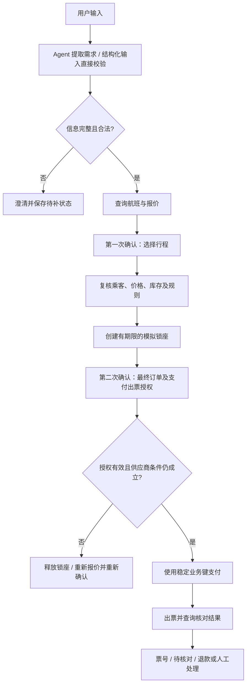

# 机票预订：Agent、Workflow 与二次确认

日期：2026-11-01。状态：用户已批准并实施；验证记录见 ../../evaluation/2026-11-01-flight-booking/REPORT.md。

## 目标与范围

在 `orchestration/flight-booking` 添加可运行案例，展示自然语言澄清、行程比较、确定性预订、两次用户确认、业务幂等与故障恢复。使用当前 go.mod 固定的 GoAgent 公开 API，不改变核心定位，不引入第二套 Agent/Workflow 接口。

用户明确要求补充二次确认。本文对两次确认的含义作如下提案：第一次选择行程；第二次在最终复核后授权具体订单的支付和出票。用户已批准按本文实施。

实现默认采用模拟供应商和支付服务，离线脚本化模型保证案例可重复；可选真实模型复用 internal/livemodel。真实模型只处理对话和推荐，业务效果仍是本地模拟。已按此方式实施；不代表取得真实航司或支付接入授权。

本次不接真实购票 API、不接受真实证件和银行卡、不实现航司规则大全、跨主机接管或通用订票框架。复杂日期、旅客类型、退改费用等用明确的合成规则展示，不声称覆盖真实航司政策。

## 方案选择

| 方案 | 收益 | 成本及限制 |
| --- | --- | --- |
| 模拟业务适配器 + 可选真实模型（推荐） | 可稳定验证无票、涨价、超时及恢复；无需购票账号 | 不验证真实供应商协议 |
| 直接对接航司或 OTA | 验证实际协议 | 需要指定供应商、测试账号、支付与退款环境；不适合当前默认案例 |

完整业务以 Workflow 承载；Agent 承担需求理解、澄清和只读推荐。结构化、已明确的请求可绕过 Agent 直接进入同一 Workflow。首轮不强制子 Agent；后续规划专家可以作为只读 Runnable 接入，不能获取支付或出票权限。

## 职责与状态

- Agent：将输入提取为受校验的意图及字段，缺失时询问；推荐只引用供应商返回的航班和报价 ID。不得补造日期、乘客、价格、确认或付款结果。
- 宿主：管理合成用户身份、对话待补信息、请求 ID、确认命令与会话授权；用户确认是结构化命令，不交给模型判断是否有效。
- Workflow：参数校验、查询、报价、等待选择、复核、锁座、等待最终授权、支付、出票、对账及必要补偿。
- 工具及供应商适配器：只读查询和可核对的业务操作；使用稳定业务幂等键，区分明确拒绝与结果未知。

对外状态至少包括 `needs_input`、`awaiting_selection`、`awaiting_final_confirmation`、`requote_required`、`payment_pending`、`ticketing_pending`、`ticketed`、`canceled`、`refund_pending`、`refunded`、`needs_attention`、`rejected`。Workflow 结束与业务成功分别表达；只有有有效票号的 `ticketed` 才表示出票成功。

## 两次确认的契约

### 第一次：选择行程

展示明确日期、出发/到达机场及时区、去返程航段、旅客数量与类型、舱位、当前总价和币种、行李与退改摘要。用户选择具体报价，宿主验证该报价来自当前查询并属于当前用户及业务请求。第一次确认不授权扣款或出票。

不明确的“可以”“就这个”不直接转为授权命令。交互层须能确定当前等待项与目标报价；有歧义则澄清。

### 第二次：最终订单授权

先重新核对报价及库存，再创建可过期的合成锁座。展示最终快照：业务请求 ID、修订号、航段、合成旅客引用、舱位、行李、票价和税费明细、总价、币种、退改规则版本、锁座 ID、到期时间。金额以整数最小货币单位表达。

等待项携带独立的 `confirmation_id`、随机确认令牌、内容摘要、修订号、所有者及有效期。用户通过明确命令确认，例如 `-confirm <token> -actor demo-traveler`。令牌不是身份凭证；演示身份是本地规则，生产宿主必须另行完成身份认证及权限检查。

授权必须绑定此业务请求、所有者、修订号及快照摘要，并持久化确认者和确认时间。提交确认、取消及开始支付的状态变更必须通过同一业务锁或事务串行化。重复提交同一确认仅返回原状态；不能创建另一笔支付。错误用户、错误令牌、旧修订、过期或内容不匹配均拒绝。

用户拒绝时不扣款，释放未使用的锁座，记录取消。修改行程或旅客后增加修订号，先失效旧确认并释放旧锁座，再重新生成报价和两次确认。第二次确认后任一价格变动、币种变动、旅客变动、行程变动或规则变动，均不能继续使用原授权；示例不允许“差价在预算内自动接受”。

确认通过后仍需在支付前核对有效期和供应商条件。模拟供应商必须将有效锁座、已确认快照及金额匹配作为支付/出票的业务前置条件，不能只依赖之前查过一次。供应商无法保证报价条件时返回重新报价或待核对，不按新价格静默扣款。付款已经成功的恢复先查询原支付；不得因确认后来过期而遗失已付款事实或再次付款。

## 持久化、恢复与副作用

使用 `workflow.Graph[T]`、`CompileDurable` 和现有 `core/durable`；分支路由为纯函数。两处用户等待分别使用明确节点，审批前回调校验授权快照与身份；确认材料的业务记录与图检查点分别保存，恢复时先核对业务记录。

澄清是宿主待输入状态，不伪装成订单确认。确认超期、取消和修改需要通过业务记录更新，并使旧令牌不可复用；不能用 `Approve` 更换已保存的图输入。新修订采用新的执行 ID，并在同一业务请求中保证只存在一个可支付修订。旧执行恢复必须检查当前修订，不能继续支付。

按业务请求与操作种类生成稳定幂等键；使用本地持久业务账本模拟供应商，所有执行 ID 共享此账本。业务请求绑定所有者和参数摘要，同 ID 不同所有者或未经修订的不同参数拒绝。并发确认、取消及重复运行不得形成重复支付、重复锁座或重复出票。

供应商模拟记录与 Workflow 检查点不共享事务，以暴露崩溃窗口。副作用提交后、检查点保存前退出时，恢复查询原操作和收据；框架至少一次执行不意味着任何外部服务都恰好一次。支付及出票结果未知进入核对状态，禁止更换业务键重做。

出票明确失败且已支付时进入模拟退款流程；退款也需要稳定幂等键和结果核对。用户主动退票/改签是另一个需重新确认费用的业务流程，与出票失败的补偿区分。首轮实现出票失败补偿；用户主动退改签仅返回 `needs_attention` 及未执行标记并在文档中说明，不伪装为已支持完整退改签。

## 场景与验收

首轮实现单程和往返、合成成人/儿童旅客、固定航班集、整数金额和注入式时钟。机场歧义、相对日期和时区存在歧义时要求明确输入；确定性代码校验日期、返程顺序和旅客约束。

| 场景 | 断言 |
| --- | --- |
| 输入不完整、日期/机场有歧义 | needs_input，无锁座、扣款及出票 |
| 未知报价、模型伪造字段、提示注入 | 校验拒绝，不产生支付 |
| 无航班、超预算、无直飞 | 返回可解释结果或替代建议，不擅自改变约束 |
| 一次确认完成，尚无二次确认 | 可以锁座，支付及出票数均为 0 |
| 二次确认正确 | 精确授权快照对应的一笔支付及出票 |
| 错误用户/令牌、过期、旧修订 | 拒绝；支付数为 0 |
| 报价变化、锁座过期或库存耗尽 | 重新报价或明确失败，旧授权不可复用 |
| 修改旅客、日期或航班 | 原确认失效，重新走两次确认 |
| 重复确认、跨执行重试和并发确认 | 同一业务订单仅一笔支付和出票 |
| 支付明确拒绝 | 不出票，释放可释放锁座 |
| 支付超时但实际已成功 | 查询原支付，不再次扣款 |
| 已支付、出票超时但实际已成功 | 查询原票号，不重复出票 |
| 已付款、出票明确失败 | 幂等退款或 needs_attention，不报告订票成功 |
| 支付/出票/退款提交后进程退出 | 新进程恢复得到原收据，操作数不增加 |
| 用户取消与确认并发 | 明确唯一业务状态；若支付已开始则先核对，不能只报取消成功 |
| 模型失败、非法输出或超预算 | 有界失败，未授权的业务效果为 0 |
| 摘要生成失败、连接断开 | 保留订单结果，重试交付不能重新付款 |
| 用户主动退票/改签 | 明确转人工且无新增效果，首轮不实现完整流程 |

离线测试运行真实 Builder Agent 和 Workflow，脚本化模型只替代供应商模型响应，不能用硬编码 if/else 冒充 Agent。真实模型模式支持现有 Gemini、DeepSeek、MiniMax 适配器；是否调用及选择哪个模型在实施验证阶段依用户已有授权和环境决定，不能把离线通过当作真实语义验证。

## 交付及验证

- 可运行 CLI、合成场景 fixtures、使用说明、Agent/Workflow 职责说明、两次确认的命令示例与上述故障测试。
- 输出包含业务状态、执行状态、修订号、等待类型、允许的下一步、模拟标记及任务级 token 统计；复用现有统计钩子，不自行估算供应商账单。
- 无真实证件、支付凭证；文档说明本地状态目录为可信演示存储，令牌不输出到通用日志，仅在交互结果中交付。
- 使用 `GOWORK=off` 验证新增包 race 测试和构建，回归受影响的公共测试辅助代码。崩溃恢复通过子进程验证。
- 在 README 加入入口。保留现有案例，不新增框架依赖，不自动推送或发布。

## 留给实施者的选择

具体 Go 类型、文件拆分、合成航班数据、CLI 子命令及令牌生成编码由实施者决定。确认与订单保护规则必须与本文一致。若现有 DurableGraph 审批接口不足以表达某项业务变更，先在示例宿主层管理业务状态与新修订，不为此增加核心新接口。
