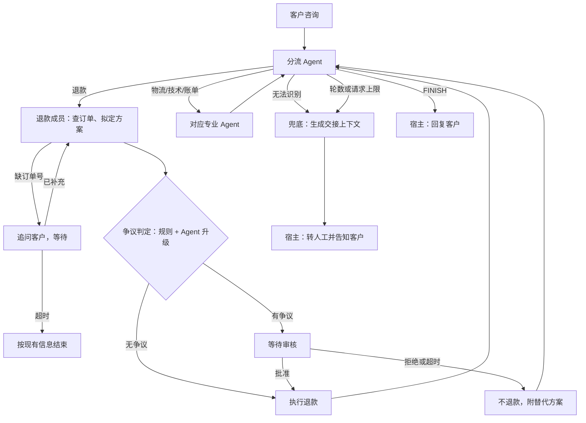

# 客服编排：分流、争议退款审核与转人工

日期：2026-11-05。状态：设计草案，待用户审阅。

## 目标与范围

在 `orchestration/customer-service` 添加可运行案例，演示内部客服服务的第一期流程：分流 Agent 把咨询交给专业 Agent，退款区分无争议直退与有争议人工审核，审核人按组织架构解析，等待超时按拒绝处理，无法处理时转人工并交接结构化上下文。

案例基于 GoAgent 的 `multiagent` 包（设计见 goagent 仓库 `docs/superpowers/specs/2026-11-05-multiagent-patterns-design.md`），本文的业务能力不进入 GoAgent 内核。`multiagent` 发版之前，用 `make work` 生成的 `go.work` 指向 `../goagent` 联调；发版后固定版本。

默认离线运行：脚本化模型、内存组织架构、只记录不发送的通知。飞书适配器用标准库 `net/http` 直接调用开放平台接口，不引入 SDK，显式开启才访问网络。没有真实支付接口，退款写入模拟账本，不转移资金。

本次不做：真实工单系统与 IM 渠道的完整接入、飞书审批（approval）实例流、多租户、跨主机调度的选主与分布式锁、审核界面。

## 业务决定（业务方确认，2026-11-05）

| 事项 | 决定 |
|---|---|
| 退款审批 | 无争议直接退；有争议由人工审核决定是否退。争议由业务配置的确定性规则判定，Agent 只能把“无争议”升级为“有争议”，不能降级 |
| 审核人 | 可配置，按组织架构解析（如提交人的上级、财务人员）；参考飞书通讯录接口，但必须是抽象接口 |
| 等待时限 | 业务配置，默认 48 小时；超时即结束，按拒绝处理并告知客户；追问客户超时则按现有信息结束 |
| 提醒 | 等待临近超时提醒审核人 |
| 转人工 | 渠道取决于 IM 系统；交接上下文包含客户意图与解决方案（可多个） |
| 成本 | 不设业务硬上限，但必须有处理：用量超过阈值提示运营；轮数超限提示客户并转人工 |

## 流程



- 图用 `multiagent.RouterSupervisor` 构造：Supervisor 是分流 Agent，成员是退款、物流、技术、账单，Fallback 是交接 Step。
- 状态类型是案例自定义的 `Ticket`，不用 `Conversation`：退款需要订单、提议、判定等类型化字段。分流结果由分流 Step 的 `out` 写入 `Ticket.Route`，`Next` 读取它；因此不用 `TextNext`，路由经 `RouterSupervisor` 内部的 `GuardRoute` 获得兜底。
- 轮数超限（`ErrMaxSteps`）与 `MaxModelRequests` 防失控上限由宿主捕获后转人工；路由无效走 Fallback。

## 副作用由宿主执行

图在持久恢复时可能重入节点，节点内直接发通知或转人工会重复发送。因此图只负责决定与等待，对外投递全部由宿主在观察到运行状态后执行，并经发件箱（outbox）按稳定键去重：

| 事件 | 触发点 | 去重键 | 宿主动作 |
|---|---|---|---|
| 新的审核等待 | 快照出现 `refund-review` 中断 | 中断键 | 解析审核人，发审核消息，记录首次观察时间 |
| 临近超时 | 首次观察时间 + 时限 − 提醒提前量 | 中断键 + `reminder` | 提醒审核人 |
| 等待超时 | 首次观察时间 + 时限 | 中断键 + `timeout` | 以超时输入回应中断 |
| 运行完成 | 快照 `Done` | 运行 ID + `result` | 把最终回复发给客户 |
| 转人工 | 运行以 Fallback 结束，或捕获超限错误 | 运行 ID + `handoff` | 调用 `Handoff`，告知客户已转人工 |
| 用量超阈值 | `UsageHook` 事件 | 运行 ID + 阈值 | 告警运营 |

唯一在图内执行的副作用是退款本身：退款工具以业务申请 ID 为幂等键写入模拟账本，沿用 `workflow/refund-recovery` 的账本做法，重入时返回原收据。

## 组件与接口

包路径 `orchestration/customer-service/support`（案例内部，不导出到其他案例）。

```go
type Order struct {
    ID            string
    PaidCents     int64
    RefundedCents int64
    Currency      string
    DeliveredAt   time.Time
}

type RefundProposal struct {
    OrderID       string
    AmountCents   int64
    Reason        string
    AgentDisputed bool   // Agent 只能升级为有争议
    AgentNote     string
}

type Verdict struct {
    Disputed bool
    Reasons  []string // 命中的规则与 Agent 的升级理由，展示给审核人
}

// DisputePolicy 必须是订单与提议的确定性函数：节点重入时会再次调用。
type DisputePolicy interface {
    Evaluate(ctx context.Context, order Order, p RefundProposal) (Verdict, error)
}

type User struct{ ID, Name string }

// Directory 是组织架构查询，飞书与内存各一份实现。
type Directory interface {
    Leader(ctx context.Context, userID string) (User, error)
    GroupMembers(ctx context.Context, groupID string) ([]User, error)
}

type ApprovalRequest struct {
    RunID, InterruptKey, Submitter string
    Order                          Order
    Proposal                       RefundProposal
    Verdict                        Verdict
}

type ApproverResolver interface {
    Resolve(ctx context.Context, req ApprovalRequest) ([]User, error)
}

type MessageKind string // approval_request、reminder、customer_result、usage_alert

type Message struct {
    Kind         MessageKind
    Title, Body  string
    RunID        string
    InterruptKey string
}

type Notifier interface {
    Notify(ctx context.Context, to User, m Message) error
}

type Solution struct {
    Title, Detail    string
    RequiresApproval bool
}

type HandoffReason string // invalid_route、max_rounds、max_requests、review_timeout

type HandoffContext struct {
    RunID, CustomerID string
    Intent            string     // 客户意图
    Solutions         []Solution // 已给出或可选的解决方案，可多个
    Reason            HandoffReason
    Summary           string
}

type Handoff interface {
    Transfer(ctx context.Context, h HandoffContext) error
}

type Clock interface{ Now() time.Time }
```

**争议判定**：最终结果为“规则判定 OR Agent 升级”。规则来自配置，第一期支持：金额超过阈值、签收超过天数、累计退款超过支付额的比例、订单已有退款记录。Agent 的 `AgentDisputed` 只能把结果改为有争议，不能把规则判定的争议改回无争议，防止客户输入诱导自动退款。

**审核人解析**：`ApproverResolver` 的通用实现按配置的策略列表依次解析并去重，不写死任何组织：

```yaml
approvers:
  rules:
    - when: { min_amount_cents: 0 }
      strategies: [ { kind: submitter_leader } ]
    - when: { min_amount_cents: 50000 }
      strategies: [ { kind: group, group_id: finance-reviewers } ]
  fallback_user_ids: [ ou_xxx ]   # 解析结果为空时使用
```

策略种类：`submitter_leader`（经 `Directory.Leader`）、`group`（经 `Directory.GroupMembers`）、`fixed`（固定用户）。“提交人”由宿主随工单传入，通常是工单当前负责的客服账号；为空时直接使用 `fallback_user_ids`。

审核结果由宿主校验：回应中断前确认作答人在该中断的已解析审核人列表中；`AwaitInput` 的 validate 只校验输入格式。

**飞书适配器**（`support/feishu`，`net/http` 实现，实现时以飞书开放平台文档核对字段与权限）：
- 令牌：`POST /open-apis/auth/v3/tenant_access_token/internal`，按过期时间缓存；
- 上级：`GET /open-apis/contact/v3/users/:user_id` 读 `leader_user_id`，再取上级信息；
- 组成员：用户组成员列表接口，分页读取；
- 消息：`POST /open-apis/im/v1/messages`，审核消息带运行 ID 与中断键，供回调或命令行回应。
- 开启方式：`FEISHU_APP_ID`、`FEISHU_APP_SECRET`，以及可选的 `FEISHU_BASE_URL`（测试指向 `httptest`）。

## 等待与超时

- 审核中断 `refund-review` 的输入为 `{"approved": bool, "note": string, "approver": string}` 或超时输入 `{"approved": false, "reason": "timeout"}`；追问中断 `order-id` 的输入为 `{"order_id": string}` 或 `{"timeout": true}`。validate 只校验格式。
- 宿主的 `Sweeper` 按周期扫描等待中的运行，用 `Clock` 判断提醒与超时，动作见“副作用由宿主执行”。时限默认 48 小时，提醒提前量默认 4 小时，均可配置。
- 根预算截止时间设为“最长等待时限 + 余量”（默认 48 小时 + 1 小时），否则长时间等待后的续跑会因截止时间失败（见 multiagent 设计“人工等待与截止时间”）。
- 审核超时按拒绝分支结束：不退款，给客户回复并附替代方案（`Solutions`）；追问超时按现有信息结束并回复客户。

## 成本

- `budget.Config.MaxModelRequests` 必须 ≥ 1，设为宽松的防失控上限（默认 40）；触达时与轮数超限一样转人工，`HandoffReason` 为 `max_requests`。
- 用量提示经 `budget.WithUsageHook`：事件含累计统计，超过配置的请求数或 token 阈值时经 `Notifier` 告警运营，流程继续。

## 测试

离线测试使用 goagent 的 `testing/mocks.ScriptedClient`、内存 `Directory`、记录型 `Notifier`/`Handoff` 与可控 `Clock`：

| 路径 | 断言 |
|---|---|
| 无争议直退 | 不出现审核中断；退款执行一次；客户收到结果 |
| 有争议批准 | 出现 `refund-review` 中断，Info 含订单、金额与判定理由；宿主解析出上级与（超阈值时）财务组成员并各发一条审核消息；批准后退款执行一次 |
| 有争议拒绝 | 退款不执行；客户回复含替代方案 |
| Agent 升级争议 | 规则判为无争议、Agent 标记有争议时进入审核 |
| Agent 试图降级 | 规则判为有争议、Agent 未标记时仍进入审核 |
| 临近超时与超时 | 推进时钟到提醒点只提醒一次；到时限后以超时输入回应，按拒绝结束；重复扫描不重复发送 |
| 非审核人作答 | 宿主拒绝回应，运行保持等待 |
| 追问与追问超时 | 缺订单号时等待；补充后继续；超时按现有信息结束 |
| 无法识别与超限 | 分流输出无效时经 Fallback 转人工，`HandoffContext` 含意图与至少一个方案；轮数超限与请求上限分别以对应原因转人工并告知客户 |
| 用量告警 | 超过阈值告警运营一次，流程继续完成 |
| 崩溃恢复 | 退款写入账本后、检查点保存前退出，恢复后不重复退款；发件箱在重启后不重复投递 |
| 审核人解析 | 策略组合、去重、解析为空时用兜底人、`Directory` 出错时报错 |

飞书适配器用 `httptest` 模拟令牌、通讯录与消息接口，覆盖令牌缓存与过期刷新、分页、错误码映射。真实飞书调用不进默认测试。

## 文件与运行

```
orchestration/customer-service/
├── README.md
├── main.go            // 命令行：new、resume、sweep、show
├── graph.go           // Ticket 状态、成员与 RouterSupervisor 装配
├── host.go            // Sweeper、发件箱、审核作答校验
├── support/           // 接口、争议规则、审核人解析、内存实现
└── support/feishu/    // 飞书 Directory 与 Notifier
```

命令行沿用 `workflow/refund-recovery` 的风格：`-dir` 指定持久目录，`new` 新建咨询，`show` 输出等待状态与中断键，`resume` 以审核或追问输入续跑，`sweep` 执行一次超时扫描（可用 `-now` 指定时间演示超时）。

## 顺序与依赖

1. 在 goagent 实现 `multiagent` 与 `testing/mocks.ScriptedClient`；
2. 本案例用 `go.work` 联调，先实现 `support` 与离线测试，再接飞书适配器；
3. goagent 发版后更新 `go.mod`，`make test-remote` 验证。
