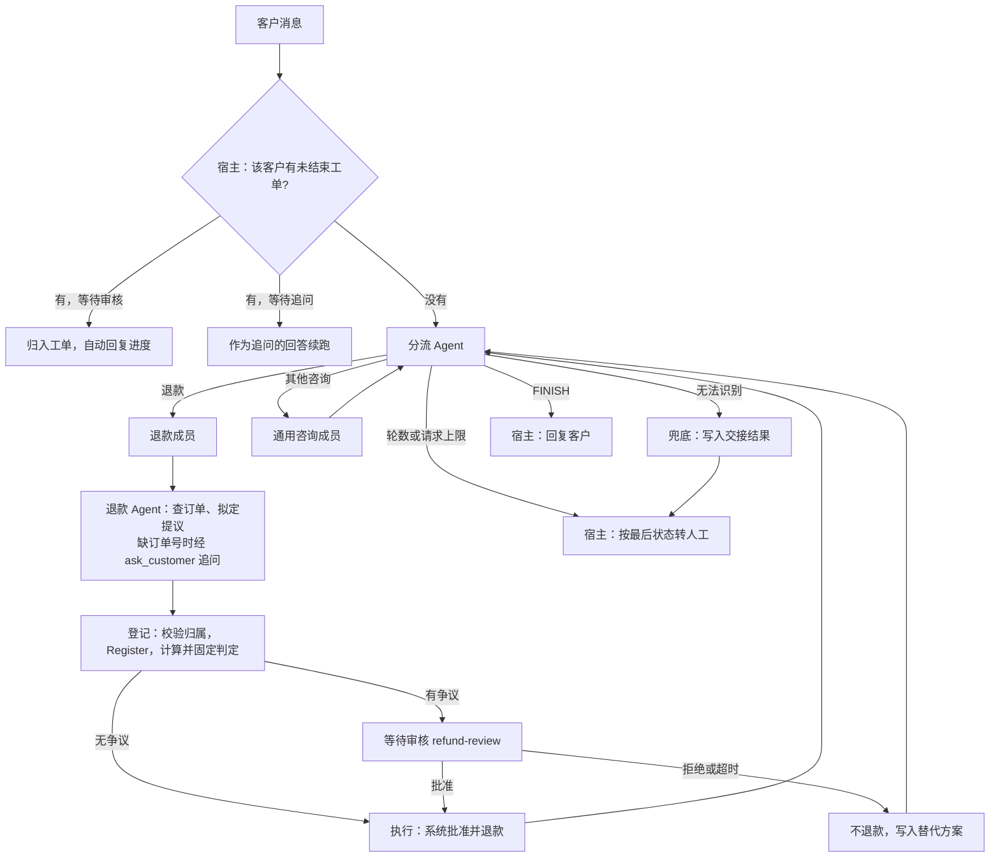

# 客服编排：分流、争议退款审核与转人工

日期：2026-11-05。状态：设计草案，待用户审阅。修订：首轮独立复审（2 项阻断、11 项重要、10 项次要，提交 `3f23300`）。

## 目标与范围

在 `orchestration/customer-service` 添加可运行案例，演示内部客服服务的第一期流程：分流 Agent 把咨询交给退款成员或通用咨询成员；退款区分无争议直退与有争议人工审核；审核人按组织架构解析；等待超时按拒绝处理；无法处理时转人工并交接结构化上下文。

案例基于 GoAgent 的 `multiagent` 包（设计见 goagent 仓库 `docs/superpowers/specs/2026-11-05-multiagent-patterns-design.md`，分支 `feat/multiagent-patterns`）与已有的 `workflow/refund.Service`。本文的业务能力不进入 GoAgent 内核。

默认离线运行：复用仓库已有的脚本化模型 `orchestration/internal/demomodel`（支持结构化工具调用，按请求内容回复并计数），内存组织架构，记录型通知。飞书通讯录用 `net/http` 直接调用开放平台；飞书消息只用 `httptest` 验证，不接真实发送。真实模型调用经 `internal/livemodel` 显式开启，与 flight-booking 案例一致。没有真实支付接口，退款写入模拟账本，不转移资金。

本次不做：真实工单系统与 IM 渠道接入、飞书审批实例流、多租户、跨主机调度的选主与分布式锁、审核界面、按角色逐级审核（业务方选择任一审核人作答即生效）。

### 依赖与合入顺序

本案例依赖 goagent 尚未发版的 `multiagent`。`go.work` 被 `.gitignore` 忽略，CI 按 `go.mod` 固定的 goagent 版本编译，该版本没有 `multiagent`，所以：

1. goagent 实现 `multiagent` 前，本案例只在 `feat/customer-service` 分支上用 `make work` 联调；
2. goagent 发版后执行 `GOWORK=off go get github.com/kart-io/goagent@<版本>`，`make test-remote` 通过后才合入 `main`。

## 业务决定（业务方确认，2026-11-05）

| 事项 | 决定 |
|---|---|
| 退款审批 | 无争议直接退；有争议由人工审核决定是否退。争议由业务配置的确定性规则判定，Agent 只能把“无争议”升级为“有争议”，不能降级 |
| 审核人 | 可配置，按组织架构解析（如提交人的上级、财务人员），抽象接口，不写死；解析出多人时任一人作答即生效 |
| 等待时限 | 业务配置，默认 48 小时；审核超时按拒绝处理并告知客户；追问超时按现有信息结束 |
| 提醒 | 等待临近超时提醒审核人 |
| 等待期间的新消息 | 归入同一工单并自动回复进度；追问期间的消息作为追问的回答；重复的退款申请按业务申请 ID 去重 |
| 转人工 | 渠道取决于 IM 系统；交接上下文包含客户意图与解决方案（可多个） |
| 成本 | 不设业务硬上限，但必须有处理：用量超过阈值提示运营；轮数超限提示客户并转人工 |

## 流程



- 图用 `multiagent.RouterSupervisor` 构造：Supervisor 是分流 Agent，成员是退款成员与通用咨询成员（第一期把物流、技术、账单合成一个通用成员），Fallback 是交接 Step。`MaxRounds` 默认 4。
- 状态是案例自定义的 `Ticket`：

```go
type Ticket struct {
    TicketID, CustomerID, Submitter string
    Input     string
    Turns     []multiagent.Turn
    Route     string     // 分流结果；解析失败时为空，由 Next 返回 ErrInvalidRoute
    Intent    string     // 客户意图，成员持续更新
    Solutions []Solution // 已给出或可选的方案
    Refund    *RefundCase
    Outcome   Outcome    // reply 或 handoff，供宿主决定发什么
}
```

- 分流 Step 的 `out` 只解析、不报错：解析失败时 `Route` 置空，`Next` 返回包装 `multiagent.ErrInvalidRoute` 的错误，经 `RouterSupervisor` 内部的 `GuardRoute` 进入 Fallback。`out` 返回 error 会使节点失败，走不到 Fallback。
- 通用咨询成员是普通 `AgentStep`。

## 退款成员

退款成员是自定义 `Step.Run`，按“提议 → 登记 → 审核 → 执行”分段，资金相关的每段都由持久操作固定，节点重入时回放（与 multiagent 设计 S5 一致）：

1. **提议**：调用退款 Agent（`WithDurableScope("refund-agent")`）。Agent 只有只读工具 `get_order` 与追问工具 `ask_customer`，输出结构化提议 `{order_id, amount_cents, reason, agent_disputed, agent_note}`。缺订单号时 Agent 调用 `ask_customer`。
2. **登记**：`durable.Do(ctx, "refund/register", intent, policy, run)`，`run` 依次：
   - 校验订单属于 `Ticket.CustomerID`（案例订单仓储的 `Owner(orderID)`），不属于则返回业务拒绝写入状态，不登记；
   - 生成业务申请 ID：`sha256(CustomerID + "/" + OrderID + "/" + AmountCents)` 截断，同一客户对同一订单的重复申请（含重复咨询、并行工具调用）落到同一 ID，由 `refund.Service.Register` 去重；
   - `ValidUntil` 由宿主时钟生成：登记时间 + 审核时限 + 1 小时；
   - 调用 `Register` 固定订单事实与版本；
   - 计算争议判定并写入案例的 `refund_verdicts` 表（以申请 ID 为主键，只插入一次）。
   `policy.Reconcile` 按申请 ID 查已登记的申请与判定，存在则补记完成。判定随操作记录固定，等待期间订单事实或规则变化不会改变它。
3. **审核**（仅有争议）：`durable.AwaitInput(ctx, "refund-review", info, validate)`。`info` 为 `{request_id, order_id, amount_cents, currency, submitter, reasons}`；输入为 `{"approved": bool, "note": string, "approver": string}` 或超时输入 `{"approved": false, "reason": "timeout"}`。输入由宿主在认证作答人之后构造（见“宿主”），`approver` 是宿主认证出的主体 ID，不是作答人自填。validate 只校验格式。
4. **执行**（无争议，或审核批准）：`durable.Do(ctx, "refund/execute", intent, policy, run)`，`run` 调用 `Approve(req, actor)` 后调用 `Refund(execKey, req)`。无争议时 `actor` 为系统主体 `system:auto-policy`。
   - `policy` 为 `{MaxAttempts: 3, RetryInterrupted: true, Reconcile}`，`Reconcile` 按申请 ID 查回执，存在则补记完成；`Refund` 本身按申请 ID 幂等，先返回已提交回执。
   - 案例账本的 `Approve` 必须对同一申请 ID 与主体幂等（重复执行只覆盖相同值）；不同主体再次批准时报错。
   - `Authorizer` 规则：`system:auto-policy` 只能批准判定为无争议的申请（查 `refund_verdicts`）；人工主体必须在该申请已持久化的审核人名单中（见“宿主”）。
5. 拒绝或超时时不执行退款，写入替代方案到 `Ticket.Solutions`，交 Agent 回复客户。

### 争议判定

结果为“规则判定 OR Agent 升级”，在登记操作内计算一次：

| 规则 | 有争议的条件 |
|---|---|
| 金额阈值 | `AmountCents` 超过配置阈值 |
| 签收天数 | 签收超过配置天数 |
| 累计退款 | 该订单已退金额加本次超过支付额的配置比例 |
| 同单多申请 | 该订单在本申请之前已有其他已登记的申请（任何状态） |

“同单多申请”按登记顺序判断：账本按订单串行化登记（`refund.Store` 的要求），登记顺序固定，所以判定稳定，并发拆单时只有最先登记的一笔可能自动通过。Agent 的 `agent_disputed` 只能把结果改为有争议；规则判为有争议时 Agent 未标记也进入审核。判定记录规则配置的版本号，修改规则须提升版本，旧版本的未结束运行按“版本与迁移”继续用旧规则（见 multiagent 设计）。

## 组件与接口

包路径 `orchestration/customer-service/support`。

```go
type DisputeRules struct {
    Version            string
    MaxAutoAmountCents int64
    MaxDeliveryDays    int
    MaxRefundRatio     float64
}

type Verdict struct {
    Disputed    bool
    Reasons     []string
    RuleVersion string
}

type User struct{ ID, Name string }

// Directory 是组织架构查询。found 为 false 表示没有上级。
type Directory interface {
    Leader(ctx context.Context, userID string) (leader User, found bool, err error)
    GroupMembers(ctx context.Context, groupID string) ([]User, error)
}

type ApprovalRequest struct {
    RequestID, Submitter string
    AmountCents          int64
    Verdict              Verdict
}

type ApproverResolver interface {
    Resolve(ctx context.Context, req ApprovalRequest) ([]User, error)
}

type MessageKind string // approval_request、reminder、customer_reply、customer_question、progress、handoff_notice、usage_alert

type Message struct {
    Kind           MessageKind
    IdempotencyKey string // 发件箱键，飞书实现映射为消息接口的 uuid
    Title, Body    string
}

type Notifier interface {
    Notify(ctx context.Context, to User, m Message) error
}

type Solution struct {
    Title, Detail    string
    RequiresApproval bool
}

type HandoffReason string // invalid_route、max_rounds、max_requests

type HandoffContext struct {
    TicketID, CustomerID string
    Intent               string
    Solutions            []Solution
    Reason               HandoffReason
    Summary              string
}

type Handoff interface {
    Transfer(ctx context.Context, idempotencyKey string, h HandoffContext) error
}

type Clock interface{ Now() time.Time }
```

**审核人解析**：通用实现按配置的规则依次解析、去重；配置用 JSON（不新增 YAML 依赖）：

```json
{
  "approvers": {
    "rules": [
      {"min_amount_cents": 0,     "strategies": [{"kind": "submitter_leader"}]},
      {"min_amount_cents": 50000, "strategies": [{"kind": "group", "group_id": "finance-reviewers"}]}
    ],
    "fallback_user_ids": ["ou_xxx"]
  }
}
```

- 策略：`submitter_leader`（`Directory.Leader`）、`group`（`Directory.GroupMembers`）、`fixed`（固定用户）。提交人为空或没有上级时只跳过 `submitter_leader`，其余策略照常；结果为空时用 `fallback_user_ids`。
- “提交人”由宿主随工单传入，通常是工单当前负责的客服账号。
- 解析出多人时任一人作答即生效（业务方决定）。解析为空且无兜底人、或 `Directory` 出错时，告警运营，下次扫描重试，运行保持等待。

**飞书通讯录**（`support/feishu`，`net/http`）：
- 令牌：`POST /open-apis/auth/v3/tenant_access_token/internal`，按过期时间缓存并提前刷新（请求与响应字段实现时以开放平台文档逐字核对）；
- 上级：`GET /open-apis/contact/v3/users/:user_id` 读 `leader_user_id`，需要字段权限 `contact:user.department:readonly`；为空表示没有上级；
- 用户组成员：成员列表接口只返回 `member_id` 与 `member_type`，可能含部门；第一期只取用户成员，部门成员忽略并记录；用户名另行查询；分页读取；
- 应用需开通通讯录读取权限，通讯录权限范围须覆盖被查询的用户与用户组；
- 开启方式：`FEISHU_APP_ID`、`FEISHU_APP_SECRET`，可选 `FEISHU_BASE_URL`。

**飞书消息**：只实现到 `httptest` 验证：`POST /open-apis/im/v1/messages`，`receive_id_type` 必填，`uuid` 取 `Message.IdempotencyKey`；应用需开启机器人并让接收人在可用范围内。不接真实发送。

## 宿主

宿主负责一切对外投递、超时与作答认证。图只决定与等待，因为持久恢复时节点会重入，节点内发消息会重复。

### 工单登记表与发件箱

与退款账本共用一个 SQLite 库（沿用 refund-recovery 的即时写事务）：

- `tickets`：工单 ID、客户 ID、运行 ID、状态（running、waiting_review、waiting_customer、done、handoff、delivered）、首次进入等待的时间、等待的中断键。`durable.Store` 不能枚举运行（`core/durable/runner.go:57-62`），所以由这张表充当运行索引。
- `review_approvers`：申请 ID 与解析出的审核人名单，首次观察到审核等待时写入一次，之后作答校验与 `Authorizer` 都读它。
- `outbox`：幂等键、接收人、消息、状态、尝试次数。投递为至少一次，接收方按幂等键去重。

### 事件与动作

| 事件 | 触发 | 幂等键 | 动作 |
|---|---|---|---|
| 进入审核等待 | 快照出现 `refund-review` 中断 | 中断键 | 解析审核人写入 `review_approvers`，向每人发审核消息，记录等待开始时间 |
| 审核临近超时 | 等待开始 + 审核时限 − 提醒提前量 | 中断键 + `reminder` | 提醒审核人 |
| 审核超时 | 等待开始 + 审核时限 | 中断键 + `timeout` | 以超时输入回应中断 |
| 进入追问等待 | 快照出现 `ask_customer` 中断 | 中断键 | 把问题发给客户 |
| 追问超时 | 等待开始 + 追问时限 | 中断键 + `timeout` | 以 `{"timeout": true}` 回应，按现有信息结束 |
| 等待期间客户来消息 | 工单为 waiting_review | 消息 ID | 消息记入工单，自动回复进度与预计时间 |
| 追问期间客户来消息 | 工单为 waiting_customer | 消息 ID | 以该消息回应追问中断并续跑 |
| 运行结束 | 快照 `Done` | 工单 ID + `final` | 按 `Outcome` 只发一条：`reply` 回复客户；`handoff` 调用 `Handoff` 并告知客户已转人工 |
| 超限 | 运行返回 `ErrMaxSteps` 或请求上限错误 | 工单 ID + `final` | 读最后快照的 `Ticket`，按 `max_rounds` 或 `max_requests` 构造交接上下文转人工，告知客户 |
| 用量超阈值 | `UsageHook` 事件，或扫描时读根预算统计补偿 | 工单 ID + 阈值 | 告警运营一次 |

- 等待时限可配置：审核默认 48 小时，追问默认 48 小时，提醒提前量默认 4 小时。
- `Sweeper` 按周期扫描 `tickets` 中 waiting、done 未投递、handoff 未投递的记录与 `outbox` 中未完成的消息；时间取自 `Clock`，测试推进时钟。
- 审核作答：宿主认证作答人（飞书回调或命令行传入主体），确认其在 `review_approvers` 中，再以该主体构造输入回应中断。作答与超时并发时，后到者收到 `workflow.ErrInterruptAnswered`，宿主按“已有结果”处理并告知后到的审核人。
- 用量告警的 `UsageHook` 不是持久投递，`Sweeper` 另读根预算的累计统计补偿，按幂等键去重。

## 预算与等待

- 不设 `DeadlineUnixMilli`：一个运行可能经历追问与审核两次等待，截止时间难以覆盖，且必须在运行生命周期内不变（见 multiagent 设计“人工等待与截止时间”）。等待时长由 `Sweeper` 的时限控制。
- `MaxModelRequests` 设为宽松的防失控上限（默认 40），触达时按“超限”转人工。
- 退款的有效期由 `refund.Request.ValidUntil` 控制（登记时间 + 审核时限 + 1 小时），过期后批准会被 `refund.Service` 拒绝。

## 测试

离线测试用 `demomodel`、内存 `Directory`、记录型 `Notifier`/`Handoff`、可控 `Clock` 与临时 SQLite：

| 路径 | 断言 |
|---|---|
| 无争议直退 | 不出现审核中断；系统主体批准；退款一次；只发一条客户回复 |
| 有争议批准 | 出现 `refund-review` 中断，Info 含订单、金额与判定理由；上级与（超阈值时）财务组成员各收到一条审核消息；任一人批准后退款一次 |
| 有争议拒绝与超时 | 退款不执行；回复含替代方案；超时由 `Sweeper` 推进时钟触发 |
| Agent 升级与降级 | 规则无争议、Agent 标记有争议时进入审核；规则有争议、Agent 未标记时仍进入审核 |
| 判定固定 | 等待期间修改订单事实或规则阈值后续跑，判定不变 |
| 并发拆单 | 同一订单两笔并发登记，只有先登记者可能自动通过，后者进入审核 |
| 重复申请 | 同一客户对同一订单金额的重复咨询得到同一申请 ID，不新增登记 |
| 订单归属 | 订单不属于该客户时不登记、不退款，回复客户 |
| 非审核人作答 | 宿主拒绝回应，运行保持等待 |
| 作答与超时并发 | 后到者收到 `ErrInterruptAnswered`，结果以先到者为准 |
| 追问 | 缺订单号时发问题给客户；客户回复后续跑；追问超时按现有信息结束 |
| 等待期间新消息 | 审核等待中自动回复进度，不新开运行 |
| 转人工 | 分流无效经 Fallback；轮数超限与请求上限由宿主捕获；`HandoffContext` 含意图与至少一个方案；每种只发一条最终消息 |
| 用量告警 | 超阈值告警一次；关闭 `UsageHook` 后由扫描补偿 |
| 崩溃恢复 | 回执写入后、执行操作记录仍为 pending 时退出，恢复经 `Reconcile` 补记，不重复退款；登记写入后、登记操作仍为 pending 时退出，恢复经 `Reconcile` 补记；`Sweeper` 重启后不重复投递 |
| 审核人解析 | 策略组合与去重；没有上级时只跳过该策略；结果为空用兜底人；`Directory` 出错时告警并保持等待 |
| 飞书适配器 | `httptest` 覆盖令牌缓存与刷新、`leader_user_id` 为空、用户组分页与非用户成员、消息 `uuid` 与 `receive_id_type`、错误码映射 |

真实模型的手动验证沿用 flight-booking 的开关方式，不进入默认测试。

## 文件与运行

```
orchestration/customer-service/
├── README.md
├── main.go          // 命令行：message、answer、sweep、show
├── graph.go         // Ticket、分流、通用成员、Fallback 与 RouterSupervisor 装配
├── refund.go        // 退款成员：提议、登记、审核、执行
├── host.go          // 工单登记表、发件箱、Sweeper、作答认证
├── ledger.go        // SQLite：refund.Store、判定表、工单与发件箱
├── support/         // 接口、争议规则、审核人解析、内存实现
└── support/feishu/  // 飞书通讯录与消息（消息仅 httptest）
```

命令行沿用 refund-recovery 的风格：`-dir` 指定持久目录；`message -customer -text` 投递一条客户消息（新建或归入工单）；`show` 输出工单状态与中断键；`answer -ticket -approver -approve|-reject` 以认证后的主体作答；`sweep -now` 执行一次扫描（可指定时间演示超时）。
