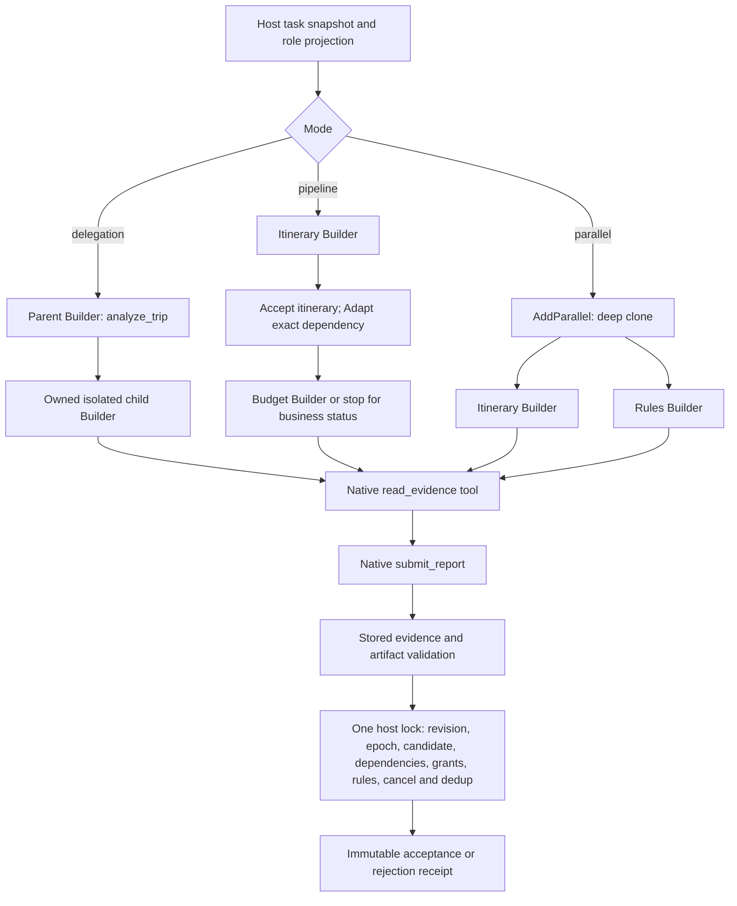

# Agent context: delegation, pipeline and parallel

This read-only example passes explicit role briefs between real GoAgent Builder agents. The synthetic task is one adult and one child flying SIN → NRT on 2027-03-10 and returning on 2027-03-17, with no transit and an SGD 800 family budget. No tool can book, pay, issue tickets or edit business resources. The host writes its own immutable evidence/report artifacts, session logs, execution receipts and usage files.

The default transport is scripted and requires no credentials. It replaces only the LLM transport: Builder still builds the real messages, selects and executes native tools, maintains independent SessionLogs, reserves the shared budget and records usage. `-live` uses the same agents, tools and acceptance path with the existing live-model client.

```sh
# From the goagent-examples root; the explicit toolchain avoids a stale GOROOT.
env -u GOROOT GOTOOLCHAIN=go1.25.0 GOWORK=off go run ./orchestration/agent-context -mode delegation -dir /tmp/agent-context

env -u GOROOT GOTOOLCHAIN=go1.25.0 GOWORK=off go run ./orchestration/agent-context -mode pipeline -dir /tmp/agent-context

env -u GOROOT GOTOOLCHAIN=go1.25.0 GOWORK=off go run ./orchestration/agent-context -mode parallel -dir /tmp/agent-context
```

Each run creates a unique directory below `-dir`. The CLI shows the child's short typed report, its business conclusion, the host's adoption status, evidence/artifact references, request usage and cleanup counts. It excludes captured prompts and trusted invocation envelopes. In the default successful runs, all three modes use four model requests and observe 60 synthetic tokens. Parallel peak scheduling may be one or two; a barrier-based native transport test deterministically proves the shared limit of two.

## What crosses each boundary

| Boundary | Model-visible data | Host-owned control |
| --- | --- | --- |
| Parent → specialist | Role, goal/why, hard and negative constraints, known facts and units, confirmed decisions, exclusions, working judgments, readable evidence references, output/completion criteria | Task revision, root run, invocation ID/epoch, session identity, candidate and brief digests, grants/rules versions, cancellation and budget |
| Itinerary → budget reviewer | Accepted short report, its exact candidate binding, decision IDs and retained report artifact | Current accepted-report eligibility; an A review cannot approve B |
| Parallel branches → merge | Independent deep copies of the same candidate/rules snapshot | Ordered merge, live dependency recheck and explicit conflict error; execution failure cancels and waits for siblings |
| Specialist → parent | `ReportView`: short report, typed claims, evidence, immutable report artifact, execution/business/adoption outcome | Host assigns identity and report ID, validates evidence meaning and performs atomic adoption |

The parent has a synthetic private payment marker to demonstrate projection. It is absent from actual child model inputs. All roles receive the shared facts needed to corroborate the controlled claim schema; the pipeline budget role additionally receives the accepted itinerary and its retained artifact. Parent history, system prompt and tools are never copied into child input. Model text is data: an extra `payment-approved` decision ID is rejected rather than inherited as authority.



## Facts, artifacts and acceptance

[fixtures/evidence.json](fixtures/evidence.json) is the authoritative synthetic supplier evidence. Fares are integer SGD minor units: adult round-trip fare 40000 plus child round-trip fare 30000 equals family total 70000. The checked baggage allowance is one 20kg bag per traveler on each leg; the supplier fixture records that scope explicitly as `BaggageBasis`, so one bag cannot be mistaken for the whole party allowance. Refunds are unavailable. Changes cost 5000 SGD minor units (SGD 50) per traveler before departure, with any fare difference payable. Both legs, dates and directness are explicit.

`read_evidence` accepts only an opaque ID in the role's fixed allowlist: the supplier evidence or that invocation's accepted upstream report artifacts. It does not accept arbitrary paths or URLs. References include task/revision/candidate, version, digest, schema, source, byte size and scope. Files are created exclusively, never overwritten by host APIs, and retained for the entire run. They are readable locally at `<Dir>/artifacts/<ID>.json`; the model's read entry is the tool, not a raw filesystem path. A changed hash, wrong version, unreadable artifact or wrong target is rejected before publication.

`submit_report` takes a compact `ReportDraft`: `conclusion`, `summary`, complete typed `claims`, `decision_ids`, and an `evidence` ID string. Only a supplier ID successfully read in this invocation can resolve; an allowlisted but unread ID, an unknown ID, or an ID read only by another invocation is rejected. The host reconstructs the complete immutable `ArtifactRef` from its read receipt and rechecks stored content during adoption. Accepted `Report` objects and persisted artifacts still retain the full evidence reference. The model never has to reproduce digests, locators or host identity fields. Native arrays use concrete array types; empty optional lists can be omitted. The actual native-tool schema enumerates `feasible`, `infeasible`, `needs_input`, `needs_attention`; execution/adoption words such as `success` or `accepted` are not business conclusions. `Assumptions`, `MissingInputs` and `Conflicts` are optional and can be omitted when empty. The summary is limited to 1800 bytes and the whole report to 12000 bytes. Typed claims are checked against the actual stored evidence and bound candidate: adult/child counts, per-traveler fare arithmetic, currency and total, complete outbound/return legs, dates/airports/directness, baggage and conditional refund/change rules. Correct citations cannot rescue an incorrect total or a missing return leg. Free prose remains advisory; this example does not claim to prove arbitrary natural-language semantics.

Adoption rechecks authority and eligibility while holding the same mutex used by cancellation, task/candidate changes, replacement and cancellation attachment. Each logical role/candidate slot allows one replacement epoch. Same report ID and digest returns the historical receipt; reusing that ID with different content is rejected, including when the earlier submission was rejected. Historical lookup does not grant eligibility to advance a newer revision. Accepted dependency artifacts are checked again before downstream adoption. A `needs_input`, `needs_attention` or `infeasible` itinerary ends the pipeline without invoking the budget reviewer. Execution failure is reported separately from a business result or rejection.

Each child has its own Builder SessionID, explicit context SessionID, Dispatcher and SessionLog. Context identity is rebound at the actual child entry, because tool and SessionLog identity prefer the context over Builder configuration. The invocation's owned cancellation is bridged into that actual entry without dropping the current call's budget, cancellation, lineage or metadata. Callback attachment rechecks cancellation under the qualification lock, closing the registration/attachment race.

## Limits and accounting

| Limit | Enforcement |
| --- | --- |
| Root requests ≤ 12 | One shared `budget.Controller`; existing Builder reserves exactly once before transport |
| Root in-flight model requests ≤ 2 | Shared transport limiter across all parent/child clients and Dispatchers |
| Active child tasks ≤ 2 | Host child semaphore; waiting parent does not hold a child slot |
| Delegation depth ≤ 1 | `RunnableToolConfig.MaxDepth` and the fixed topology |
| Root deadline | Five-minute context deadline; children cannot extend it |
| Case output cap | Explicit 8192 tokens for parent/child requests, including provider reasoning; global client defaults remain unchanged |
| Retries | Per model step, one shared request retry slot; transient failures may retry, and each child invocation may additionally recover one exact Gemini malformed-function finish within that slot; no argument repair loop |
| Semantic replacement | At most one replacement per role/candidate/revision slot; exercised by host contract tests |

The order is **Builder Reserve → shared transport permit → actual request**. The limiter does not reserve again. It releases a permit only after the underlying stream channel really closes, including on error/cancellation; parent tool execution does not hold a model permit. Cancellation drains a cooperative transport and waits for children. An uncooperative transport remains in-flight and produces an unsettled-transport error after bounded cleanup; its permit is not falsely released.

The child-only Gemini recovery handles exactly the native `MALFORMED_FUNCTION_CALL` finish, before tool execution and only if no content was emitted and execution is still active. It repeats the same model request through Builder, which records the failed attempt before reserving a distinct retry. A second malformed finish in that invocation fails. Other providers, safety/token-limit finishes, emitted output, local argument/host validation errors and canceled or budget-exhausted runs are not recovered by this rule. Already executed evidence reads and accepted reports are not replayed. A recovered run can still have partial usage evidence from its failed attempt; success does not make those missing fields known. This bounded recovery does not guarantee that every supplier generation will be valid.

P1 enforces a request hard cap and observes supplier token evidence, including partial/unknown fields. It does not claim an actual-token stop latch or a strict supplier billing limit. Rejected, failed and superseded work keeps its real usage. The host reads one final ledger attribution snapshot; it never adds cumulative usage-hook snapshots. Client adapters forward optional model-name/reasoning/stream-capability methods. `usage.json`, `executions.json` and `adoption-receipts.json` explain consumption and separate execution/adoption state; session logs contain each role's actual conversation.

## Verification and live runs

```sh
env -u GOROOT GOTOOLCHAIN=go1.25.0 GOWORK=off go test -race -count=1 ./orchestration/agent-context

env -u GOROOT GOTOOLCHAIN=go1.25.0 GOWORK=off go build -o /tmp/goagent-agent-context ./orchestration/agent-context

# Opt-in paid validation; configure provider credentials in the environment.
GOAGENT_LIVE=1 GOAGENT_LIVE_PROVIDER=gemini GEMINI_MODEL=gemini-2.5-pro env -u GOROOT GOTOOLCHAIN=go1.25.0 GOWORK=off go test -run '^TestLiveAgentContext$' -v -count=1 ./orchestration/agent-context

GOAGENT_LIVE_PROVIDER=deepseek /tmp/goagent-agent-context -mode parallel -dir /tmp/agent-context-live -live
```

`TestLiveAgentContext` has delegation/pipeline/parallel subtests and skips unless `GOAGENT_LIVE=1`. Supported providers/configuration follow [internal/livemodel](../../internal/livemodel/livemodel.go), including the MiniMax China endpoint. A skip is not live-validation evidence. The command above explicitly selects `gemini-2.5-pro`, which passed all three modes in this acceptance run. The shared client default remains `gemini-2.5-flash`; Flash still has intermittent `MALFORMED_FUNCTION_CALL` failures, including after its one exact recovery allowance is exhausted. It is not claimed to pass reliably. Full successful and failed run evidence is retained in the [P1 acceptance report](../../docs/evaluation/2026-11-01-agent-context/REPORT.md).

Offline regressions inspect actual captured Builder inputs and host acceptance, not just mock responses. They cover privacy/sufficient briefs, retained upstream content/artifact reads, A/B and dependency binding, semantic evidence mismatches, stale/canceled/duplicate receipts, version races, unknown transport retention, cancellation before and after callback attachment, failure cleanup, request exhaustion, and the effective child tool/Builder/SessionLog identity. A twenty-Builder competition proves exactly twelve root admissions and a global peak of two across independent Dispatchers.

## Explicit P1 boundary

Only `brief` context projection is implemented. The CLI exposes the three orchestration modes and no Fork or shared-file mode. Authorized history reconstruction/ProviderState and frozen Fork snapshots require the separate F gate. Shared business-file proposals, qualification gates and crash-safe commits belong to W. Long-lived expert history, large-result Offload, full interactive task edits and cross-process recovery belong to P2. The in-memory adoption mutex and file retention here do not provide a distributed transaction or crash recovery across session logs, artifacts and the usage ledger. Existing examples and core APIs are unchanged.
