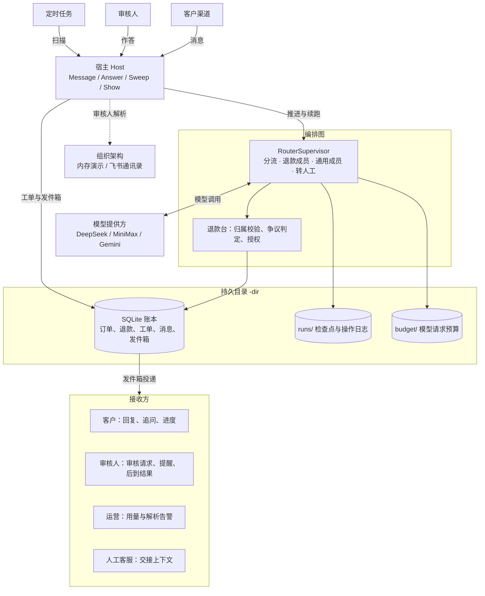
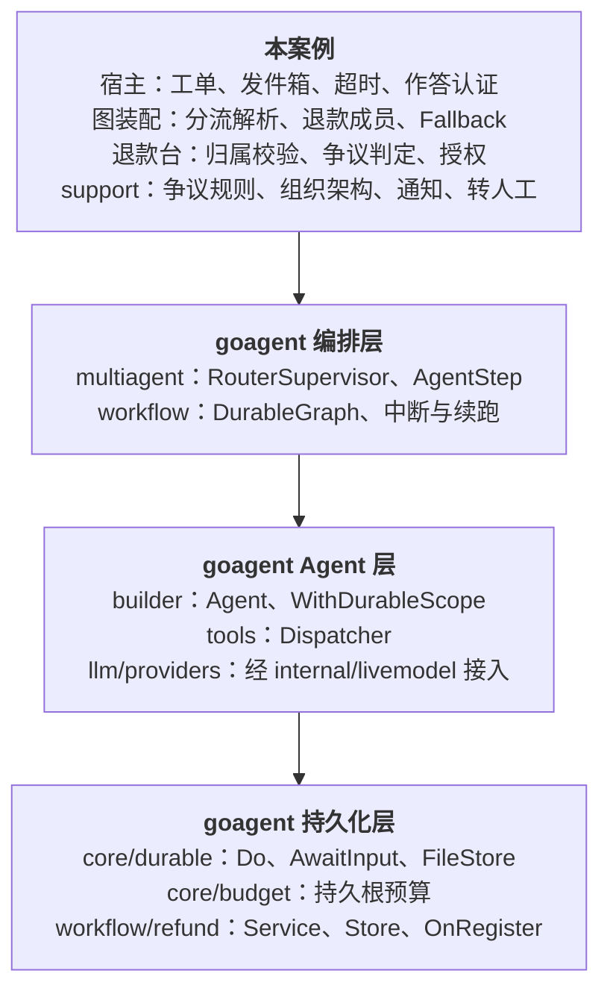
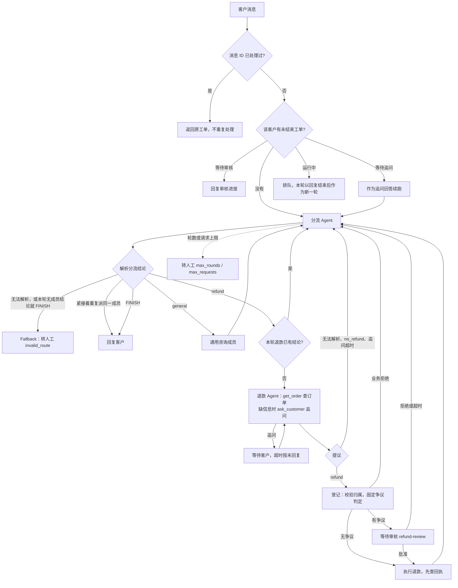
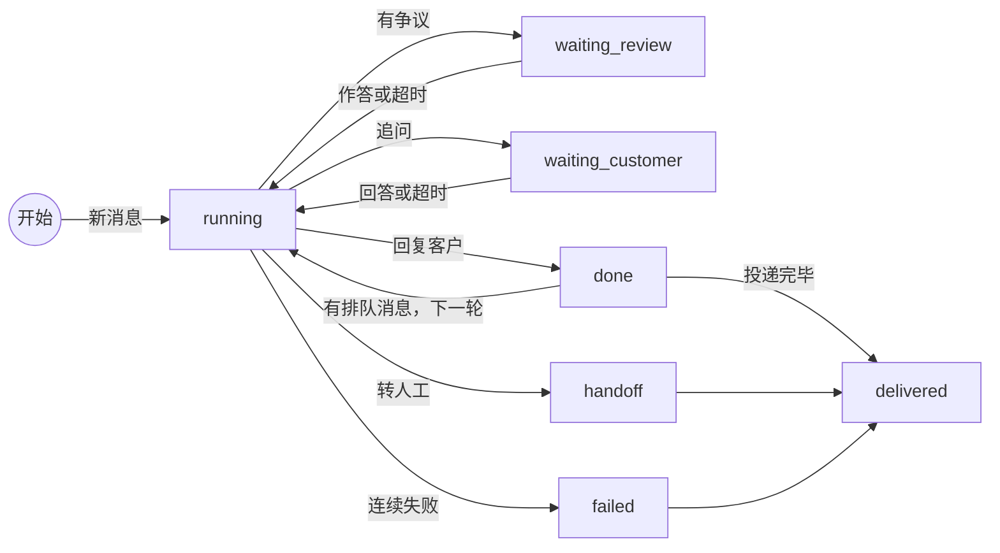

# 客服编排：分流、争议退款审核与转人工

内部客服服务第一期流程的可运行案例：分流 Agent 把咨询交给退款成员或通用咨询成员；退款区分无争议直退与有争议人工审核；审核人按组织架构解析；等待超时按拒绝处理；无法处理时转人工并交接结构化上下文。设计见 [客服编排设计](../../docs/superpowers/specs/2026-11-05-customer-service-design.md)。

默认离线运行：脚本化模型（`orchestration/internal/demomodel`）、内存组织架构、打印型通知。退款写入本地 SQLite 模拟账本，不转移资金；没有真实支付、工单系统或 IM 接入。

## 依赖

本案例使用 goagent 的 `multiagent` 包与 `refund.Service.OnRegister`（v0.48.0 起），以及 Gemini 3 工具调用回放修复（v0.48.1）；`go.mod` 固定为 v0.49.0。按 `go.mod` 运行：

```bash
make test-remote   # GOWORK=off go test -race ./...
```

与本地 goagent 联调时用 `make work` 生成 `go.work`（指向 `../goagent`，已被 `.gitignore` 忽略）。

## 职责划分

| 部分 | 负责 |
|---|---|
| 图（`graph.go`） | `multiagent.RouterSupervisor`：分流 Agent 为 Supervisor，成员为退款与通用咨询，Fallback 为转人工；`MaxRounds` 为 4 |
| 退款成员（`refund.go`） | 提议 → 登记（`refund/register`，固定判定）→ 有争议时等待 `refund-review` → 执行（`refund/execute`，先查回执） |
| 退款台（`desk.go`） | 订单归属校验、业务申请 ID、经 `refund.Service.OnRegister` 同事务写入判定与登记序号、授权规则 |
| 账本（`ledger.go`） | SQLite：`refund.Store`、判定与序号、工单表、消息、发件箱、审核人名单、事件 |
| 宿主（`host.go`、`sweeper.go`） | 一切对外投递、超时与作答认证；节点只做决定与等待，因为持久恢复时节点会重入 |
| 业务接口（`support/`） | 争议规则、组织架构、审核人解析、通知、转人工与时钟；`support/feishu` 是飞书实现 |

## 架构

### 系统架构

宿主是唯一对外的边界：客户消息、审核作答与定时扫描都进入宿主；对外消息先写入账本中的发件箱，再由宿主按幂等键投递。



### 框架

案例只写业务与宿主，编排、Agent、持久化、预算与退款状态机都用 goagent 的组件。



| 本案例 | 使用的 goagent 组件 |
|---|---|
| 宿主 | `workflow.DurableGraph` 推进与续跑，`durable.InterruptAnswer` 读取已固定的回答，`budget` 持久根预算（RootKey 即运行 ID） |
| 图装配 | `multiagent.RouterSupervisor`、`AgentStep`、`ErrInvalidRoute` 进入 Fallback |
| 成员 Agent | `builder` 带 `WithDurableScope` 回放模型调用；`tools.Dispatcher` 开启 `ReturnArgumentErrors`，工具参数错误交还模型 |
| 退款成员 | `durable.Do` 固定登记与执行，`durable.AwaitInput` 等待审核与追问 |
| 退款台 | `refund.Service` 申请状态机，`OnRegister` 同事务写入判定，SQLite 实现 `refund.Store` |

### 一条消息的处理流程



### 工单状态



`running` 超过 `StaleAfter` 没有进展时由扫描重推；连续失败按 `run_failed` 转人工，状态记为 `failed`。

## 运行

```bash
cs() { go run ./orchestration/customer-service "$@"; }
DIR=$(mktemp -d)

# 有争议退款：金额超过自动退款上限，进入审核，上级与财务组各收到一条审核消息
cs message -dir $DIR -now 2026-11-05T08:00:00Z -id m1 -customer c-1001 -text "订单 A1002 申请退款 800 元"
cs show -dir $DIR -ticket tk-m1
cs answer -dir $DIR -now 2026-11-05T09:00:00Z -ticket tk-m1 -approver fin-1 -approve -note 核实无误

# 缺订单号时追问，客户的下一条消息作为回答
cs message -dir $DIR -now 2026-11-05T10:00:00Z -id m2 -customer c-1001 -text "我要退款 30 元"
cs message -dir $DIR -now 2026-11-05T10:01:00Z -id m3 -customer c-1001 -text "订单号 A1001"

# Agent 升级为有争议，审核超时按拒绝处理
cs message -dir $DIR -now 2026-11-05T11:00:00Z -id m4 -customer c-2002 -text "订单 A2001 申请退款 30 元，我要投诉"
cs sweep -dir $DIR -now 2026-11-07T11:00:00Z
```

每条命令打印投递的通知（`"event":"notify"`）与转人工（`"event":"handoff"`），最后一个 JSON 是命令结果。`answer -approver` 传入的主体视为已认证，仅供演示，不是真实认证。`-approvers` 可指定审核人配置文件，格式同 `support.DefaultApproverConfig`。

`answer` 在审核回答尚未固定、工单暂处 running 或 waiting_customer 时返回“审核暂不可作答，请稍后重试”（`ErrReviewNotReady`），不会发通知，稍后重试即可。`sweep` 会重新推进“审核回答已固定但工单仍停在等待审核”的工单（超过 `StaleAfter` 后，计入 `advanced`），不再提醒或按超时处理。

离线脚本只认以下说法：

| 说法包含 | 行为 |
|---|---|
| 订单号 `A1001`/`A1002`/`A1003`/`A2001` 与“N 元” | 查询订单后按金额提议退款；没有金额时按支付额 |
| “退款”但没有订单号 | 经 `ask_customer` 追问订单号 |
| “投诉” | Agent 标记有争议 |
| “直接结束” | 分流不派成员就以 FINISH 自行答复（模拟提示注入），按无效分流转人工 |
| “再派退款” | 退款有结论后分流再派回一次退款，退款成员直接返回已有结论，不重新登记或审核 |
| “漏参数” | 第一次查订单漏掉 `order_id`，参数错误交还模型改正后照常退款 |
| “问原因” | 查到订单后追问退款原因；追问超时时即使模型仍提议退款也不登记 |
| “不用退” / “胡乱提议” | 提议 `no_refund` / 无法解析的提议，不登记 |
| “乱码” | 分流输出无效，经 Fallback 转人工 |
| “反复咨询” | 在通用与退款成员之间来回分派，轮数超限转人工 |
| “一直派通用” | 通用成员答复后分流又派回通用成员，按结束处理并用分流的回复 |
| 其他 | 通用咨询答复 |

演示订单：`A1001`（客户 `c-1001`，99 元，签收 3 天）、`A1002`（`c-1001`，2000 元）、`A1003`（`c-1001`，99 元，签收 20 天）、`A2001`（`c-2002`，99 元）。默认规则：超过 500 元、签收超过 7 天、累计退款超过支付额的 80%、同一订单已有其他申请时有争议。

## 飞书

设置 `FEISHU_APP_ID`、`FEISHU_APP_SECRET`（可选 `FEISHU_BASE_URL`）后，审核人解析改用飞书通讯录：上级读 `leader_user_id`（需要字段权限 `contact:user.department:readonly`），用户组成员分页读取，只取用户成员。应用需开通通讯录读取权限，通讯录权限范围须覆盖被查询的用户与用户组。飞书消息只用 `httptest` 验证，命令行仍打印通知，不接真实发送。

## 真实模型

```bash
GOAGENT_LIVE=1 DEEPSEEK_API_KEY=... go test -run TestLiveRefundTriage -v ./orchestration/customer-service
cs message -dir $DIR -live -customer c-1001 -text "订单 A1001 申请退款 30 元"
```

`-live` 与 `GOAGENT_LIVE=1` 都会产生费用，业务仍为模拟；提供方与模型见 `internal/livemodel`。离线回归、命令行演练与 7 个模型的实测结果及据此修复的问题见[验证报告](../../docs/evaluation/2026-11-05-customer-service/REPORT.md)。

目录首次打开时绑定所用模型（离线脚本或 `提供方/模型`），记录在 `$DIR/model`。持久恢复会回放已记录的模型调用，换模型后旧工单无法续跑，因此同一目录的 `message`、`answer`、`sweep` 须使用相同的 `-live` 与模型配置，否则命令直接报错；要换模型请换用新目录。`show` 只读，不检查模型。

## 测试覆盖

`go test -race ./orchestration/customer-service/...` 覆盖：无争议直退、有争议批准/拒绝/超时、Agent 升级、判定固定、并发拆单、重复申请、订单归属、非审核人作答、作答与超时并发、自审自批、新工单再次申请、审核期间订单变化、退款已生效后重跑、登记半途退出、运行失败转人工、他人订单、无需退款与提议无效、运行中来消息、追问与追问超时（超时后不退款）、目录绑定模型、工具参数错误交还模型、代码块中的提议、分流在退款有结论后再派回退款、分流未派成员即结束、紧接着重复派同一成员、等待期间新消息、三种转人工、用量告警与扫描补偿、崩溃恢复与重启后不重复投递、审核人解析与目录故障、飞书适配器。

## 限制

- 投递为至少一次，接收方按幂等键去重；飞书 `uuid` 去重只在约 1 小时内有效，发件箱以本地状态为准。
- 默认值：审核 48 小时超时、到期前 4 小时提醒审核人；追问客户 48 小时超时；`StaleAfter` 为 2 分钟；模型请求上限 40，达到 20 时告警运营。
- 不设预算截止时间，等待时长由 `Sweeper` 的时限控制；`MaxModelRequests` 默认 40，触达时转人工。
- 第一期不做飞书审批实例流、多租户、跨主机调度的选主与分布式锁、审核界面与按角色逐级审核。
- `refund.Service` 的业务拒绝（申请金额超过支付额、签收超过 30 天不在售后期、累计退款超过支付额、批准时申请已过期）以错误返回，经扫描重试后按 `run_failed` 转人工，而不是给客户一条业务回复。
- 发件箱投递完毕后，已结束的工单（`done`、`handoff`、`failed`）一律记为 `delivered`，`show` 不再区分成功、转人工与运行失败；需要时查看发件箱或转人工记录。
- 运行中到达的消息只在本轮以回复结束后作为新一轮咨询处理；本轮转人工或运行失败时，这些排队消息不再处理。
