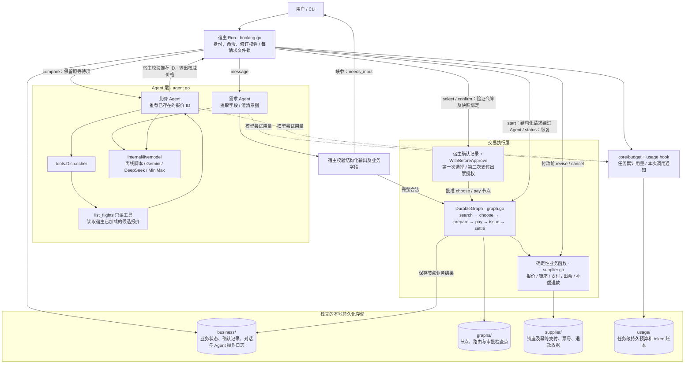
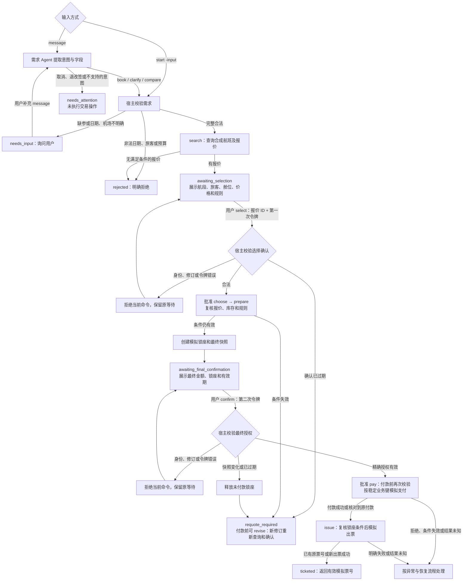
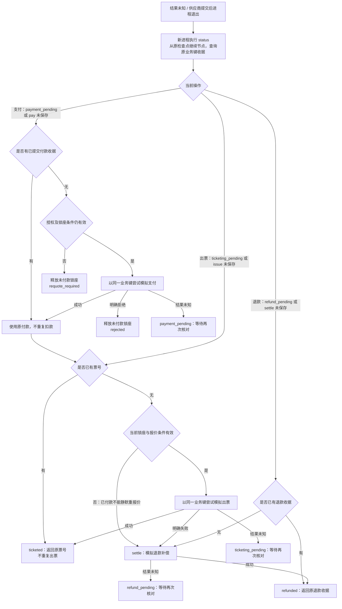

# 机票预订：Agent + Workflow + 两次确认

本案例使用 GoAgent 当前公开接口演示自然语言澄清、只读比价、确定性预订、两次确认、业务幂等、结果核对和跨进程恢复。所有航班、旅客、锁座、支付、出票和退款均为本地模拟；没有真实航司、OTA 或支付接口。

## Agent 和 Workflow 如何分工

| 入口 | 负责内容 | 产生订票效果的权限 |
| --- | --- | --- |
| `message` → Builder Agent | 提取需求、保留已明确字段、提示缺失项；意图输出经过宿主校验 | 无；不能产生确认、付款、取消或退改签授权 |
| `compare` → Builder Agent → `list_flights` Tool → Agent | 查询当前候选并请求模型推荐；宿主验证报价 ID 并输出权威价格 | 仅只读工具 |
| `start -input` | 明确结构化请求，直接进入同一个 Workflow | 无需先请求模型 |
| Durable Workflow | 查询 → 第一次确认 → 复核与锁座 → 第二次确认 → 支付 → 出票/退款补偿 | 必须满足宿主授权与供应商前置条件 |

不需要每一步都调用 Agent，也不强制创建子 Agent。将来可以将复杂行程规划委派给只读子 Agent，但交易授权仍由宿主和 Workflow 管理。示例没有修改 GoAgent 核心。

## 架构图

宿主 `Run` 是所有命令的统一入口：校验命令、演示身份和修订号，并按业务请求加锁。Agent 的输出先经过宿主校验；付款和出票由确定性业务函数执行，不作为 Agent 可调用的工具暴露。



这里没有必需的子 Agent，也没有后台自动确认。`choose` 和 `pay` 是实际的图审批节点；用户提交的是业务确认令牌，宿主校验并持久化授权后，才使用内部图审批键推进对应节点。业务状态、供应商收据与图检查点分别保存，不共享一个事务。

## 预订流程图

实线展示用户交互和交易推进。`message` 仅用于待补信息阶段；需求已明确时，`start -input` 可直接进入同一个 Workflow。`compare` 是两处等待状态的只读旁路，执行后保留原确认令牌，不推进交易。



第一次确认允许复核和锁座，不能付款；第二次确认只授权当前修订的精确快照。两处确认及已完成结果的恢复查询不需要再请求模型。`revise` 会使旧确认不能用于新修订；用户不能通过聊天文本代替 `select` 或 `confirm` 命令。

## 异常与恢复流程图

下图中的“结果未知”和“副作用已提交但检查点未保存”使用同一个原则：先以原业务键核对收据，不更换 ID 重做。图节点可能被再次执行，业务账本负责去重。



主动取消与异常补偿是不同入口：付款前 `cancel` 释放锁座并返回 `canceled`；已有付款时返回 `needs_attention`，主动退票和改签不在本轮自动执行范围内。已经提交的收据优先于后来过期的授权；但只有付款、还没有票号且锁座条件失效时，应核对后退款，不能继续创建新票。

## 两次确认

第一次确认具体报价，包括日期、机场及时区、航段、舱位、合成旅客、总价、行李和退改规则。它允许进入复核及模拟锁座，**不授权付款**。

第二次确认最终快照：请求 ID、修订号、航班、旅客、票价/税费、总价、币种、行李、规则、锁座 ID 和到期时间。只有用户明确提交这个等待项的令牌，宿主才记录支付出票授权。两次令牌分别生成，不能互换；`confirmation.kind` 区分 `selection` 和 `payment_and_ticketing`。

所有确认绑定所有者、修订号、快照摘要和有效期。报价、库存、行程、旅客、币种或规则变化会使旧授权不能用于新效果；不会因为“差价还在预算内”自动扣款。支付前失效则重新报价；已付款但尚未出票且条件失效则执行模拟退款补偿；已提交的支付、票号或退款优先返回原收据。

## 运行完整流程

从仓库根目录执行，需要 Go 1.25。`GOWORK=off` 确保使用 go.mod 的远端固定版本：

```sh
env -u GOROOT GOTOOLCHAIN=go1.25.0 GOWORK=off go build -o /tmp/goagent-flight-booking ./orchestration/flight-booking
demo_dir=$(mktemp -d /tmp/goagent-flight.XXXXXX)

# 结构化输入直接进入 Workflow：尚无付款、出票和锁座。
/tmp/goagent-flight-booking -dir "$demo_dir" -action start \
  -input orchestration/flight-booking/fixtures/one-way.json > "$demo_dir/selection.json"

# 可选只读 Agent + Tool 比价，支付与出票数仍为 0。
/tmp/goagent-flight-booking -dir "$demo_dir" -action compare

# 第一次确认：必须指定当前报价和 selection 令牌。
selection_token=$(python3 -c 'import json,sys; print(json.load(open(sys.argv[1]))["confirmation"]["token"])' "$demo_dir/selection.json")
quote_id=$(python3 -c 'import json,sys; print(json.load(open(sys.argv[1]))["offers"][0]["id"])' "$demo_dir/selection.json")
/tmp/goagent-flight-booking -dir "$demo_dir" -action select -revision 1 \
  -quote "$quote_id" -token "$selection_token" > "$demo_dir/final.json"

# 查看最终订单后，再单独执行第二次确认。此时才授权支付和出票。
cat "$demo_dir/final.json"
final_token=$(python3 -c 'import json,sys; print(json.load(open(sys.argv[1]))["confirmation"]["token"])' "$demo_dir/final.json")
/tmp/goagent-flight-booking -dir "$demo_dir" -action confirm -revision 1 -token "$final_token"

# 恢复/查看结果；不重复扣款或出票。
/tmp/goagent-flight-booking -dir "$demo_dir" -action status
```

结果以 `status=ticketed` 和非空 `ticket` 表示出票成功。`execution_status=completed` 仅表示该次工作流不再等待，并不保证订票成功，例如 `rejected`、`requote_required` 和 `refunded` 都不是出票成功。令牌仅在待确认交互结果中交付，不要把整个状态目录或 JSON 当作公开日志。

## 自然语言澄清

默认离线客户端是**有限的脚本化模型传输**，不是具备自由理解能力的本地模型。以下固定对话仍经过实际 Builder Agent、模型循环与持久 Workflow：

```sh
chat_dir=$(mktemp -d /tmp/goagent-flight-chat.XXXXXX)
/tmp/goagent-flight-booking -dir "$chat_dir" -action message -message '我要订机票'
/tmp/goagent-flight-booking -dir "$chat_dir" -action message \
  -message '2030年1月10日从新加坡SIN到上海PVG，单程经济舱，一位成人，预算5000元'
```

第一次返回 `needs_input`，第二次进入 `awaiting_selection`。自由表达需要显式开启真实模型：

```sh
# 在已配置相应密钥的环境里执行；会发生模型调用费用，订票仍为模拟。
GOAGENT_LIVE_PROVIDER=gemini /tmp/goagent-flight-booking -live \
  -dir /tmp/flight-live-gemini -action message \
  -message '2030年1月10日从SIN到PVG，经济舱，一位成人，预算5000元'
```

`GOAGENT_LIVE_PROVIDER` 支持 gemini、deepseek、minimax，复用 `internal/livemodel` 的密钥及模型环境变量。仅在 `message`/`compare` 中调用模型；模型输出无效时不进入业务交易。累计每个请求最多 12 次模型请求、12 次 Agent 调用、12 次只读工具调用，单次 Agent 不做无限重试。

`task_usage` 来自同一业务请求跨修订、跨进程的持久根预算；`usage_events_this_invocation` 来自统计钩子，`model_calls_this_invocation` 只统计本次新尝试，不把回放计为新请求。离线 token 数来自合成模型，是测试证据；`live_model=false`，不能用于推算真实供应商费用。

## 修改、取消和异常注入

- `-action revise -revision <当前修订> -input <完整JSON>`：仅付款前允许；释放旧锁座、递增修订号，重新走两次确认。即使只是重新接受新价格，也通过 revise 创建新修订；旧确认令牌不可用于新修订。
- `-action cancel -revision <当前修订>`：付款前取消并释放锁座。付款已经发生则返回 `needs_attention`，不假装取消成功。主动退票、改签需要真实费用及新授权，首轮仅明确转人工且不执行新效果。
- `-actor demo-traveler` 是唯一演示身份，也是默认值；它只是本地身份模拟，不是身份认证。生产宿主须验证登录身份及订单访问权限，令牌不是身份凭证。
- `-input` 仅用于 start/revise。不能在 confirm 命令附带另一个行程；必须先 revise。
- `-at <RFC3339>` 注入演示时钟，默认使用实际 UTC 当前时间；文档采用 2030 年合成行程。

新请求的 `-scenario` 保存在业务记录中；恢复时不会被不同的命令行场景覆盖：

| 场景/参数 | 预期行为 |
| --- | --- |
| `fixtures/missing-fields.json` | needs_input，未查询到可授权报价 |
| `fixtures/round-trip-family.json` | 多航段、成人/儿童、明确时区的合成往返订单 |
| `-scenario no-flights` / 预算不足 | rejected，建议调整条件，不擅自放宽约束 |
| 第二次确认使用 `-price-delta 100` / `-currency USD` / `-rules changed` / `-sold-out` | requote_required，不付款 |
| 超过 final_quote.expires_at 的 `-at` | 旧确认过期，不产生新付款 |
| `-scenario payment-declined` | rejected，释放未付款锁座 |
| `-scenario payment-unknown` | 第一次 confirm 返回 payment_pending；status 查询原付款后继续，不再扣款 |
| `-scenario ticket-unknown` | ticketing_pending；status 返回已提交原票号 |
| `-scenario ticket-failed` | 已付款但出票明确失败，退款一次，最终 refunded |
| `-scenario refund-unknown` | refund_pending；status 核对原退款，最终 refunded |
| 确认并发或重试 | 同一请求只生成一笔支付、出票或补偿退款 |

市场变化注入参数是当前命令的供应商视图，不会永久修改行情；在下一次命令继续模拟变化时，需要再次传入该参数。

## 崩溃恢复

在上述 final 等待状态执行：

```sh
# 使用编译后的程序；供应商付款已提交，图检查点未保存，退出码 86。
/tmp/goagent-flight-booking -dir "$demo_dir" -action confirm \
  -revision 1 -token "$final_token" -crash-after payment

# 在新进程核对原付款；条件仍有效则出票，不再扣款。
/tmp/goagent-flight-booking -dir "$demo_dir" -action status
```

故障注入必须用于一个尚未执行过 final confirm 的新演示流程；已完成订单直接返回原收据，不会再触发崩溃。也可使用 `-crash-after ticket` 或 `-crash-after refund`，后者需新建 `ticket-failed` 场景。

业务记录、供应商账本和图检查点分别位于 `business/`、`supplier/` 和 `graphs/`；根用量账本位于 `usage/`。每个业务请求的文件锁串行化确认、修改、取消及推进，供应商账本通过稳定业务请求 ID 与修订号去重。真实供应商适配器需要自身的幂等与查询协议；把本地收据写在真实 API 调用旁边不能获得“恰好一次”保证。

## 测试与边界

CLI 场景冒烟脚本直接调用编译后的程序，自动验证 20 个正常、确认、异常及崩溃恢复场景：

```sh
python3 scripts/flight_booking_smoke.py /tmp/goagent-flight-booking
```

```sh
env -u GOROOT GOTOOLCHAIN=go1.25.0 GOWORK=off go test -race -count=1 ./orchestration/flight-booking
env -u GOROOT GOTOOLCHAIN=go1.25.0 GOWORK=off go build -o /tmp/goagent-flight-booking ./orchestration/flight-booking

# 显式付费模型测试（默认跳过），先自行配置密钥：
GOAGENT_LIVE=1 GOAGENT_LIVE_PROVIDER=gemini GOWORK=off \
  go test -count=1 -run '^TestLiveExtractionAndComparison$' -v ./orchestration/flight-booking
```

离线验证覆盖确认绑定、替换输入拒绝、行情变化、超期、多人往返、同日航段时间顺序、业务幂等、并发取消、模型非法输出、工具只读权限及独立进程的三类提交后崩溃。实际验证结果见 [报告](../../docs/evaluation/2026-11-01-flight-booking/REPORT.md)。

本案例面向可信本地状态目录，依赖文件锁与原子保存；不防有文件访问权的操作者篡改，不提供跨主机接管、真实身份认证、支付合规或完整航司退改签政策。自由自然语言质量与真实供应商协议需要分别验证，离线通过不代表已验证真实模型或航空业务接入。


## 三平台真实验证记录

本例已使用 Gemini、DeepSeek、MiniMax 实际验证完整预订与两次确认、多轮澄清、日期歧义及越权文本，每个平台 4 组均通过。确认和恢复阶段没有额外模型请求。[真实验证报告](../../docs/evaluation/2026-11-01-flight-booking-live/REPORT.md)记录请求数、token 明细和原始测试证据。

本次环境的 MiniMax 凭据需要中国站端点，执行时额外设置 `MINIMAX_BASE_URL=https://api.minimax.cn/v1`；默认国际站曾返回 HTTP 401。这个覆盖仅作用于当前命令，不修改全局环境。真实测试现包含 4 组场景，每个平台成功运行会发出 7 次模型请求；默认仍跳过，需显式开启付费测试。
